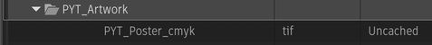
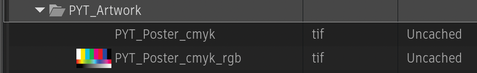
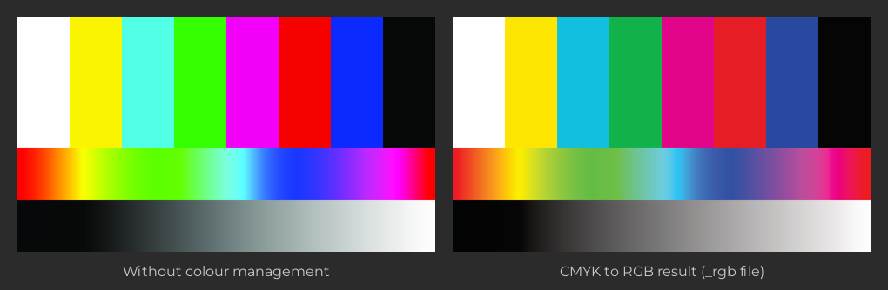

# CMYK to RGB

**Script Version:** 1.1.0  
**Flame Version:** 2025  
**Written by:** Michael Vaglienty  
**Creation Date:** 12.06.25  
**Update Date:** 11.02.26  

**Script Type:** Media Panel / Media Hub File Browser

## Description

Convert CMYK images to RGB.<br><br>
Supported image formats: TIF, JPG, and PSD.<br><br>
PSD files will be saved as TIFF files.<br><br>
Works on Linux and Apple Silicon Macs. Intel Macs are not supported.<br><br>
The image's embedded CMYK profile is used for the conversion. Images without an embedded profile are converted using U.S. Web Coated (SWOP) v2 (Adobe profile; see assets/icc_profiles/README.txt for its license).<br><br>
Output images are 8-bit RGB with an sRGB profile.<br><br>
CMYK PSDs with extra channels (alpha or spot) and CMYK TIFFs with transparency are not supported.

## URL

https://logik-portal.com/scripts/cmyk_to_rgb

## Menus

- Right-click on a CMYK clip in the Media Panel → CMYK to RGB
- Right-click on a CMYK file in the Media Hub File Browser → CMYK to RGB

## Installation

Copy script into /opt/Autodesk/shared/python/cmyk_to_rgb

---

# User Guide

<!-- user-guide: v1.1.0 11.03.26 -->

## Contents

- [Overview](#overview)
- [Requirements and Installation](#requirements-and-installation)
- [Where to Find It](#where-to-find-it)
- [How Converting Works](#how-converting-works)
- [Colour Profiles](#colour-profiles)
- [Workflows](#workflows)
- [Tips, Troubleshooting and FAQ](#tips-troubleshooting-and-faq)

## Overview

Print artwork (logos, posters, packshots, magazine pages) often arrives as CMYK files. CMYK to RGB turns those files into RGB images you can use in Flame, with colour-managed colours, without leaving Flame.

The script has no window of its own. Right-click the CMYK clips or files, choose **CMYK to RGB**, and the script:

1. Writes an RGB copy next to each source file, with `_rgb` added to the name.
2. Imports the RGB copy into Flame.
3. Shows one message at the end with what was converted, skipped or failed.

For example, the clip `PYT_Poster_cmyk` in the folder `PYT_Artwork` points to the CMYK file:

```
/Volumes/projects/Big_Job/artwork/PYT_Poster_cmyk.tif
```

Right-click it in the Media Panel → **CMYK to RGB**:



The script writes `/Volumes/projects/Big_Job/artwork/PYT_Poster_cmyk_rgb.tif` and imports it into the same folder, as the clip `PYT_Poster_cmyk_rgb`:



In this example Flame showed no thumbnail for the CMYK clip; the RGB clip has one.

The conversion uses the colour profile of the CMYK file, so the colours match what a colour-managed app (for example Photoshop) shows. Reading the CMYK numbers without a profile gives colours that are too bright and saturated:



## Requirements and Installation

- Flame 2025 or newer. The menus don't appear in older versions.
- An Apple Silicon Mac, or Linux. **Intel Macs are not supported.**
- Flame's Python must be 3.11 or 3.13 (the Python versions the script brings packages for).
- Copy the whole `cmyk_to_rgb` folder (with its `lib` and `assets` folders) into `/opt/Autodesk/shared/python`, so the script is at `/opt/Autodesk/shared/python/cmyk_to_rgb/cmyk_to_rgb.py`.
- In Flame, rescan Python hooks (or restart Flame) so the menus appear.
- If the script folder isn't named `cmyk_to_rgb`, or Flame can't write to it, the script stops and shows a message when you run it.
- The script writes the RGB files into the same folder as the CMYK files, so you need write access to that folder.

### Python package (first run only)

The script needs **Pillow**, an image library that Flame doesn't include. It comes with the script, in `assets/python_packages`, for Apple Silicon Macs and Linux, for Python 3.11 and 3.13.

Each time you run the script it checks whether Pillow is installed in Flame's Python. If it already is (for example because another script installed it), nothing happens and the conversion starts. If it isn't:

1. A password window opens: `This script requires python packages to be installed. System password is required to install them.` Enter your computer's (system) password. Pillow is copied into Flame's own Python folder, which needs admin rights.
2. Python hooks are rescanned, and a message lists the installed package and says `Starting script...`.
3. The script carries on and converts the selected images.

If you cancel the password window, nothing is installed and the script stops. You only need to do this once per Flame version.

## Where to Find It

| Where | Right-click on | Menu | What it does |
| --- | --- | --- | --- |
| Media Panel | One or more clips | **CMYK to RGB** | Converts the CMYK images the clips point to, and imports each RGB copy next to its clip. |
| MediaHub (Files) | One or more image files | **CMYK to RGB** | Converts the selected CMYK files, and imports the RGB copies into a new library. |

Notes:

- The menu item is near the top of the right-click menu (among the custom script items), with a separator below it.
- The menu only appears when at least one selected item is a supported image: a clip (not a sequence) whose file ends in `.tif`, `.tiff`, `.jpg`, `.jpeg` or `.psd` (upper or lower case), or a MediaHub file with one of those endings.
- The menu doesn't check that the image is CMYK. RGB, greyscale and other images are skipped when the script runs (see [How Converting Works](#how-converting-works)).
- Other clips and MediaHub files selected along with the images (for example PNG files) are listed as skipped in the summary. Sequences, folders, reels and other items that aren't clips or MediaHub files are left out without a message.
- Image sequence clips can also show the menu (the check only looks at the file ending). They are skipped when the script runs.
- Flame 2027.2 won't import CMYK JPG or PSD files, or CMYK TIFFs with transparency, as clips. Use the MediaHub menu for those files.

## How Converting Works

When you choose **CMYK to RGB**, the script first checks every selected image, then converts the ones that passed, then imports the results, and finally shows one message.

### 1. Checking the selection

Each selected image is checked in turn. An image is **skipped** (left alone) when:

- Its file doesn't end in `.tif`, `.tiff`, `.jpg`, `.jpeg` or `.psd`.
- The file can't be found, or the clip is an image sequence. Only single image files are converted.
- The file isn't really a TIFF, JPEG or PSD (for example a renamed file).
- The image isn't CMYK (RGB, greyscale, LAB and so on).

An image **fails** (is listed as an error) when:

- The file can't be read. CMYK TIFFs with transparency can't be read.
- It's a CMYK PSD with extra channels (alpha or spot channels).
- Its `_rgb` file would have the same name as another selected image's `_rgb` file. For example `logo.psd` and `logo.tif` would both be saved as `logo_rgb.tif`: the first one is converted, the second one fails. Names are compared without regard to upper or lower case.

### 2. Existing files

If any `_rgb` files already exist (for example because you converted the same images before), **one** warning lists them all and asks whether to overwrite them:

- **Confirm** overwrites them.
- **Cancel** leaves those files alone and skips those images. The other images are still converted.

### 3. Converting

Each image is converted on its own, so one failed image doesn't stop the rest. The RGB file is written next to the source file:

| Source | RGB file |
| --- | --- |
| `PYT_Poster_cmyk.tif` (or `.tiff`) | `PYT_Poster_cmyk_rgb.tif` (same ending as the source) |
| `PYT_Poster_cmyk.jpg` (or `.jpeg`) | `PYT_Poster_cmyk_rgb.jpg` |
| `PYT_Poster_cmyk.psd` | `PYT_Poster_cmyk_rgb.tif` (PSD files are saved as TIFF) |

The RGB files are:

- 8-bit RGB, with an sRGB colour profile embedded.
- The same resolution (DPI) as the source. PSD files are the exception: their DPI isn't read, so the TIFF made from a PSD has a DPI of 1. The pixel size is the same.
- JPEGs are saved at high quality (95) with full colour resolution (no chroma subsampling).
- 16-bit CMYK images are read as 8-bit, so the result is 8-bit too.

### 4. Importing

- **Media Panel:** each RGB file is imported into the same place as its clip (the same library, folder or reel).
- **MediaHub:** a new library called `-= Imported CMYK to RGB Images =-` is made in the current workspace and opened, and the RGB files are imported into it. Every run from the MediaHub makes a **new** library, even if one already exists.

If Flame reports an error while importing an RGB file, that image is listed as failed, with the import error. If an import silently brings in nothing, the image still counts as converted.

### 5. The summary

- Everything converted: `CMYK to RGB Conversion Complete!` with the number converted.
- Some images skipped, none failed: an information message with the number converted and a list of the skipped files with the reason for each.
- Anything failed: an error message with the number converted and the lists of skipped and failed files.
- If nothing in the selection was a clip or a MediaHub file, no message opens; a warning is printed in the console.

Full details for every image (paths, which colour profile was used, each result) are printed in Flame's console (shell).

## Colour Profiles

- **Image with an embedded CMYK profile:** that profile is used. This is the usual case for files saved from Photoshop or InDesign.
- **Image without a profile** (or with one that can't be read): the script uses **U.S. Web Coated (SWOP) v2**, a standard US print profile from Adobe that comes with the script (`assets/icc_profiles/USWebCoatedSWOP.icc`). If the file was made for a different print standard (for example European FOGRA), the colours can be slightly off; ask for a version with an embedded profile.
- The conversion uses relative colorimetric rendering with black point compensation, to sRGB.

**About the SWOP profile:** the profile belongs to Adobe and is not covered by the script's MIT license. It is included under Adobe's colour profile bundling terms, and using it means accepting Adobe's licence terms, which are in `assets/icc_profiles/` (`README.txt` and `Color Profile Bundling License_10.15.08.pdf`). Don't rename or change the profile file. If you don't want to use it, `README.txt` explains what to do; images without an embedded profile then can't be converted.

## Workflows

### Convert CMYK artwork already in a library

1. Select the CMYK clips in the Media Panel (you can select several at once).
2. Right-click → **CMYK to RGB**.
3. The first time only: enter your system password to install Pillow.
4. If any `_rgb` files already exist, choose **Confirm** to overwrite them or **Cancel** to keep them.
5. Read the summary. The `_rgb` clips are next to the original clips.

### Convert CMYK files from MediaHub

Use this for CMYK JPG and PSD files, which Flame won't import as clips.

1. In MediaHub, go to the folder with the artwork and select the files.
2. Right-click → **CMYK to RGB**.
3. Read the summary. The `_rgb` files are next to the source files on disk, and the clips are in the new `-= Imported CMYK to RGB Images =-` library.

### Convert the same artwork again

Run the script again on the same images. One warning lists the `_rgb` files that already exist. **Confirm** replaces them. The RGB clips that were imported the first time are still in Flame; the new import adds another clip.

## Tips, Troubleshooting and FAQ

**The menu doesn't appear when I right-click my clip.**  
The clip's file must end in `.tif`, `.tiff`, `.jpg`, `.jpeg` or `.psd`, and it can't be a sequence (a timeline). Image sequence clips do show the menu, but they are skipped when the script runs: only single image files are converted. Also check that you are in Flame 2025 or newer and that Python hooks were rescanned after installing.

**My CMYK JPG or PSD won't import into Flame, so I can't right-click it in the Media Panel.**  
Flame 2027.2 won't import CMYK JPG or PSD files as clips. Right-click the file in MediaHub instead.

**Where are the RGB files?**  
Next to the source files, with `_rgb` added to the name. PSD files become `.tif`.

**Can I choose where the RGB files are saved?**  
No. They always go next to the source file. Copy the source somewhere else first if you want them elsewhere.

**Why are there several `-= Imported CMYK to RGB Images =-` libraries?**  
Each run from MediaHub makes a new one. Rename them or tidy them up as you go.

**My 16-bit CMYK image came out 8-bit.**  
The script always writes 8-bit images, and reads 16-bit CMYK as 8-bit.

**The colours don't match what the client sees.**  
Check the console for which profile was used. If it says `Using default CMYK profile`, the file had no profile and SWOP was assumed. Ask for a file with its colour profile embedded.

**My image has transparency. Can it be converted?**  
Not as it is. CMYK TIFFs with transparency can't be read, and CMYK PSDs with alpha or spot channels are refused. Remove the transparency or extra channels first.

## Updates

### v1.1.0 [11.02.26]
- Added Linux support.
- Intel Macs are not supported. A message is now shown instead of installing a package that can't run.
- Fixed the Pillow install reporting success when it failed.
- The Python version is now read from Flame's Python (3.11 or 3.13) instead of guessed from the Flame version.
- Images without an embedded CMYK profile are now converted with the U.S. Web Coated (SWOP) v2 profile. Before, they got a basic conversion with wrong colors.
- Fixed black point compensation not being applied.
- One failed image no longer stops the rest. A single summary is shown at the end instead of a message for each image.
- Fixed errors when other items are selected along with the images.
- Only CMYK images are converted. RGB, grayscale, LAB and other images are skipped.
- PSDs with extra channels (alpha or spot) are now refused. Before, they were saved with scrambled pixels.
- Image sequences and missing files are now skipped.
- Output images now include an sRGB profile and keep their DPI. JPEGs are saved without chroma subsampling.
- A warning is now shown before existing files are overwritten.
- Two selected images that would save to the same file name (for example image.psd and image.tif) are no longer both saved.
- The menu now only shows for supported image files.
<br>

### v1.0.2 [10.13.26]
- Updated to PyFlameLib v5.5.3 - Fixes screenGeometry error with Flame 2027.2.
- Changed license from GPL-3.0 to MIT. See LICENSE file for details.
<br>

### v1.0.1 [12.24.25]
- Moved PIL python packages to assets/python_packages directory.
- Updated python package installation.
<br>

### v1.0.0 [12.06.25]
- Initial release.
