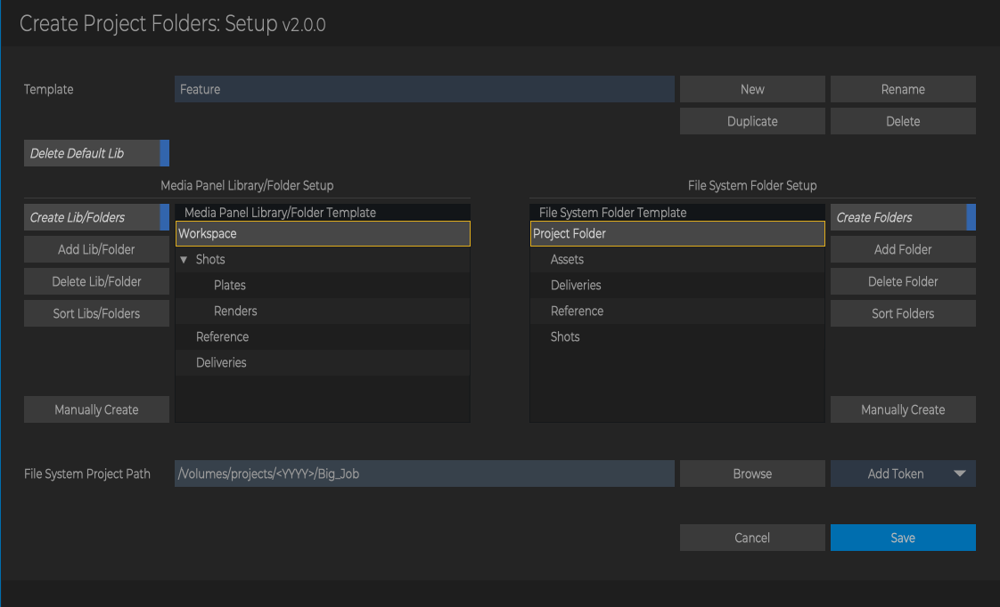
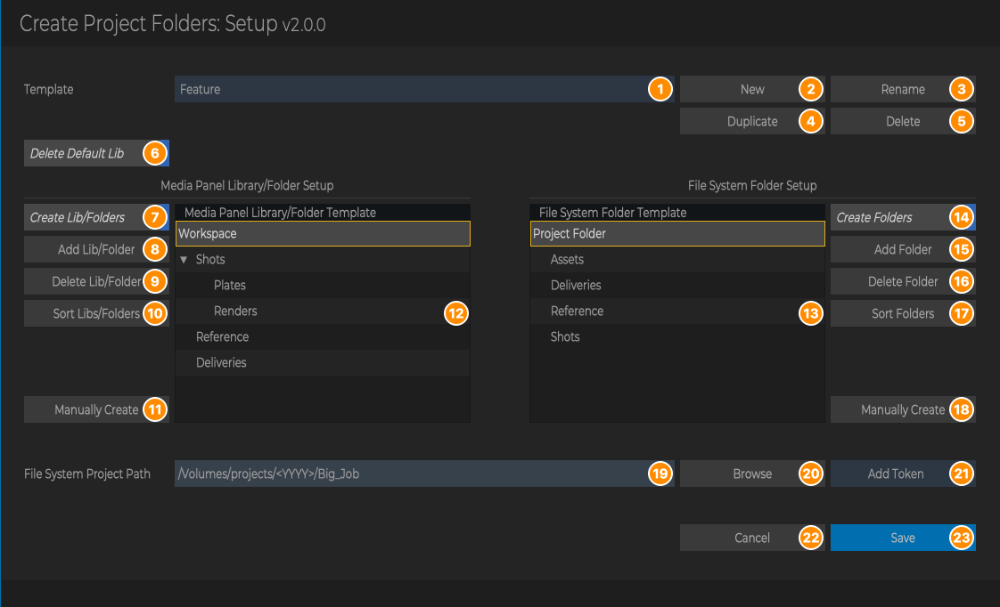
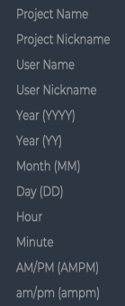
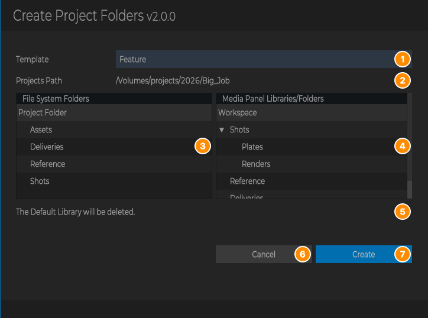
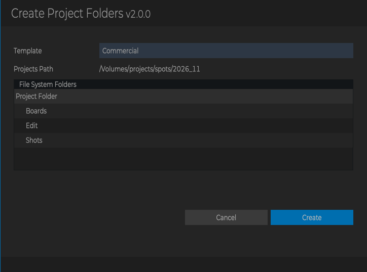
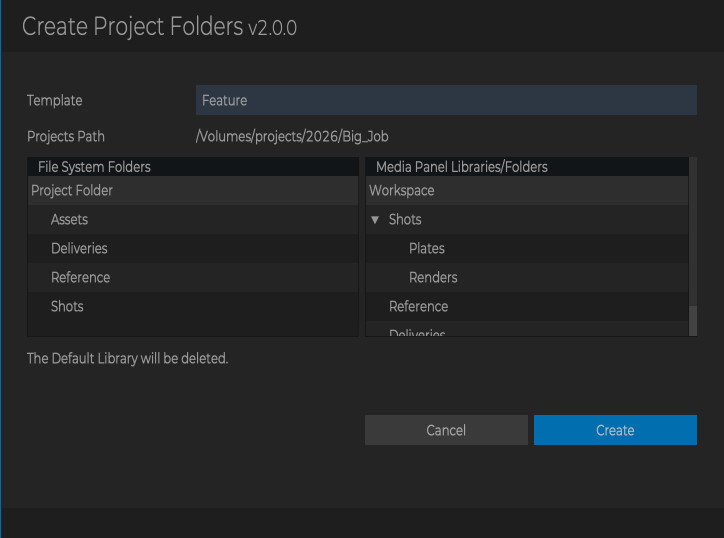

# Create Project Folders

**Script Version:** 2.0.0  
**Flame Version:** 2025.2  
**Written by:** Michael Vaglienty  
**Creation Date:** 09.22.21  
**Update Date:** 11.09.26  

**Script Type:** Flame Startup / Flame Main Menu

## Description

Creates a project file system folder structure and/or media panel library/folder structure when Flame starts and when a project is loaded.
Each project is offered once each time it's loaded, even if Flame runs both start-up hooks.<br><br>Folder structures are saved as templates. Each template has its own Projects Path, file system folders and media panel libraries/folders,
and its own settings for creating them (Create Folders, Create Lib/Folders) and for deleting the project's Default Library (Delete Default Lib).

## URL

https://logik-portal.com/scripts/create_project_folders

## Menus

- Flame Main Menu → Logik → Logik Portal Script Setup → Create Project Folders Setup
- Runs on its own when Flame starts and when a project is loaded

## Installation

Copy script into /opt/Autodesk/shared/python/create_project_folders

---

# User Guide

<!-- user-guide: v2.0.0 11.09.26 -->

## Contents

- [Overview](#overview)
- [Requirements and Installation](#requirements-and-installation)
- [Where to Find It](#where-to-find-it)
- [The Setup Window](#the-setup-window)
- [The Create Project Folders Window](#the-create-project-folders-window)
- [Tokens](#tokens)
- [When Folders Are Offered](#when-folders-are-offered)
- [How Folders Are Created](#how-folders-are-created)
- [Workflows](#workflows)
- [Messages and What to Do](#messages-and-what-to-do)
- [Tips, Troubleshooting and FAQ](#tips-troubleshooting-and-faq)

## Overview

Create Project Folders builds the same folder structure for every new job, so you don't have to make it by hand:

- **File system folders**: a project folder on disk with the subfolders you want (for example `Assets`, `Deliveries`, `Reference`, `Shots`).
- **Media panel libraries and folders**: libraries in the project's workspace, with folders inside them (for example a `Shots` library with `Plates` and `Renders` folders).

You describe these structures once, as a **template**, in the Setup window. You can keep several templates, for example one for features and one for commercials, each with its own Projects Path and folder trees.

When Flame starts, or when you load a project, a window opens and offers to create the folders for that project. Pick a template, click **Create**, and the folders are made. The project is then marked as done, so you aren't asked about it again.

For example, a template with the Projects Path:

```
/Volumes/projects/<ProjectName>
```

and the file system folders `Assets`, `Deliveries`, `Reference` and `Shots`, creates these folders for project `Big_Job`:

```
/Volumes/projects/Big_Job/Assets
/Volumes/projects/Big_Job/Deliveries
/Volumes/projects/Big_Job/Reference
/Volumes/projects/Big_Job/Shots
```



## Requirements and Installation

- Flame 2025.2 or newer. The Setup menu doesn't appear in older versions.
- Copy the whole `create_project_folders` folder (with its `lib`, `assets` and `config` folders) into `/opt/Autodesk/shared/python`, so the script is at `/opt/Autodesk/shared/python/create_project_folders/create_project_folders.py`.
- In Flame, rescan Python hooks (or restart Flame) so the menu appears and the script runs at start-up.
- If the script folder isn't named `create_project_folders`, or Flame can't write to it, the script stops and shows a message when it runs. Check the folder name and its permissions.
- Flame needs permission to create folders in the Projects Path you use.
- Settings and templates are stored in `config/config.json` inside the script folder. Everyone using the same installed copy of the script shares them (see [Tips](#tips-troubleshooting-and-faq)).

## Where to Find It

| Where | Right-click on | Menu | What it does |
| --- | --- | --- | --- |
| Flame Main Menu | | Logik → Logik Portal Script Setup → **Create Project Folders Setup** | Opens the Setup window to manage templates and create folders by hand. |
| Flame start | | (none, runs on its own) | Offers to create folders for the project Flame opens with. |
| Loading a project | | (none, runs on its own) | Offers to create folders for the project you loaded. |

See [When Folders Are Offered](#when-folders-are-offered) for exactly when the window opens.

## The Setup Window

Open it from **Flame Main Menu → Logik → Logik Portal Script Setup → Create Project Folders Setup**. The window is titled `Create Project Folders: Setup v2.0.0`.



| # | Part | What it does |
| --- | --- | --- |
| 1 | **Template** menu | Lists every template. Choosing one shows its settings, trees and path. Edits you made to the template you leave are kept (not saved yet, see [What is saved, and when](#what-is-saved-and-when)). |
| 2 | **New** | Adds a template with the default settings: default path and trees, **Create Lib/Folders** and **Create Folders** off, **Delete Default Lib** on. It's named `New Template` (then `New Template 2` and so on). |
| 3 | **Rename** | Renames the template shown. Asks for the new name. |
| 4 | **Duplicate** | Adds a copy of the template shown, with everything in it as it is on screen (including edits you haven't saved). It's named `<name> Copy` (then `<name> Copy 2` and so on). |
| 5 | **Delete** | Deletes the template shown, after asking you to confirm. The last template can't be deleted. |
| 6 | **Delete Default Lib** | For this template: when on, the project's `Default Library` is deleted after this template's media panel libraries are created. When off, the Default Library is left alone. See [The Default Library](#the-default-library). |
| 7 | **Create Lib/Folders** | For this template: create the media panel libraries/folders (12) when the folders are offered. |
| 8 | **Add Lib/Folder** | Adds an item to the media panel tree. Select **Workspace** to add a library (`New Library`), or select a library or folder to add a folder inside it (`New Folder`). |
| 9 | **Delete Lib/Folder** | Deletes the selected library or folder, with everything inside it. **Workspace** can't be deleted, and the last item that has nothing inside it can't be deleted. |
| 10 | **Sort Libs/Folders** | Sorts the media panel tree alphabetically. |
| 11 | **Manually Create** | Creates the media panel libraries/folders of the template shown in the current project, now. See [Manually Create](#manually-create). |
| 12 | Media panel tree | The template's libraries and folders. The items under **Workspace** are libraries; items under a library are folders. Double-click an item to rename it. Tokens can be used in names. |
| 13 | File system tree | The template's file system folders. The top item (**Project Folder**) stands for the project folder at the end of the Projects Path (19); the folders under it are created inside that folder. Double-click a folder to rename it. Tokens can be used in names. |
| 14 | **Create Folders** | For this template: create the file system folders (13) when the folders are offered. |
| 15 | **Add Folder** | Adds `New Folder` inside the selected folder (or under **Project Folder** if nothing is selected). |
| 16 | **Delete Folder** | Deletes the selected folder, with everything inside it. **Project Folder** can't be deleted, and the last folder that has nothing inside it can't be deleted. |
| 17 | **Sort Folders** | Sorts the file system tree alphabetically. |
| 18 | **Manually Create** | Creates the file system folders of the template shown for the current project, now. See [Manually Create](#manually-create). |
| 19 | **File System Project Path** | The template's Projects Path: the full path of the project folder, usually with tokens, for example `/Volumes/projects/<ProjectName>`. The last folder in the path is the project folder. |
| 20 | **Browse** | Opens Flame's file browser to pick a folder. The chosen folder **replaces** the whole path. |
| 21 | **Add Token** | Menu of [tokens](#tokens). Choosing one inserts it into the path at the text cursor. |
| 22 | **Cancel** | Closes the window. Every edit since the last Save is thrown away. (Escape does the same.) |
| 23 | **Save** | Saves all templates and closes the window. If any template has a Create button on, asks whether to create folders for the current project now. (Return does the same.) |

The Add Token menu:



### Templates

A template holds everything for one kind of job:

- its Projects Path (19),
- its file system tree (13) and media panel tree (12),
- its own **Create Folders** (14), **Create Lib/Folders** (7) and **Delete Default Lib** (6) buttons.

A template is only offered when folders are offered (at Flame start or project load) if at least one of its Create buttons is on. A template with both off stays in Setup and can still be used with Manually Create.

Renaming: the new name can't be empty and can't be the name of another template. Spaces at the start and end are removed. Cancelling the rename dialog changes nothing.

Duplicating a copy adds another ` Copy` to the name (`Feature Copy` → `Feature Copy Copy`). Rename it if you like.

### What is saved, and when

- **Nothing is saved until you click Save.** New, Rename, Duplicate, Delete, tree edits, path edits and the buttons all stay in the window until then. Switching templates in the menu keeps your edits to each one.
- **Cancel (or Escape) throws all of it away**, including new, renamed, duplicated and deleted templates.
- **Manually Create saves first.** Both Manually Create buttons save all templates (as Save does) before they create anything, so your edits are kept even if you then click Cancel. The media panel Manually Create asks for confirmation first; if you cancel there, nothing is saved.
- **Save** also remembers which template was shown, so Setup and the Create Project Folders window open on it next time.

### Rules

- **A template with Create Folders on needs a Projects Path.** If its path is empty (or only `/` and spaces), Save shows that template with an error and the window stays open.
- **If no template has a Create button on**, Save asks you to confirm, because no folders will be offered at Flame start or project load. You can still continue and save.
- **Add Lib/Folder needs a selection.** Select Workspace to add a library, or a library/folder to add a folder.
- **The top items can't be renamed or deleted.** The name of the file system tree's top item doesn't matter: the project folder always gets its name from the Projects Path.

## The Create Project Folders Window

This window opens on its own when Flame starts or a project is loaded (see [When Folders Are Offered](#when-folders-are-offered)), and after Setup → Save → Create. Its title is `Create Project Folders v2.0.0`.



| # | Part | What it does |
| --- | --- | --- |
| 1 | **Template** menu | Lists only templates with at least one Create button on. It starts on the template used last, if it's in the list, otherwise on the first one. Choosing another template updates the rest of the window. |
| 2 | **Projects Path** | Read-only. The template's Projects Path with its tokens filled in for this project: the project folder that will be created. Shown only when the template's **Create Folders** is on. |
| 3 | **File System Folders** | Read-only. The template's file system tree (names as typed in Setup, tokens not filled in). Shown only when **Create Folders** is on. |
| 4 | **Media Panel Libraries/Folders** | Read-only. The template's media panel tree. Shown only when **Create Lib/Folders** is on. |
| 5 | Default Library note | `The Default Library will be deleted.` Shown only when the Default Library will really be deleted: **Create Lib/Folders** and **Delete Default Lib** are on, the project has a `Default Library`, and the template has no library of its own named `Default Library`. |
| 6 | **Cancel** | Closes the window without creating anything. When the window opened on its own, the project is marked so it isn't offered again, and a message says how to create the folders later. After Setup → Save → Create, Cancel only closes the window. (Escape does the same.) |
| 7 | **Create** | Creates the folders of the template shown, remembers it as the template used last, and marks the project (unless every part failed with an error). (Return does the same.) |

When a template only has one Create button on, the window shows just that tree, full width. Here template `Commercial` only has **Create Folders** on:



The window doesn't block Flame: you can keep working while it's open.

## Tokens

Tokens can be used in the Projects Path and in the names of libraries and folders in both trees. They are filled in for the current project when the folders are created. Type them exactly as shown (they are case-sensitive), or insert them into the path with **Add Token**.

Examples below use project `Big_Job` with nickname `bj`, Flame user `artist` with nickname `art`, at 2:05 PM on 11.09.26.

| Add Token menu | Token | Becomes | Example |
| --- | --- | --- | --- |
| Project Name | `<ProjectName>` | Name of the current Flame project. | `Big_Job` |
| Project Nickname | `<ProjectNickName>` | Nickname of the current Flame project. | `bj` |
| User Name | `<UserName>` | Name of the current Flame user. | `artist` |
| User Nickname | `<UserNickName>` | Nickname of the current Flame user. | `art` |
| Year (YYYY) | `<YYYY>` | Current year. | `2026` |
| Year (YY) | `<YY>` | Last two digits of the current year. | `26` |
| Month (MM) | `<MM>` | Current month, two digits. | `11` |
| Day (DD) | `<DD>` | Current day, two digits. | `09` |
| Hour | `<Hour>` | Current hour, 12-hour clock, no leading zero. | `2` |
| Minute | `<Minute>` | Current minute, two digits. | `05` |
| AM/PM (AMPM) | `<AMPM>` | `AM` or `PM`. | `PM` |
| am/pm (ampm) | `<ampm>` | `am` or `pm`. | `pm` |

Example: `/Volumes/projects/<YYYY>/<ProjectName>` becomes `/Volumes/projects/2026/Big_Job`.

If the project has no nickname, `<ProjectNickName>` becomes nothing (the same for `<UserNickName>` when the user has no nickname). When that leaves an empty folder in the Projects Path, or an empty folder or library name, an error is shown and nothing is created for that part (see [Messages and What to Do](#messages-and-what-to-do)).

## When Folders Are Offered

### At Flame start and project load

Every time Flame starts, and every time you load a project, the script checks the current project:

1. **First time only:** if the script has never been set up, it asks whether to set up a template now (see [First-time setup](#first-time-setup)). This question is asked only once, whichever button you click. No folders are offered that time.
2. **Marked project:** if the project is marked as done, nothing happens.
3. **No template enabled:** if no template has a Create button on, nothing happens.
4. Otherwise the [Create Project Folders window](#the-create-project-folders-window) opens.

Each project is offered once per load. If Flame runs its start-up and project-load steps for the same load, you still only see one window. Loading the project again later offers it again, unless it has been marked.

### Marked projects

Once a project is marked, it isn't offered again at Flame start or project load. A project is marked when:

- you click **Create** in the Create Project Folders window (unless every part of the creation failed with an error),
- you click **Cancel** in the Create Project Folders window when it opened on its own (at Flame start or project load),
- you use **Manually Create** in Setup, even if you cancel one of its confirmations (but not when an error or the save question about no Create option being on stops it),
- the project folder or a template library already exists when the folders are created, whether or not you then create the missing folders.

Marked projects are stored by name in the `ignore_projects` list in `config/config.json`. The list is shared by every workstation that uses the same script folder, so a project marked on one workstation isn't offered on any of them. It is never cleaned up automatically.

To offer a marked project again, open `config/config.json` in a text editor, remove the project's name from the `ignore_projects` list (keep the quotes and commas valid), and save the file. You don't need to un-mark a project to create its folders: Setup's Manually Create and Save → Create work on marked projects too.

### Manually Create

The two **Manually Create** buttons in Setup create folders now, from the template shown in Setup (with any edits you've made), for the project that is current when you click:

- They work even if the project is marked, and even if the template's Create buttons are off.
- They save all templates first (see [What is saved, and when](#what-is-saved-and-when)).
- They mark the project, even if you cancel one of their confirmations. They don't mark it when an error stops them, or when you cancel the save question about no Create option being on.
- **Manually Create** (media panel, 11) always asks for confirmation first, then shows which libraries were created and which folders were added.
- **Manually Create** (file system, 18) shows `File system folders created.` when it created anything.

### Save then Create

After **Save** in Setup, if any template has a Create button on, you're asked whether to create folders for the current project. Click **Confirm** to open the Create Project Folders window. This works on marked projects too, and uses the project that is current when you click Save. Cancel in that window only closes it; it doesn't mark the project.

### A window left open across a project load

If you load another project while a Create Project Folders window from the earlier project is still open, that window stays on screen, but it won't do anything to the new project:

- **Create** shows a message naming both projects, creates nothing, marks nothing and closes the window.
- **Cancel** (or Escape) only closes it. Nothing is marked.

A Setup window left open across a project load keeps your edits. Its **Manually Create** and **Save → Create** use the project that is current when you click them.

## How Folders Are Created

### File system folders

The last folder of the Projects Path is the project folder. Everything under **Project Folder** in the file system tree is created inside it.

For example, with the Projects Path `/Volumes/projects/<YYYY>/Big_Job` and this tree:

```
Project Folder
    Assets
    Deliveries
    Reference
    Shots
```

the script creates:

```
/Volumes/projects/2026/Big_Job
/Volumes/projects/2026/Big_Job/Assets
/Volumes/projects/2026/Big_Job/Deliveries
/Volumes/projects/2026/Big_Job/Reference
/Volumes/projects/2026/Big_Job/Shots
```

Missing parent folders (`/Volumes/projects/2026`) are created too. A `/` at the end of the path is ignored. After creating, every folder is checked; any that couldn't be created are listed in one error message.

**If the project folder already exists**, it isn't created again. The script checks which template folders are missing in it:

- Nothing missing: nothing happens (a line is printed in the console).
- Folders missing: a message lists them, and you can create just those or cancel.

Either way the project is marked.

### Media panel libraries and folders

Libraries are created in the current workspace, with their folders inside them. Tokens in names are filled in.

**If a library already exists** (same name, after tokens are filled in), it isn't created again. The script checks which template folders are missing in it, and one message lists the missing folders of all existing libraries, so you can create just those or cancel. New libraries are created either way.

### The Default Library

New Flame projects come with a library called `Default Library`. As the last step of creating media panel libraries, the script deletes it when:

- the template's **Delete Default Lib** is on (the default), and
- the template has no library of its own named `Default Library`.

If **Delete Default Lib** is off, or the template has its own `Default Library` library, the Default Library is kept. Because the delete is part of media panel creation, it only happens when media panel folders are created (Create with **Create Lib/Folders** on, or media panel Manually Create). Deleting the library deletes everything in it, so move anything you need out of it first.

### Errors

The file system part and the media panel part are created separately. If one fails, the other is still created. The project is marked unless every part failed.

## Workflows

### First-time setup

1. The first time Flame starts with the script installed, it asks:
   `Configure project folders and media panel libraries/folders now?`
2. Click **Confirm**. The Setup window opens with a `Default` template, and a message reminds you what to do. (If you click **Cancel**, you can set it up later from the Flame Main Menu; you won't be asked again.)
3. Enter the **File System Project Path**, for example `/Volumes/projects/<ProjectName>`. Use **Browse** to pick the root folder first, then add tokens with **Add Token**.
4. Build the file system tree with **Add Folder** and double-click folders to rename them.
5. Build the media panel tree: select **Workspace** and click **Add Lib/Folder** to add libraries, select a library to add folders.
6. Turn on **Create Folders** and/or **Create Lib/Folders**. Leave **Delete Default Lib** on if you want the Default Library removed.
7. Click **Save**. When asked whether to create folders for the current project, click **Confirm** to do it now, or **Cancel** to wait for the next project.

### Everyday: a new project

1. Create the project in Flame and load it (or start Flame with it).
2. The Create Project Folders window opens. Check the template, the **Projects Path** and the trees.

   

3. Click **Create**. The folders and libraries are made and the project is marked.
4. If the project folder or a library already existed, you're asked whether to create only the missing folders.

If you don't want folders for this project, click **Cancel**. The project is marked and isn't offered again.

### Adding a second template

1. Open Setup and choose the template closest to what you need in the **Template** menu.
2. Click **Duplicate**, then **Rename** it, for example `Commercial`.
3. Change its Projects Path, trees and buttons. For example, turn **Create Lib/Folders** off if commercials only need disk folders.
4. Click **Save**.
5. From now on, the Create Project Folders window lists both templates. Pick the one for the job before clicking Create.

### Creating folders for a marked project

1. Load the project.
2. Open Setup and choose the template in the **Template** menu.
3. Click **Manually Create** under the tree you want (media panel or file system). Only missing folders are offered if some already exist.

Or click **Save**, then **Confirm** when asked whether to create folders, and use the Create Project Folders window.

## Messages and What to Do

### Pop-up messages

| Message | When | What to do |
| --- | --- | --- |
| `Configure project folders and media panel libraries/folders now?`<br>`This can be done later through the Setup window.`<br>`Flame Main Menu -> Logik -> Logik Portal Script Setup -> Create Project Folders Setup` | The first Flame start or project load after installing. Asked once. | **Confirm** opens Setup. **Cancel** skips it; use the Flame Main Menu later. |
| `Set up a folder template and enable creating Media Panel Libraries/Folders and/or File System Folders, then Save.`<br>`You will then be offered to create folders after saving and when Flame starts.` | After you click Confirm on the first-time question. | Set up the template in Setup, then Save. |
| `Select the Workspace to add a library, or a library/folder to add a folder.` | **Add Lib/Folder** with nothing selected in the media panel tree. | Select an item first. |
| `Template name can't be empty or the same as another template: <name>` | **Rename** with an empty name or the name of another template. | Rename again with another name. |
| `The last template can't be deleted.` | **Delete** when there's only one template. | Change the template instead, or add another one first. |
| `Delete template: <name>?` | **Delete**. | Confirm to delete the template (saved when you click Save), or cancel. |
| `Template: <name>`<br>`Projects Path: Enter path where folders will be created.` | **Save** or **Manually Create** when a template with **Create Folders** on has an empty path. That template is shown. | Enter a Projects Path, or turn Create Folders off for it. |
| `Neither File System Folders or Media Panel Libraries/Folders selected to create in any template.`<br>`No folders will be created.`<br>`Continue?` | **Save** or **Manually Create** when no template has a Create button on. | Confirm to save anyway (folders won't be offered at start-up or project load), or cancel and turn a Create button on. |
| `Create Project Media Panel Libraries and/or File System Folders for current project?` | After **Save**, when a template has a Create button on. | **Confirm** opens the Create Project Folders window for the current project. |
| `Create Project Libraries/Folders?`<br>`This will delete the Default Library.` | Media panel **Manually Create**. The second line only appears when the Default Library will be deleted. | Confirm to create, or cancel. |
| `Libraries created:`<br>`<libraries, or None>`<br>`Folders added to existing libraries:`<br>`<folders, or None>` | After media panel **Manually Create**. The second part only appears when some libraries already existed. | Nothing; for information. |
| `File system folders created.` | After file system **Manually Create**, when anything was created. | Nothing; for information. |
| `Project folders won't be offered for this project at start-up again.`<br>`To create them later, use Flame Main Menu -> Logik -> Logik Portal Script Setup -> Create Project Folders Setup (Manually Create, or Save then Create).` | **Cancel** in the Create Project Folders window when it opened on its own. The project is now marked. | Nothing, or create the folders later from Setup. |
| `This window was opened for project <earlier project>. The current project is now <current project>.`<br>`Nothing was created. Use Setup to create folders for the current project.` | **Create** in a Create Project Folders window left open from an earlier project. | Use Setup to create folders for the current project. |
| `Project folder already exists:`<br>`<project folder>`<br>`These folders are missing:`<br>`<folders>`<br>`Create missing folders?` | Creating file system folders when the project folder exists but some template folders don't. | Confirm to create only the missing folders, or cancel. The project is marked either way. |
| `These folders are missing from existing libraries:`<br>`<Library/Folder ...>`<br>`Create missing folders?` | Creating media panel libraries when some libraries exist but are missing template folders. | Confirm to add only the missing folders, or cancel. New libraries are created either way. |
| `The file system path or a folder name has an empty part. A token such as <ProjectNickName> or <UserNickName> had no value (for example the project has no nickname).`<br>`Projects Path: <path as typed>`<br>`Resolved: <path with tokens filled in>`<br>`Empty folder names: <names>`<br>`No file system folders created.` | Creating file system folders when a token in the Projects Path or in a folder name filled in as nothing. The `Empty folder names` line only appears when a folder name is empty. Nothing is created for the file system. | Give the project (or user) a nickname, or change the template so it doesn't use that token. |
| `A media panel library or folder name is empty. A token such as <ProjectNickName> or <UserNickName> had no value (for example the project has no nickname).`<br>`Empty names: <names>`<br>`No media panel libraries/folders created.` | Creating media panel libraries when a token in a library or folder name filled in as nothing. Nothing is created for the media panel. | Give the project (or user) a nickname, or change the template so it doesn't use that token. |
| `Projects Path is not a valid folder path:`<br>`<path>`<br>`No file system folders created.` | The Projects Path (with tokens filled in) has no project folder or parent folder, for example `/`. | Fix the template's Projects Path in Setup. |
| `Could not create file system folders.`<br>`<error>` | Flame couldn't create the folders. | Check that the volume is mounted and that you have permission to write there. |
| `Could not create these file system folders:`<br>`<folders>` | Some folders were missing after creating. | Check permissions and free space, then use Manually Create again; only missing folders are offered. |
| `Could not create media panel libraries/folders.`<br>`<error>` | Flame reported an error while creating libraries or folders. | Read the error. Some libraries may already have been created; use Manually Create again to add only what's missing. |

### Console-only messages

These appear in the console (the shell Flame was started from), not in a pop-up:

| Message | Meaning |
| --- | --- |
| `Project Already Offered, Skipped: <project>` | The project was already offered during this project load. |
| `Hook project name <name> is not the current project <current>. Using the current project.` | Flame reported a different project name than the one that is open. The script uses the open project. |
| `Skipped Creating File System Folders and Media Panel Libraries/Folders` | The project is marked, so nothing was offered. |
| `Project File System Folder Already Exists: <path>` | The project folder exists; only missing folders are offered. |
| `All Project File System Folders Already Exist: <path>` | The project folder exists and nothing is missing. |
| `Skipped Creating Missing File System Folders` / `Skipped Creating Missing Library Folders` | You cancelled the missing-folders message. |
| `File System Folders Created` / `Media Panel Libraries/Folders Created` / `Missing Library Folders Created` | Folders were created. |
| `Library Already Exists: <library>` | The library exists and wasn't created again. |
| `Media Panel Libraries Already Exist` / `No Media Panel Libraries To Create` | Every template library already existed. |
| `Default Library Deleted` | The Default Library was deleted. |
| `Default Library Kept` | **Delete Default Lib** is off for the template. |
| `Default Library Kept (in template)` | The template has its own library named `Default Library`, so it wasn't deleted. |
| `Creating Media Panel Libraries/Folders Aborted` | You cancelled media panel Manually Create. The project is still marked. |
| `Creating Project Folders Cancelled` | You cancelled the Create Project Folders window after Setup → Save → Create. |
| `Template Window Closed, Project Changed Since It Opened` | You cancelled a Create Project Folders window left open from an earlier project. |
| `Old Config Keys Removed: <keys>` | An older config was updated to the current format (once). |
| `Could not remove old config keys from config file: <error>` | The config couldn't be updated to the current format. The script still works and tries again next time. |
| `Cannot delete root folder from tree.` | You tried to delete **Workspace** or **Project Folder** in Setup. |

## Tips, Troubleshooting and FAQ

**The Create Project Folders window didn't appear.**
Check these: the project was already offered during this load; the first-time question was shown instead; the project is marked (see [Marked projects](#marked-projects)); no template has **Create Folders** or **Create Lib/Folders** on. You can always create folders from Setup with Manually Create.

**Will it delete my Default Library?**
Only when media panel libraries are created and the template's **Delete Default Lib** is on, and the template has no library of its own called `Default Library`. The Create Project Folders window says `The Default Library will be deleted.` when it will. Turn **Delete Default Lib** off to keep it.

**How do I get a project offered again?**
Remove its name from `ignore_projects` in `config/config.json` (in the script folder) with a text editor. Or just create the folders from Setup; that works on marked projects without un-marking them.

**Is the config shared?**
Yes. Templates, marked projects and the template used last are stored in `config/config.json` inside the script folder. If the script is installed on a shared volume (for example a NAS that several workstations use as their Python hooks folder), every workstation shares them. A project marked on one workstation isn't offered on the others. Marked projects are stored by name, so two projects with the same name on different workstations count as one.

**Browse replaced my whole path.**
That's how Browse works. Browse to the root folder first, then add tokens and folder names after it.

**I clicked Cancel in Setup and my new template is gone.**
Setup edits are only kept when you click Save (or Manually Create, which saves first).

**The file system tree's top item is called Project Folder. Does that name matter?**
No. It stands for the project folder, which always gets its name from the last folder of the Projects Path.

**I loaded another project and the window from the old project is still open.**
Close it with Cancel. Its Create and Cancel don't touch the new project. If the new project should be offered, it gets its own window.

**Can a template create only disk folders, or only libraries?**
Yes. Turn on only **Create Folders** or only **Create Lib/Folders** for that template. The Create Project Folders window then shows just that tree.

## Updates

### v2.0.0 [11.09.26]
- A token in the file system path or a library/folder name that resolves to nothing (such as `<ProjectNickName>` with no project nickname) now shows an error and nothing is created, instead of creating folders in the wrong place.
- Cancelling Manually Create (media panel or file system) now also marks the project, the same as creating.
- Fixed an error when the script isn't installed correctly: Setup and start-up now stop after the install message.
- Folders are now also offered when a project is loaded, not only when Flame starts. Each project is offered once per load, even if Flame runs both hooks. A template window left open from an earlier project stays open, but its Create and Cancel don't create or mark anything.
- Settings are read from the config file again right before every save, so a window left open across a project load can't undo changes saved since.
- Setup's Manually Create and Save then Create now use the project that is current when the button is clicked.
- The Default Library is never deleted when the template has its own library named Default Library.
- Folders with `<Hour>`/`<Minute>` in their names are no longer reported as missing when the minute changes while they're being created.
- Old shared config keys are moved into the templates and then removed from the config file.
- Added a Delete Default Lib button to the Setup window. Each template has its own setting, on by default (existing templates get it on). When it's off, the Default Library is no longer deleted after creating media panel libraries/folders.
- Each template now has its own Create Lib/Folders (media panel) and Create Folders (file system) settings, instead of one shared pair. Existing templates get the old shared settings. New resets them to off, Duplicate copies them. The start-up window lists only templates with at least one of them on.
- Added folder templates. Each template has its own Projects Path, file system folders and media panel libraries/folders. Templates are managed in the Setup window (New, Rename, Duplicate, Delete). An existing config's folders become the Default template.
- Added a window to pick the template when folders are created at start-up or from Setup (Save then Create). It shows the template's Projects Path and the folder trees that will be created.
- File system folders and media panel libraries are now always checked separately for existing folders. Existing libraries are checked without a confirmation first.
- Cancelling folder creation at start-up now marks the project and says how to create the folders later, instead of asking whether to ask again.
- The first-time setup question is asked only once, at the first start-up. Clicking either button stops it showing again.
- Folders can still be created from the Setup window (Manually Create, or Save then Create) for a project that's already marked as done.
- When the project folder or a library already exists, there's a prompt to create only the missing folders, or cancel. Either way the project isn't asked about again.
- Manually Create (file system or media panel) now also marks the project, so it isn't asked about at the next start.
- Updated to PyFlameLib v5.5.3.
- Script now only works with Flame 2025.2+.
- Fixed error messages and the Setup window not opening with the current PyFlameLib.
- Setup window stays open when a template's projects path is empty or only slashes, instead of saving and asking to create folders.
- File system folders that can't be created are now listed in one error message, instead of being reported as created.
- Projects path ending in / now creates folders in the right place. A path with no folder name or parent folder (such as /) shows an error.
- Add Lib/Folder with nothing selected shows a message instead of an error.
- Media panel Manually Create always asks for confirmation first, doesn't create libraries that already exist, and says what was created and added.
- Libraries that already exist are also not created again when Flame starts.
- Errors while creating libraries/folders are shown in an error message.
- Setup token menu now has all supported tokens.
- Setup menu now needs Flame 2025.2+.
- Added MIT License.
<br>

### v1.9.0 [01.03.25]
- Updated to PyFlameLib v4.0.0.
- Script now only works with Flame 2023.2+.
- Updated SCRIPT_PATH to use absolute path. Allows script to be installed in different locations.
<br>

### v1.8.0 [10.01.24]
- Updated to PyFlameLib v3.2.0.
- Updated UI to be more consistent with other scripts.
<br>

### v1.7.0 [01.21.24]
- Updates to UI/PySide.
<br>

### v1.6.0 [08.15.23]
- Updated to PyFlameLib v2.0.0.
- Updated script versioning to semantic versioning.
<br>

### v1.5 [02.04.23]
- Added check to make sure script is installed in the correct location.
<br>

### v1.4 [01.21.23]
- Moved setup menu for Flame 2023.2+ to: Flame Main Menu -> Logik -> Logik Portal Script Setup -> Create Project Folders Setup
- Updated config file loading/saving.
<br>

### v1.3 [06.06.22]
- Messages print to Flame message window - Flame 2023.1 and later
<br>

### v1.2 [03.28.22]
- Tokens for `<ProjectName>` and `<ProjectNickName>` can be entered into library and folder names
- Updated UI for Flame 2023
- Moved UI widgets to external file
- Imporved initial script setup
<br>

### v1.1 [11.03.21]
- Added ability to create media panel libraries and folders on project start up
- Added buttons to manually create file system/media panel folders
- Added buttons to enable/diable creation of either file systems folders or media panel folders
- Setup will now open first time Flame is started after script is installed
