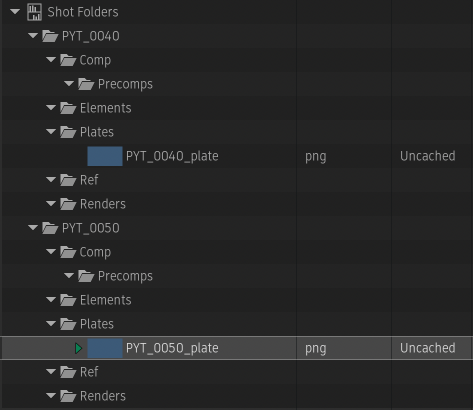
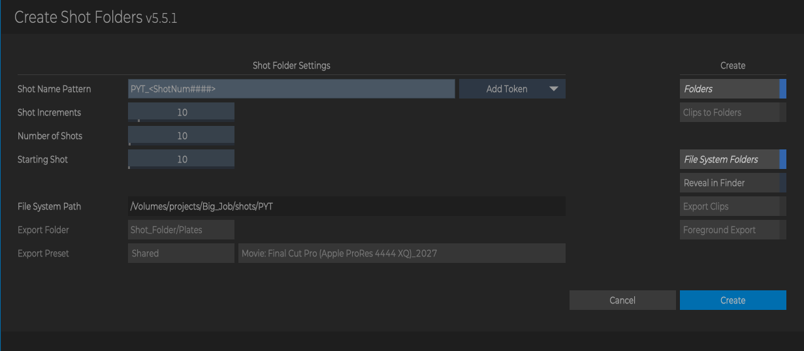
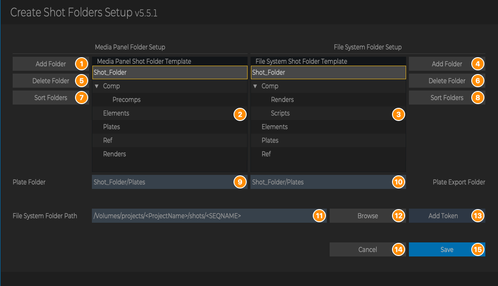
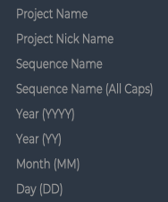
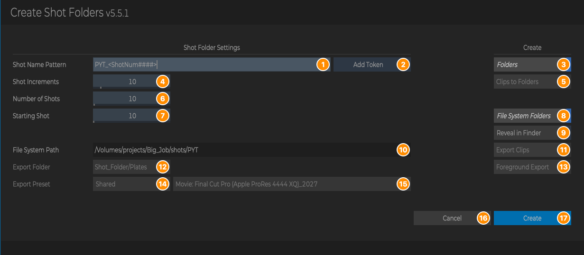
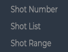
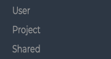
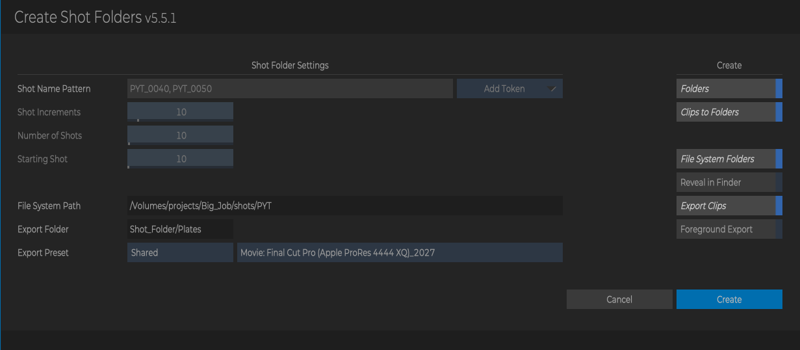
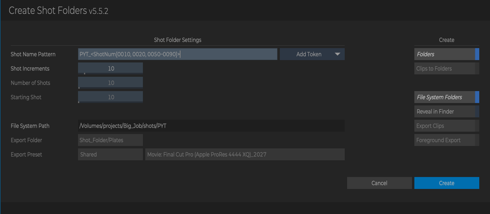

# Create Shot Folders

**Script Version:** 5.5.2  
**Flame Version:** 2025.2  
**Written by:** Michael Vaglienty  
**Creation Date:** 06.09.18  
**Update Date:** 11.03.26  

**Script Type:** MediaPanel

## Description

Create shot folders in the Media Panel and/or file system based on folder structure templates.<br><br>Custom folder structure templates can be set up in the script setup window.

## URL

https://logik-portal.com/scripts/create_shot_folders

## Menus

- Flame Main Menu → Logik → Logik Portal Script Setup → Create Shot Folders Setup
- Right-click in Media Panel → Create... → Shot Folders
- Right-click selected clips in Media Panel → Create... → Shot Folders (From Clips)
- Right-click selected segments in a Timeline → Create... → Shot Folders (From Segments)
- Right-click in MediaHub Files → Create Shot Folders (doesn't work in v5.5.2, see [Where to Find It](#where-to-find-it))

## Installation

Copy script folder into /opt/Autodesk/shared/python

---

# User Guide

<!-- user-guide: v5.5.2 11.03.26 -->

## Contents

- [Overview](#overview)
- [Requirements and Installation](#requirements-and-installation)
- [Where to Find It](#where-to-find-it)
- [The Setup Window](#the-setup-window)
- [The Create Shot Folders Window](#the-create-shot-folders-window)
- [Shot Name Patterns](#shot-name-patterns)
- [File System Path Tokens](#file-system-path-tokens)
- [How Creating Works](#how-creating-works)
- [Workflows](#workflows)
- [Messages and What to Do](#messages-and-what-to-do)
- [Tips, Troubleshooting and FAQ](#tips-troubleshooting-and-faq)

## Overview

Create Shot Folders builds the same folder structure for every shot of a job, in the Media Panel, on disk, or both, in one go.

You set up two folder templates once (one for the Media Panel, one for disk). Then you give the script a list of shots, either as a **shot name pattern** or by selecting clips or timeline segments that already have shot names, and it makes one shot folder per shot from the templates.

For example, with the pattern `PYT_<ShotNum####>`, 10 shots, starting at 10 in steps of 10, you get a new Media Panel library called **Shot Folders** with the shot folders `PYT_0010` to `PYT_0100`, each holding the folders of the Media Panel template. With the file system path `/Volumes/projects/<ProjectName>/shots/<SEQNAME>` in project `Big_Job`, the same shots are created on disk under `/Volumes/projects/Big_Job/shots/PYT/PYT_0010`, `.../PYT_0020` and so on, each with the folders of the disk template.

When you start from clips or segments, the script can also copy each clip into its shot's plate folder in the Media Panel and export it into its shot's plate folder on disk with a Flame export preset.

Here is the result of **Shot Folders (From Clips)** on two clips with the shot names `PYT_0040` and `PYT_0050`, with the Media Panel template `Comp/Precomps`, `Elements`, `Plates`, `Ref`, `Renders` and Plate Folder `Shot_Folder/Plates`:



On disk (File System Folders on, Export Clips off), the same run created:

```
/Volumes/projects/Big_Job/shots/PYT/PYT_0040/Comp/Renders
/Volumes/projects/Big_Job/shots/PYT/PYT_0040/Comp/Scripts
/Volumes/projects/Big_Job/shots/PYT/PYT_0040/Elements
/Volumes/projects/Big_Job/shots/PYT/PYT_0040/Plates
/Volumes/projects/Big_Job/shots/PYT/PYT_0040/Ref
/Volumes/projects/Big_Job/shots/PYT/PYT_0050/...  (the same folders)
```



## Requirements and Installation

- Flame 2025.2 or newer. The menus don't appear in older versions.
- Copy the whole `create_shot_folders` folder (with its `lib` and `assets` folders) into `/opt/Autodesk/shared/python`, so the script is at `/opt/Autodesk/shared/python/create_shot_folders/create_shot_folders.py`.
- In Flame, rescan Python hooks (or restart Flame) so the menus appear.
- If the script folder isn't named `create_shot_folders`, or Flame can't write to it, the script stops and shows a message when you run it. Check the folder name and its permissions.
- To create folders on disk, Flame needs permission to write to the file system path.
- To export clips, you need at least one Flame export preset (Movie or Image Sequence) saved as a User, Project or Shared preset.

## Where to Find It

| Where | Right-click on | Menu | What it does |
| --- | --- | --- | --- |
| Flame Main Menu | | Logik → Logik Portal Script Setup → **Create Shot Folders Setup** | Opens the Setup window to edit the folder templates, the file system path and the plate folders. |
| Media Panel | Anywhere | Create... → **Shot Folders** | Opens the Create Shot Folders window to make shots from a shot name pattern. |
| Media Panel | One or more clips | Create... → **Shot Folders (From Clips)** | Opens the Create Shot Folders window with the shot names of the selected clips. |
| Timeline | One or more segments | Create... → **Shot Folders (From Segments)** | Opens the Create Shot Folders window with the shot names of the selected video segments. |
| MediaHub Files | A folder | **Create Shot Folders** | Meant to create shot folders on disk in the selected folder. **In v5.5.2 this item doesn't work:** clicking it does nothing except print a Python error (`TypeError`) in the console. Use the Media Panel item with **File System Folders** on instead. |

Notes:

- **Shot Folders** is always in the Media Panel **Create...** menu. It ignores what is selected and always creates a new library.
- **Shot Folders (From Clips)** appears when at least one clip is selected. Every selected clip must have a shot name.
- **Shot Folders (From Segments)** appears when at least one segment is selected. Only video segments are used; every one of them must have a shot name.

## The Setup Window

Open it from **Flame Main Menu → Logik → Logik Portal Script Setup → Create Shot Folders Setup**.



The left half is the Media Panel template, the right half the disk (file system) template. The top folder, **Shot_Folder**, stands for each shot's folder: it is replaced by the shot name (for example `PYT_0010`) when folders are created. Everything under it is created inside every shot folder.

| # | Part | What it does |
| --- | --- | --- |
| 1 | **Add Folder** (Media Panel) | Adds a folder called `New Folder` inside the selected folder of the Media Panel template (inside **Shot_Folder** if nothing is selected). If the name is taken, a number is added. Double-click a folder to rename it. |
| 2 | **Media Panel Shot Folder Template** | The folders created in each Media Panel shot folder. Double-click a folder to rename it. **Shot_Folder** itself can't be renamed. |
| 3 | **File System Shot Folder Template** | The folders created in each shot folder on disk. Works the same way as the Media Panel template. |
| 4 | **Add Folder** (File System) | Adds a `New Folder` to the disk template, like (1). |
| 5 | **Delete Folder** (Media Panel) | Deletes the selected folder and everything in it from the Media Panel template. **Shot_Folder** can't be deleted, and the last folder under it can't be deleted either. |
| 6 | **Delete Folder** (File System) | Same as (5), for the disk template. |
| 7 | **Sort Folders** (Media Panel) | Sorts the Media Panel template alphabetically, at every level. |
| 8 | **Sort Folders** (File System) | Same as (7), for the disk template. |
| 9 | **Plate Folder** | The Media Panel folder that clips are copied into when you create shots from clips or segments, written as a path from the top of the template, for example `Shot_Folder/Plates`. |
| 10 | **Plate Export Folder** | The disk folder that clips are exported into, written the same way, for example `Shot_Folder/Plates`. Choose a folder **inside** Shot_Folder (see [Rules](#rules)). |
| 11 | **File System Folder Path** | The folder on disk that the shot folders are created in. It can contain [tokens](#file-system-path-tokens). |
| 12 | **Browse** | Opens Flame's file browser to choose the folder. The chosen folder **replaces** everything in File System Folder Path. |
| 13 | **Add Token** | Menu of [file system path tokens](#file-system-path-tokens). Choosing one inserts it into File System Folder Path at the text cursor. |
| 14 | **Cancel** | Closes the window without saving any of your changes. (Escape does the same.) |
| 15 | **Save** | Checks the plate folders, saves everything and closes the window. (Return does the same.) |

The Add Token menu:



### What is saved, and when

- Nothing is saved until you click **Save**. Folder changes, renames, deletes and path changes are all lost if you click **Cancel** or press Escape.
- **Save** stores both templates, the file system path and both plate folders. They are used by every Create Shot Folders window from then on.

### Rules

- **Plate Folder** must match a folder in the Media Panel template and **Plate Export Folder** a folder in the File System template, written exactly as the path from the top, with `/` between folders and the same capital letters: `Shot_Folder/Plates`, `Shot_Folder/Comp/Precomps`. Otherwise Save shows an error and the window stays open.
- If you rename or delete the plate folder in a template, update the matching entry before you click Save.
- **Plate Export Folder** must be a folder inside Shot_Folder. Setup accepts `Shot_Folder` on its own, but exporting clips then stops with a Python error (see [Tips](#tips-troubleshooting-and-faq)). A **Plate Folder** of `Shot_Folder` on its own is fine: clips are then copied into the shot folder itself.
- The file system path isn't checked when you save. It is checked when you create folders.

## The Create Shot Folders Window

Open it from the Media Panel (**Create... → Shot Folders** or **Shot Folders (From Clips)**) or the Timeline (**Create... → Shot Folders (From Segments)**). The same window is used for all three. The parts that don't apply are greyed out.



| # | Part | What it does |
| --- | --- | --- |
| 1 | **Shot Name Pattern** | The shots to create. See [Shot Name Patterns](#shot-name-patterns). From clips or segments, this shows the shot names found in the selection and can't be edited. |
| 2 | **Add Token** | Menu of shot number tokens. Choosing one inserts it into the pattern at the text cursor. |
| 3 | **Folders** | Create shot folders in the Media Panel, in a new library called **Shot Folders**. |
| 4 | **Shot Increments** | The step between shot numbers, for example 10 for `0010`, `0020`, `0030`. Used by `<ShotNum####>` patterns and by ranges such as `0050-0090`. |
| 5 | **Clips to Folders** | Available only from clips or segments, with **Folders** on (from segments it can stay available after turning **Folders** off). Meant to switch copying the clips into the plate folder on and off, but in v5.5.2 it **has no effect**: clips are always copied when **Folders** is on. |
| 6 | **Number of Shots** | How many shots a `<ShotNum####>` pattern creates (1 to 1000). |
| 7 | **Starting Shot** | The first shot number of a `<ShotNum####>` pattern (1 to 10000). |
| 8 | **File System Folders** | Create shot folders on disk, in the File System Path (10). |
| 9 | **Reveal in Finder** | Opens the File System Path in the Finder (the file browser on Linux) after the folders are created. Available when **File System Folders** is on. |
| 10 | **File System Path** | Read-only. The file system path from Setup with the tokens filled in: where the shot folders on disk will go. It updates as you type the pattern. Change the path in Setup. |
| 11 | **Export Clips** | Available only from clips or segments, with **File System Folders** on. Exports each clip into its shot's plate export folder on disk. |
| 12 | **Export Folder** | Read-only. The Plate Export Folder from Setup. |
| 13 | **Foreground Export** | On: Flame exports the clips straight away and you wait. Off: the exports are sent to Flame's background export. Available when **Export Clips** is on. |
| 14 | **Export Preset** location | Where to look for export presets: **User**, **Project** or **Shared**. Changing it fills the preset menu (15) with that location's presets and picks the first one. |
| 15 | **Export Preset** | The Flame export preset used by Export Clips. It lists every Movie preset (`Movie: <name>`) and Image Sequence preset (`Image Sequence: <name>`) saved in the chosen location. |
| 16 | **Cancel** | Closes the window without saving or creating anything. (Escape does the same.) |
| 17 | **Create** | Closes the window, saves the settings and creates the shot folders. (Return does the same.) |

The shot number Add Token menu, and the Export Preset location menu:

 

From two clips with the shot names `PYT_0040` and `PYT_0050`, with Folders, File System Folders and Export Clips on:



### What is saved, and when

Settings are saved when you click **Create**, after the checks pass and before anything is created. **Cancel** saves nothing.

| Saved from | Settings saved |
| --- | --- |
| **Shot Folders** (pattern) | Shot Name Pattern, Shot Increments, Number of Shots, Starting Shot, Folders, File System Folders, Reveal in Finder, Export Preset location and preset. |
| **From Clips / From Segments** | Folders, Clips to Folders, File System Folders, Reveal in Finder, Export Clips, Foreground Export, Export Preset location and preset. The pattern and sliders are not saved, so your saved pattern is still there next time. |

### When the saved export preset is missing

When the window opens, the script checks that the saved export preset still exists in the saved location.

- If it doesn't, a warning shows the missing preset, and the menu is set to the first preset in that location (or left blank if there are none).
- Clicking **Create** then saves that preset (or a blank one) in place of the missing one, even for a pattern, where exporting isn't used.
- A blank preset with **Export Clips** on stops the export with an error (see [Tips](#tips-troubleshooting-and-faq)). Choose another location or save a preset in Flame first.

## Shot Name Patterns

The pattern in **Shot Name Pattern** sets which shots are created. Shot numbers are made with the `<ShotNum...>` token. The Add Token menu inserts the three forms:

| Add Token menu | Token | Creates | Sliders used |
| --- | --- | --- | --- |
| Shot Number | `<ShotNum####>` | **Number of Shots** shots, starting at **Starting Shot**, in steps of **Shot Increments**. The number of `#` sets the padding (`####` → `0010`). `<ShotNum>` with no `#` pads to 4 digits. | All three |
| Shot List | `<ShotNum[0010, 0020, 0050]>` | Exactly the numbers listed. | None |
| Shot Range | `<ShotNum[0010, 0020, 0050-0090]>` | The listed numbers, and every number in each range in steps of **Shot Increments**. The padding comes from the first number of the range. | Shot Increments |

Examples:

| Pattern | Settings | Shots created |
| --- | --- | --- |
| `PYT_<ShotNum####>` | 5 shots, start 10, increments 10 | `PYT_0010`, `PYT_0020`, `PYT_0030`, `PYT_0040`, `PYT_0050` |
| `PYT_<ShotNum###>` | 3 shots, start 1, increments 1 | `PYT_001`, `PYT_002`, `PYT_003` |
| `PYT_<ShotNum[0010, 0020, 0050]>` | | `PYT_0010`, `PYT_0020`, `PYT_0050` |
| `PYT_<ShotNum[0010, 0050-0090]>` | increments 20 | `PYT_0010`, `PYT_0050`, `PYT_0070`, `PYT_0090` |
| `PYT_<ShotNum####>_comp` | 2 shots, start 10, increments 10 | `PYT_0010_comp`, `PYT_0020_comp` |
| `PYT_[0010, 0020, 0030-0050]` | increments 10 | `PYT_0010` to `PYT_0050` (the same list and ranges work without the token) |
| `PYT_0010` | | `PYT_0010` only |

The sliders grey out when the pattern doesn't use them. Here the Shot Range token is typed in, so only **Shot Increments** is available:



The **File System Path** shows the path the shot folders go into: here `<SEQNAME>` became `PYT`, the letters before the token (see [File System Path Tokens](#file-system-path-tokens)).

Things to know:

- **A range can't start at zero.** `<ShotNum[0000-0050]>` or `[0000-0050]` stops with a Python error and nothing is created (the settings were already saved). Start the range at the first real shot, for example `0010-0050`.
- With the bracket form without the token (`PYT_[...]`), anything after `]` is left out of the shot names.
- From clips or segments, the pattern is replaced by the shot names of the selection, sorted and with each name listed once.

## File System Path Tokens

The **File System Folder Path** in Setup can contain tokens. They are filled in when the Create Shot Folders window opens, and the result is shown in its **File System Path** field.

Examples below use project `Big_Job`, project nickname `bj`, pattern `PYT_<ShotNum####>`, on 11.03.26.

| Add Token menu | Token | Becomes | Example |
| --- | --- | --- | --- |
| Project Name | `<ProjectName>` | Name of the current Flame project. | `Big_Job` |
| Project Nick Name | `<ProjectNickName>` | Nickname of the current Flame project. | `bj` |
| Sequence Name | `<SeqName>` | The sequence name, taken from the shot name pattern (see below), as it is written. | `PYT` |
| Sequence Name (All Caps) | `<SEQNAME>` | Same as `<SeqName>`, in capitals. | `PYT` |
| Year (YYYY) | `<YYYY>` | Current year. | `2026` |
| Year (YY) | `<YY>` | Last two digits of the current year. | `26` |
| Month (MM) | `<MM>` | Current month, two digits. | `11` |
| Day (DD) | `<DD>` | Current day, two digits. | `03` |

The sequence name is:

- with a `<ShotNum####>` pattern: the text before the token, without a trailing `_`. `PYT_<ShotNum####>` gives `PYT`.
- with a plain shot name: the text before the first number. `PYT_0010` gives `PYT`.
- from clips or segments: the text before the first number of the first shot name in the list.
- with a Shot List or Shot Range token, or the `PYT_[...]` bracket form: the text before the token or bracket, without a trailing `_`. `PYT_<ShotNum[0010, 0020]>` and `PYT_[0010-0050]` give `PYT`.

All shots of one Create go into the same folder: the sequence name isn't worked out per shot.

## How Creating Works

When you click **Create**, the window closes and the script:

1. Checks that **Folders** or **File System Folders** is on and that the pattern isn't empty. If not, an error is shown and nothing is saved or created. Open the window again to fix it.
2. Saves the settings (see [What is saved, and when](#what-is-saved-and-when-1)).
3. Works out the list of shots.
4. From segments only: creates a library called **Temp Clips Library** and matches each selected video segment out into it as a clip.
5. With **Folders** on: creates a new library called **Shot Folders** in the current workspace, with one folder per shot built from the Media Panel template. Each shot folder is tagged `ShotName: <shot name>`. From clips or segments, each clip is then **copied** (not moved) into the **Plate Folder** of its shot's folder, and that folder is opened in the Media Panel.
6. With **File System Folders** on: creates the File System Path if it doesn't exist yet, then one folder per shot inside it built from the disk template. Folders that already exist are left as they are; nothing on disk is deleted. With **Reveal in Finder** on, the File System Path is opened in the Finder.
7. From clips or segments with **Export Clips** on: exports each clip with the chosen preset into `<File System Path>/<shot name>/<Plate Export Folder without Shot_Folder>`, for example `/Volumes/projects/Big_Job/shots/PYT/PYT_0040/Plates`.
8. From segments only: deletes **Temp Clips Library**.

Things to know:

- **Every Create makes a new Shot Folders library**, even when one already exists, and even when you had a library or folder selected. Move the shot folders where you want them afterwards.
- **Clips are copied whenever Folders is on**, whether or not **Clips to Folders** is on. With **Folders** off, nothing is copied.
- Clips are matched to shots by their shot name. Several clips with the same shot name all go into that shot's folder.
- If the File System Path can't be created or written to, an error is shown and nothing more is done on disk. The Media Panel folders (and clip copies) from step 5 are already made at that point.
- If the script stops with an error part way (for example a missing export preset), what was made before the error stays. From segments, **Temp Clips Library** is then left in the workspace; you can delete it by hand.
- From segments with **Foreground Export** off, the exports are queued in the background and **Temp Clips Library** (which holds the clips being exported) is deleted straight after. In a short test the export still finished, but this wasn't checked with long clips. To be safe, turn on **Foreground Export** when exporting from segments.

## Workflows

### First-time setup

1. Open **Flame Main Menu → Logik → Logik Portal Script Setup → Create Shot Folders Setup**.
2. In the Media Panel template, select **Shot_Folder** (or a folder in it) and click **Add Folder** to add folders. Double-click a new folder to rename it. Delete the ones you don't need with **Delete Folder**.
3. Do the same for the File System template on the right.
4. Set **Plate Folder** and **Plate Export Folder** to the folders the plates should go in, for example `Shot_Folder/Plates`.
5. Click **Browse** and choose the root folder for your jobs, for example `/Volumes/projects`. Then click at the end of **File System Folder Path** and build the rest with **Add Token**, typing the `/` and fixed folder names yourself, for example `/Volumes/projects/<ProjectName>/shots/<SEQNAME>`.
6. Click **Save**.

### Create shots from a pattern

1. Right-click in the Media Panel → **Create...** → **Shot Folders**.
2. Enter a pattern, for example `PYT_<ShotNum####>`, and set **Number of Shots**, **Starting Shot** and **Shot Increments**.
3. Turn on **Folders**, **File System Folders** or both. Check the **File System Path**.
4. Click **Create**. A new **Shot Folders** library appears in the Media Panel, and the folders on disk are created.

### Create shots for an edit's plates

1. In the Media Panel, select the plate clips. Each must have a shot name.
2. Right-click → **Create...** → **Shot Folders (From Clips)**. The shot names appear in **Shot Name Pattern**.
3. Turn on **Folders** to copy each clip into its shot's plate folder.
4. To also write the plates to disk, turn on **File System Folders** and **Export Clips**, choose the **Export Preset** location and preset, and choose **Foreground Export** if you want to wait for the exports.
5. Click **Create**.

### Create shots from a timeline

1. Open the sequence in the Timeline and select the segments of the shots. Each video segment must have a shot name.
2. Right-click → **Create...** → **Shot Folders (From Segments)**.
3. Set the options as for clips and click **Create**.
4. While it runs you'll see a **Temp Clips Library** appear in the Media Panel. It holds clips matched out from the segments and is deleted at the end.

## Messages and What to Do

### Pop-up messages

| Message | When | What to do |
| --- | --- | --- |
| `All selected clips must have a Shot Name assigned.` | **Shot Folders (From Clips)** when a selected clip has no shot name. | Give every clip a shot name, or leave those clips out of the selection. |
| `Must have a Segment selected to create shot folders` | **Shot Folders (From Segments)** when no video segment is selected (for example only audio). | Select video segments. |
| `All selected segments must have a Shot Name assigned.` | **Shot Folders (From Segments)** when a selected video segment has no shot name. | Give every segment a shot name. |
| `Saved export preset not found:`<br><br>`<preset>`<br><br>`Using first available preset.` | Opening the window when the saved export preset no longer exists. | Check the preset menu before clicking Create. See [When the saved export preset is missing](#when-the-saved-export-preset-is-missing). |
| `Saved export preset not found:`<br><br>`<preset>`<br><br>`No presets available in <location> location.`<br><br>`Select a different Preset Type or save a preset in Flame.` | Opening the window when the saved export preset no longer exists and the location has no presets. | Choose another Export Preset location, or save an export preset in Flame. |
| `Select at least one shot type to create.`<br><br>`Folders or File System Folders.` | **Create** with both **Folders** and **File System Folders** off. | Open the window again and turn one of them on. |
| `Enter shot name pattern.`<br><br>`Examples`<br><br>`PYT_<ShotNum####>`<br>`PYT_<ShotNum####>`<br>`PYT_<ShotNum[0010, 0020, 0050-0090]>` | **Create** with an empty pattern. Also shown from clips when a folder or library was selected along with the clips (see [Tips](#tips-troubleshooting-and-faq)). | Open the window again and enter a pattern, or select only clips. |
| `Unable to create folder:`<br><br>`<path>`<br><br>`Check folder path and permissions then try again.` | **Create** with File System Folders on, when the File System Path doesn't exist and can't be created. | Check the path in Setup, that the volume is mounted and that you can write to it. |
| `File system folder destination not writable.`<br><br>`<path>` | **Create** with File System Folders on, when Flame can't write to the File System Path. | Fix the folder's permissions or choose another path in Setup. |
| `Plate Folder must be a valid folder in the Media Panel folder structure.`<br><br>`Example: Shot_Folder/Plates` | **Save** in Setup when Plate Folder doesn't match a folder in the Media Panel template. | Correct the path (see [Rules](#rules)). |
| `Plate Export Folder must be a valid folder in the File System folder structure.`<br><br>`Example: Shot_Folder/Plates` | **Save** in Setup when Plate Export Folder doesn't match a folder in the File System template. | Correct the path (see [Rules](#rules)). |

The messages shown after **Create** appear after the window has closed. For "Select at least one shot type..." and "Enter shot name pattern..." your changes in the window weren't saved; open it again from the menu. For "Unable to create folder" and "File system folder destination not writable" the settings were already saved.

### Console messages

These appear in the console (the shell Flame was started from) and briefly in Flame's message bar, not in a pop-up:

| Message | Meaning |
| --- | --- |
| `Shot Folder: <plate folder> Not Found` | A clip couldn't be copied because no shot folder with its shot name was found in the new Shot Folders library. |
| `File System Shot Folders Created`, `Media Panel Shot Folders Created`, `Clips Export Complete`, `Temp Library Deleted` | Steps that finished. |

## Tips, Troubleshooting and FAQ

**I clicked Create Shot Folders in the MediaHub and nothing happened.**
In v5.5.2 this menu item doesn't work; it only prints a Python error in the console. Use **Create... → Shot Folders** in the Media Panel with **File System Folders** on, and set the folder in Setup.

**Create stopped with an error after making the folders, and nothing was exported.**
The Export Preset menu was blank (no presets in the chosen location), or the Plate Export Folder in Setup is `Shot_Folder` on its own. Pick a location that has presets, or set the Plate Export Folder to a folder inside Shot_Folder, then export the clips again by hand or run Create again (it makes another Shot Folders library). From segments, delete the leftover **Temp Clips Library** by hand.

**My shot range starting at 0000 doesn't work.**
Ranges can't start at zero. Start at the first real shot number.

**I turned off Clips to Folders but the clips were still copied.**
In v5.5.2 that button has no effect. Turn off **Folders** if you don't want clips copied (no Media Panel folders are made then either), or delete the copies afterwards.

**From Clips said "Enter shot name pattern" although I selected clips.**
A folder or library was selected as well. The clips are then ignored. Select only clips.

**From Clips did nothing at all.**
Something that isn't a clip, folder or library (for example a reel) was selected along with the clips. Nothing happens and no message is shown. Select only clips.

**Where is the Shot Folders library?**
In the current workspace's Media Panel, as a new library each time you click Create. Libraries from earlier runs are kept.

**Will it overwrite folders on disk?**
No. Folders that already exist are kept, and nothing on disk is deleted. Exported clips are written by Flame's export, using the preset's own settings for existing files.

**Are the templates shared?**
The templates, path and settings are stored in the `config` folder inside the `create_shot_folders` script folder, so everyone using the same installed copy of the script shares them.

## Updates

### v5.5.2 [11.03.26]
- Minimum Flame version is now 2025.2.
- Fixed `<SeqName>` and `<SEQNAME>` resolving to nothing in the file system path when the shot name pattern uses a shot list or range, such as `PYT_<ShotNum[0010, 0020]>` or `PYT_[0010-0050]`. Shot folders were created one level too high.
- Fixed copying clips into the plate folder failing when the plate folder has subfolders of its own.
<br>

### v5.5.1 [10.13.26]
- Updated to PyFlameLib v5.5.3 - Fixes screenGeometry error with Flame 2027.2.
- Changed license from GPL-3.0 to MIT. See LICENSE file for details.
<br>

### v5.5.0 [02.18.26]
- Create shot folders for selected clips in Media Panel.
- Create shot folders for selected timeline segments.
- Set folder location for selected clips or segments for shot folders. (Setup Window)
- Create shot folders in MediaHub at selected folder location.
- Export clips to file system folders.
- Set location of plate export folders in file system folders. (Setup Window)
- Set render type. Foreground or Background.
<br>

### v5.4.0 [08.27.25]
- Updated to PyFlameLib v5.0.0.
- Escape key closes out of windows.
- Fixed: Reveal in Finder button was not disabled when File System Folders button was unchecked.
<br>

### v5.3.0 [04.03.25]
- Updated to PyFlameLib v4.3.0.
<br>

### v5.2.0 [01.02.25]
- Updated to PyFlameLib v4.1.0.
- Updated SCRIPT_PATH to use absolute path. Allows script to be installed in different locations.
- Script now only works with Flame 2025.1+.
<br>

### v5.1.0 [10.01.24]
- Updated to PyFlameLib v3.2.0.
<br>

### v5.0.1 [09.15.24]
- Shot Folder top level item in folder tree can no longer be edited.
<br>

### v5.0.0 [09.09.24]
- Split off from Create Shot script.
- Updated to PyFlameLib v3.0.0.
