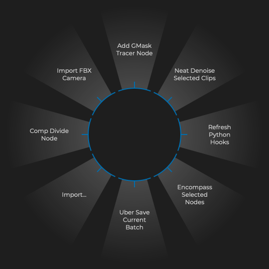
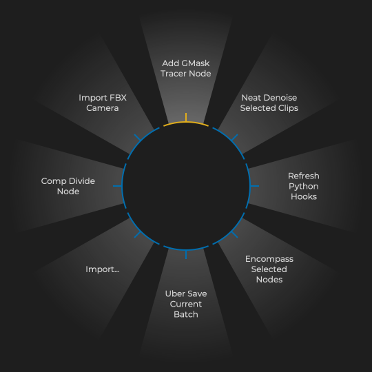
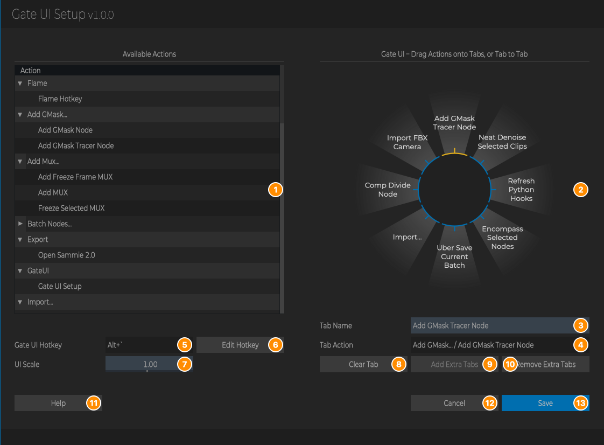
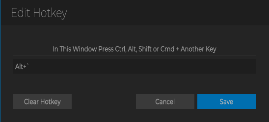

# GateUI

**Script Version:** 1.0.0  
**Flame Version:** 2025.2  
**Written by:** Michael Vaglienty  
**Creation Date:** 11.24.26  
**Update Date:** 11.24.26  

**License:** MIT License (MIT) - see LICENSE file for details

**Script Type:** Batch

## Description

Pop-up radial gate menu for Batch, based on the gate UI in Autodesk Toxik.  
The gate works with installed Python scripts and Flame hotkeys (keyboard shortcuts), but only ones that work from Batch.  
The gate opens at the cursor with a hotkey in Batch (Alt-` unless another is set in the Gate UI Setup window).  
Note: the gate opens anywhere in the Batch tab, not only over the Batch schematic. The gate can't tell when the cursor is outside the Batch schematic, so it also opens over areas where a script or hotkey on a tab might fail. Some scripts and hotkeys may not work unless the gate is opened over the Batch schematic. Some things won't work if it is opened over the Media Panel, the Batch node area, or a node's own schematic view such as GMask, GMask Tracer or Action. This is a limitation within the Flame API to be able to tell what part of the Flame UI the cursor is currently over.  
The gate has four or eight tabs. Each tab runs a Batch right-click menu action of another installed script by reference: the script's own action is called, none of its code is copied here. A blank tab only closes the gate. When nothing is selected and the action adds one node, the node is placed where the gate was opened.  
Until the tabs are set up, the top tab opens the Gate UI Setup window and the other three are blank. The Gate UI Setup tab can be replaced with any other action, or put on another tab: it is in the action list of the Gate UI Setup window under GateUI.

## URL

https://logik-portal.com/scripts/gate_ui

## Menus

Script Setup:

- Flame Main Menu → Logik → Logik Portal Script Setup → Gate UI Setup

## Installation

Copy script folder into /opt/Autodesk/shared/python

---

# User Guide

<!-- user-guide: v1.0.0 11.25.26 -->

## Contents

- [Quick Start](#quick-start)
- [Requirements](#requirements)
- [Gate UI Setup Window](#gate-ui-setup-window)
- [Flame Hotkey](#flame-hotkey)
- [Edit Hotkey Window](#edit-hotkey-window)

## Quick Start

GateUI is a pop-up menu for Batch. Each of its tabs runs a script's Batch right-click action or a Flame keyboard shortcut.

1. In Batch, put the cursor over the schematic and press the hotkey (**Alt-`** by default). The gate opens with the cursor at its center.
2. Move the cursor from the center out through a tab to run it.
3. To close without running a tab, press **Escape** or click anywhere.

Open the gate over the Batch schematic. It opens anywhere in the Batch tab, but over the Media Panel, the Batch node area, or a node's own schematic view (GMask, GMask Tracer, Action) some scripts and hotkeys won't work.

## Requirements

- Flame 2025.2 or newer.

## Gate UI Setup Window

**Flame Main Menu → Logik → Logik Portal Script Setup → Gate UI Setup**. Sets what each tab runs.

| # | Part | What it does |
| --- | --- | --- |
| 1 | **Available Actions** | **Flame → Flame Hotkey** at the top, then the Batch right-click actions of your installed scripts. Drag one onto a tab. |
| 2 | Gate picture | Drop actions on its tabs, drag a tab onto another, click a tab to select it. |
| 3 | **Tab Name** | The name shown on the selected tab. |
| 4 | **Tab Action** | What the selected tab runs. |
| 5 | **Gate UI Hotkey** | The hotkey that opens the gate. |
| 6 | **Edit Hotkey** | Opens the [Edit Hotkey Window](#edit-hotkey-window). |
| 7 | **UI Scale** | Size of the gate, from 0.1 to 2.0 (1.0 by default). Drag left or right, or click to type a value. The text and the ring lines stay the same size. Saved with **Save**. |
| 8 | **Clear Tab** | Empties the selected tab. A blank tab only closes the gate. |
| 9 | **Add Extra Tabs** | Adds four more tabs, for eight in all. Greyed out when the gate already has eight. |
| 10 | **Remove Extra Tabs** | Takes the four extra tabs away again. Asks first. |
| 11 | **Help** | Opens this guide. |
| 12 | **Cancel** | Closes the window without saving the tabs. |
| 13 | **Save** | Saves the tabs and closes the window. |

- Dropping an action on a tab that already has one asks before replacing it.
- Dropping an action between two of the four tabs adds the four extra tabs, one in each space.
- Dragging a tab onto another moves what is on it. A blank tab takes it, a tab that has something on it swaps with it.
- To put the **Gate UI Setup** tab back, drag it from the **GateUI** group.

## Flame Hotkey

Runs a Flame keyboard shortcut from a tab.

1. Drag **Flame Hotkey** (under **Flame**, the first group in **Available Actions**) onto a tab.
2. Type the shortcut's name exactly as its **Description** is shown in Flame's Keyboard Shortcut editor, for example `Import...`.

- The name is checked against Flame's shortcut list. A name that isn't found adds nothing, and so does **Cancel**.
- Only Flame's own built-in shortcuts can be used, not the Python script actions the Keyboard Shortcut editor also lists.
- Some shortcuts only work in certain places, so a valid one can still be refused when swiped.
- If Flame's shortcut list can't be read, the name is used without checking and a warning is printed.

## Edit Hotkey Window

Opens from **Edit Hotkey**. Press the new key combination anywhere in the window, then click **Save**.

- The combination must include Shift, Control, Alt or Command.
- **Clear Hotkey**, Backspace or Delete empties the field. **Save** can't be used until a new combination is pressed.
- **Save** here saves the hotkey at once and it works straight away. **Cancel** in Gate UI Setup does not undo it.
- In Batch, that combination then opens the gate instead of doing what Flame used it for.

## Updates

### v1.0.0 [11.24.26]
- Initial release.
