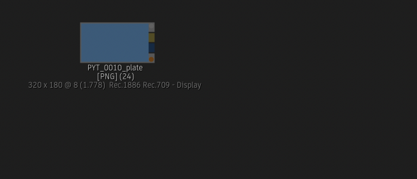
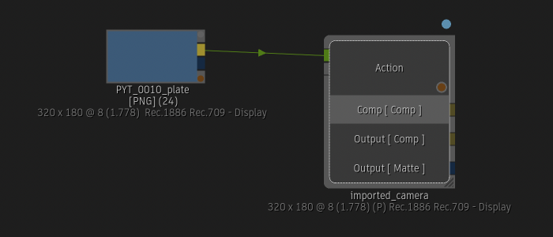
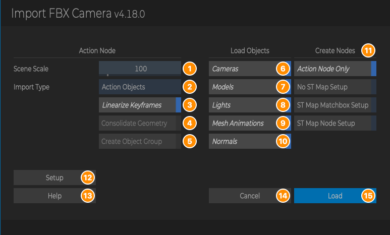
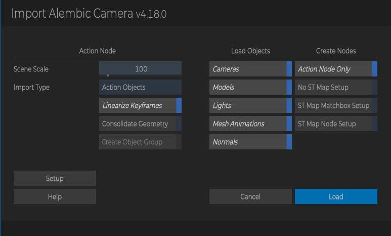
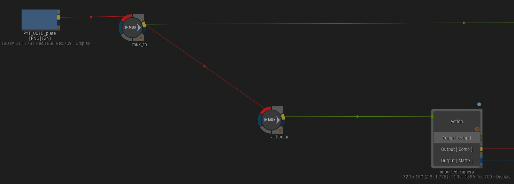
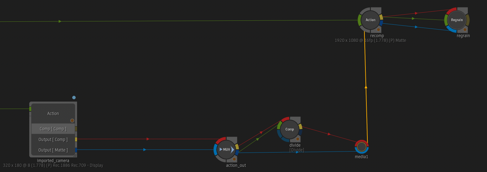
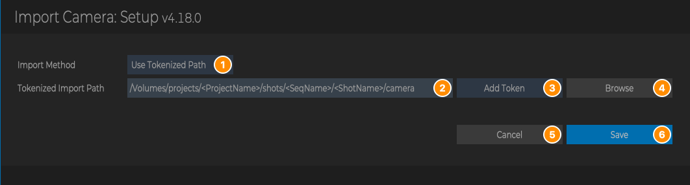

# Import Camera

**Script Version:** 4.18.0  
**Flame Version:** 2025.2  
**Written by:** Michael Vaglienty  
**Creation Date:** 06.02.18  
**Update Date:** 11.26.26  

**License:** MIT License (MIT) - see LICENSE file for details

**Script Type:** Batch

## Description

Creates a new Action node setup with selected FBX or Alembic file loaded.

## URL

https://logik-portal.com/scripts/import_camera

## Menus

- Flame Main Menu → Logik → Logik Portal Script Setup → Import Camera Setup
- Right-click in Batch or on a selected node → Import... → Import FBX Camera
- Right-click in Batch or on a selected node → Import... → Import Alembic Camera

## Installation

Copy script into /opt/Autodesk/shared/python/import_camera

---

# User Guide

<!-- user-guide: v4.18.0 11.26.26 -->

## Contents

- [Quick Start](#quick-start)
- [Requirements](#requirements)
- [Import Options Window](#import-options-window)
- [Node Setups](#node-setups)
- [ST Maps](#st-maps)
- [Setup Window](#setup-window)

## Quick Start

Import Camera loads an FBX or Alembic camera file into a new Action node in Batch, called `imported_camera`. It can also build a comp setup around it.

1. In Batch, select the plate node.
2. Right-click → **Import... → Import FBX Camera** (or **Import Alembic Camera**).
3. Pick the camera file in Flame's file browser.
4. Choose your options and click **Load**.

Before:

After:

With a node selected, the new nodes are placed to its right and connected to it. With nothing selected, they are placed at the cursor.

## Requirements

- Flame 2025.2 or newer.

## Import Options Window

Opens after you pick a file.

| # | Part | What it does |
| --- | --- | --- |
| 1 | **Scene Scale** | Size of the scene in Action: pixels per scene unit (1 to 1000). |
| 2 | **Import Type** | **Action Objects** imports the objects into Action. **Read File** keeps the file linked. |
| 3 | **Linearize Keyframes** | Sets the camera's keyframes to linear. Helps with motion blur on the first and last frames. Needs **Action Objects** and **Cameras**. |
| 4 | **Consolidate Geometry** | Alembic with **Action Objects** only. Consolidates the geometry into a single object. |
| 5 | **Create Object Group** | Alembic only. Creates a group for each object. Needs **Consolidate Geometry**. |
| 6-10 | **Load Objects** | What to load from the file: Cameras, Models, Lights, Mesh Animations, Normals. |
| 11 | **Create Nodes** | The setup to build. See [Node Setups](#node-setups). |
| 12 | **Setup** | Opens the [Setup Window](#setup-window) over this window. The options set here stay as they are. |
| 13 | **Help** | Opens this guide. |
| 14 | **Cancel** | Closes the window without importing (or press Escape). |
| 15 | **Load** | Imports the file and builds the setup (or press Return). |

- A greyed-out button is never applied, even if it is still highlighted.
- **Load** saves the options for next time. **Cancel** saves nothing.

With an Alembic file, **Consolidate Geometry** can be used:

## Node Setups

Choose one under **Create Nodes**. Every setup includes the `imported_camera` Action.

- **Action Node Only:** just the Action with the file loaded.
- **No ST Map Setup:** adds MUXes, a Divide comp, a recomp Action and a Regrain, so work done in the camera Action is comped back over the original plate.
- **ST Map Matchbox Setup:** the same, plus an undistort before the camera Action and a redistort after it, using the `uvmap_3vis` Matchbox that comes with the script.
- **ST Map Node Setup:** the same as the Matchbox setup, using Flame's **STMap** node.

No ST Map Setup:

## ST Maps

For the two ST Map setups:

1. Select the plate (or a node with the plate's resolution) before importing. Without one, a warning asks whether to continue.
2. After **Load**, pick the undistort map. It must be an EXR with `undistort` in its name.
3. The redistort map is found automatically: the first EXR with `redistort` in its name, in the same folder or a folder below it. If none is found, you are asked to pick it.
4. Both maps are imported into the `st_maps` schematic reel.

If you cancel or pick the wrong file, the options window comes back.

## Setup Window

**Flame Main Menu → Logik → Logik Portal Script Setup → Import Camera Setup**, or **Setup** in the import options window. Sets where the file browser starts when you import. A change saved from the import options window is used from the next import on.

| # | Part | What it does |
| --- | --- | --- |
| 1 | **Import Method** | **Browse To Path**: start at the last camera file you imported. **Use Tokenized Path**: start at the path in (2). |
| 2 | **Tokenized Import Path** | The folder to start in. Tokens are filled in from the current batch group. |
| 3 | **Add Token** | Adds a token to the path: `<ProjectName>`, `<ProjectNickName>`, `<SeqName>`, `<SEQNAME>`, `<ShotName>`. |
| 4 | **Browse** | Pick the folder in Flame's file browser. |
| 5 | **Cancel** | Closes the window without saving. |
| 6 | **Save** | Saves and closes the window (or press Return). |

With **Use Tokenized Path**, the path can't be empty.

## Updates

### v4.18.0 [11.26.26]
- Updated to PyFlameLib v5.6.0.
- Added a Help button to the import window. It opens the Import Camera guide (README.md) in its own window.
- Added a Setup button to the import window. It opens Import Camera Setup over the import window.
- Added an error message when an import fails. Any nodes the import added to Batch are removed, along with the st_maps reel if the import created it.
- Fixed FBX and Alembic files with upper-case extensions (.FBX, .ABC) not being imported.
- Fixed Alembic Consolidate Geometry and Create Object Group being applied when their buttons were greyed out in the window.
- Fixed the import window disappearing when the ST Map warning was declined. The window now opens again so another setup can be picked or the import cancelled.
- Fixed Linearize Keyframes joining the next line onto each CurveOrder line in the camera setup.
- Fixed the redistort map search: the first map found is now used, and only EXR files are matched.
- Fixed the redistort map file browser title saying Undistort.
- Fixed Setup saving an empty Tokenized Import Path when Use Tokenized Path is selected. An error message now asks for a path.
 

### v4.17.2 [11.06.26]
- Fixed Use Tokenized Path: the script called pyflame.resolve_path_tokens, which no longer exists in PyFlameLib. It now uses pyflame.resolve_tokens.
 

### v4.17.1 [10.13.26]
- Updated to PyFlameLib v5.5.3 - Fixes screenGeometry error with Flame 2027.2.
- Changed license from GPL-3.0 to MIT. See LICENSE file for details.
 

### v4.17.0 [06.22.26]
- Updated to PyFlameLib v5.4.0.
- Fixed calculator issues in Linux.
 

### v4.16.0 [08.27.25]
- Updated to PyFlameLib v5.0.0.
- Escape key closes main window.
- Added warning message when importing ST Map Matchbox Setup without background clip or node with background resolution selected. ST Map and camera track aren't applied properly without the background clip or node with background resolution selected.
 

### v4.15.0 [03.12.25]
- Updated to PyFlameLib v4.3.0.
 

### v4.14.0 [12.27.24]
- Updated to PyFlameLib v4.0.0.
- Updated SCRIPT_PATH to use absolute path. Allows script to be installed in different locations.
- Script now only works with Flame 2023.2+.
 

### v4.13.0 [08.04.24]
- Updated to PyFlameLib v3.0.0.
 

### v4.12.0 [05.09.24]
- Added two new options for working with ST Maps:
    - ST Map Matchbox Setup - Uses UVMap_3vis matchbox for undistort and redistort.
    - ST Map Node Setup - Flame 2025+ only. Uses Flame ST Map node for undistort and redistort.
- Removed Action node ST Map setup option.
- Added new buttons (These are not enabled when Import Type is Read File):
    - Linearize Keyframes - Set camera keyframes to linear. Helps with motion blur on first and last frames.
    - Consolidate Geometry - Alembic setting only. Consolidates geometry into a single object.
    - Create Object Group - Alembic setting only. Creates a group for each object in the Alembic file.
    - Load objects - Choose which objects to load from FBX/Alembic file:
        - Cameras
        - Models
        - Lights
        - Mesh Animations
        - Normals
- Fixed Tokenzied path not working properly.
- Fixed Linearize keyframes. Was crashing script when applied to loading FBX/ABC files as Read Files.
- Cleaned up duplicate node naming code.
 

### v4.11.2 [02.25.24]
- Misc UI fixes.
 

### v4.11.1 [01.29.24]
- Fixed PySide6 errors/font in slider calculator.
 

### v4.11.0 [01.02.24]
- Updates to UI/PySide.
 

### v4.10.0 [07.26.23]
- Updated to pyflame lib v2.0.0.
 

### v4.9.1 [06.26.23]
- Updated script versioning to semantic versioning.
- Load button is now blue.
- Pressing return in the main window will now load the selected camera.
 

### v4.9 [03.14.23]
- Fixed: ST Map Setup - Resize node setup is not being saved with correct name in 2024.
 

### v4.8 [02.04.23]
- Added check to make sure script is installed in the correct location.
 

### v4.7 [01.17.23]
- Moved setup menu for Flame 2023.2+ to: Flame Main Menu -> Logik -> Logik Portal Script Setup -> Import Camera Setup
- Fixed not being able to load setup window.
- Updated config file loading/saving.
- Fixed: ST Map Setup - Selecting an image other than the undistort map would cause the script to fail.
 

### v4.6 [01.02.23]
- Fixed not being able to select Alembic files in the import browser.
- Minimum Flame version is now 2022.3.
- Ability to set tokenized path to always open browser to when importing: Flame Main Menu -> pyFlame -> Import Camera Setup. By default this is turned off.
- Patch Setup button renamed to ReComp Setup for clarity.
 

### v4.5 [07.28.22]
- Camera keyframe extrapolation is now set to linear to help with motion blur.
 

### v4.4 [05.26.22]
- Added new flame browser window - Flame 2023.1 and later.
- Messages print to Flame message window - Flame 2023.1 and later.
 

### v4.3 [03.15.22]
- Moved UI widgets to external file.
 

### v4.2 [02.25.22]
- Updated UI for Flame 2023.
- Updated config to XML.
 

### v4.1 [01.04.22]
- Files starting with '.' are ignored when searching for undistort map after distort map is selected.
 

### v4.0 [05.22.21]
- Updated to be compatible with Flame 2022/Python 3.7.
- Redistort map will automatically be found if in the same folder as undistort map.
- Speed improvements.
 

### v3.6 [02.21.21]
- Updated UI.
- Improved calculator.
- Plate resize node in ST Map Setup now takes ratio from st map.
 

### v3.5 [01.25.21]
- Added ability to import Alembic(ABC) files.
- Fixed UI font size for Linux.
 

### v3.4 [11.05.20]
- Updates to paths and description for Logik Portal.
 

### v3.3 [10.18.20]
- ST Map search no longer case sensitive.
- If ST Map not found, file browser will open to manually select.
 

### v3.2 [10.12.20]
- Improved spinbox with calculator.
 

### v3.1 [09.26.20]
- Updated UI
- Import FBX with Patch Setup - Will import FBX into an Action node and also create other nodes to re-comp work done in FBX Action over original background.
- Import FBX with ST map Setup - Will import FBX into an Action node and also build a undistort/redistort setup using the ST maps. ST maps must be in the same folder or sub-folder of FBX camera for this to work. ST Maps should also contain 'undistort' or 'redistort' in their file names.
 

### v3.0 [06.06.20]
- Code re-write
- Add FBX Action under cursor position
- Fixed UI in Linux
