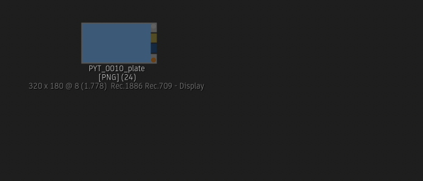
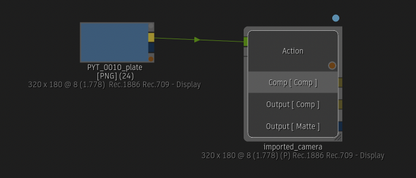
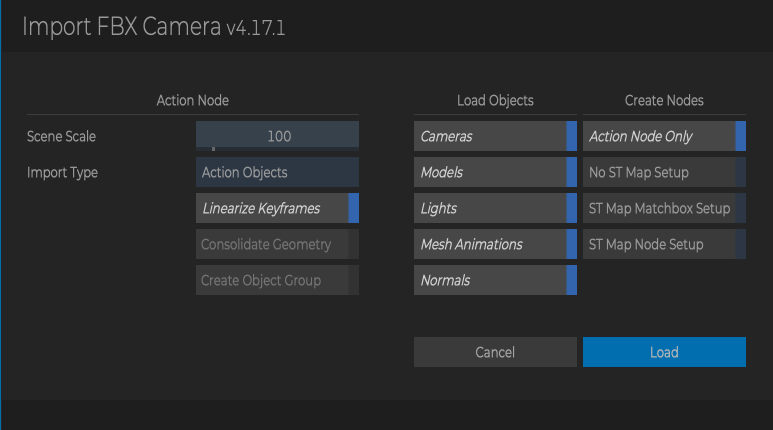
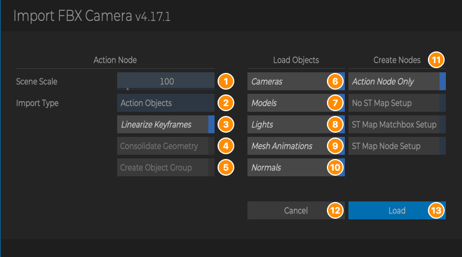
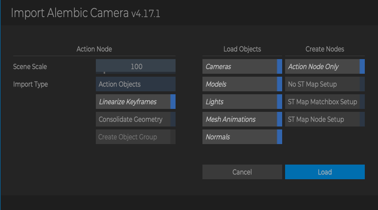
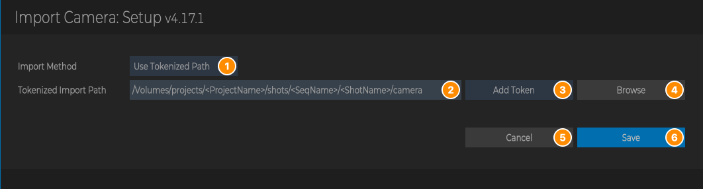
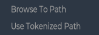
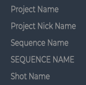
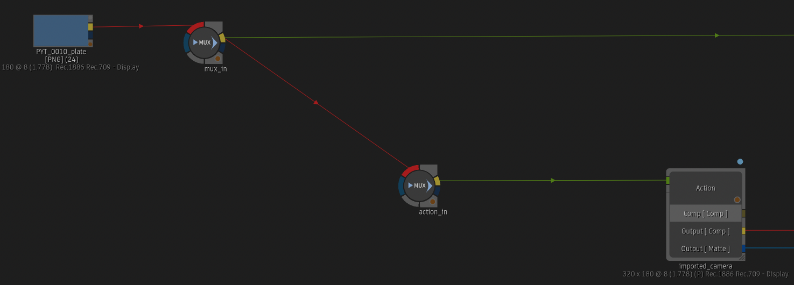
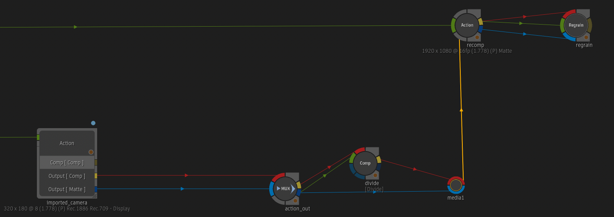

# Import Camera

**Script Version:** 4.17.2  
**Flame Version:** 2025.2  
**Written by:** Michael Vaglienty  
**Creation Date:** 06.02.18  
**Update Date:** 11.06.26  

**Script Type:** Batch

## Description

Creates a new Action node setup with selected FBX or Alembic file loaded.

## URL

https://logik-portal.com/scripts/import_camera

## Menus

- Flame Main Menu → Logik → Logik Portal Script Setup → Import Camera Setup
- Right-click in Batch or on a selected node → Import... → Import FBX Camera
- Right-click in Batch or on a selected node → Import... → Import Alembic Camera

## Installation

Copy script into /opt/Autodesk/shared/python/import_camera

---

# User Guide

<!-- user-guide: v4.17.2 11.06.26 -->

## Contents

- [Overview](#overview)
- [Requirements and Installation](#requirements-and-installation)
- [Where to Find It](#where-to-find-it)
- [The Import Options Window](#the-import-options-window)
- [The Setup Window](#the-setup-window)
- [The Node Setups](#the-node-setups)
- [How Importing Works](#how-importing-works)
- [Workflows](#workflows)
- [Tips, Troubleshooting and FAQ](#tips-troubleshooting-and-faq)

## Overview

Import Camera brings a 3D camera track (an FBX or Alembic file from a tracking or 3D app) into Batch. It creates an Action node called `imported_camera` with the file loaded, and can also build a whole comp setup around it: MUXes, a Divide comp, a recomp Action and a Regrain, with or without an ST Map undistort / redistort.

Example: a plate `PYT_0010_plate` is in Batch, and the tracking department delivered `PYT_0010_camera_v001.fbx`.

1. Select the plate node, right-click and choose **Import... → Import FBX Camera**.
2. Pick the FBX file in Flame's file browser.
3. In the options window, keep **Action Node Only** and click **Load**.

Before:

After: an Action node `imported_camera` with the camera, models and lights from the FBX, placed to the right of the plate and connected to it.

The import options window:

## Requirements and Installation

- Flame 2025.1 or newer. The menus don't appear in older versions.
- Copy the whole `import_camera` folder (with its `lib` and `assets` folders) into `/opt/Autodesk/shared/python`, so the script is at `/opt/Autodesk/shared/python/import_camera/import_camera.py`.
- In Flame, rescan Python hooks (or restart Flame) so the menus appear.
- If the script folder isn't named `import_camera`, or Flame can't write to it, the script stops and shows a message when you run it. The script needs to write to its folder: during an import it makes a `temp` folder there and removes it when the import is done or cancelled.
- The `assets` folder must be complete. It holds the Action setups loaded into the new Action nodes and the `uvmap_3vis` Matchbox used by the ST Map Matchbox Setup.

## Where to Find It

| Where | Right-click on | Menu | What it does |
| --- | --- | --- | --- |
| Batch | Anywhere in the Batch schematic, or on a selected node | Import... → **Import FBX Camera** | Opens Flame's file browser for an `.fbx` file, then the import options window. |
| Batch | Anywhere in the Batch schematic, or on a selected node | Import... → **Import Alembic Camera** | Opens Flame's file browser for an `.abc` file, then the import options window. |
| Flame Main Menu | | Logik → Logik Portal Script Setup → **Import Camera Setup** | Opens the Setup window, where you choose where the file browser starts. |

Notes:

- In the **Import...** submenu, **Import FBX Camera** is listed before **Import Alembic Camera**.
- **Where the new nodes go:**
  - If a node is selected, the new setup is placed about 300 pixels to the right of it and connected to it. Only the first selected node is used. Select the plate (or the node with the plate's resolution) you want the camera to work on.
  - If nothing is selected, the new setup is placed at the cursor position.

## The Import Options Window

This window opens after you pick a file in the browser. The title says **Import FBX Camera** or **Import Alembic Camera**.

| # | Part | What it does |
| --- | --- | --- |
| 1 | **Scene Scale** | How many pixels one unit of the 3D scene becomes in Action (1 to 1000, default 100). Drag to change it, or click it to type a value. |
| 2 | **Import Type** | **Action Objects** imports the file's objects into Action as separate nodes you can edit. **Read File** keeps the file linked as a read file in Action. |
| 3 | **Linearize Keyframes** | Sets the extrapolation of the imported camera's position, rotation and scale channels to linear, and sets every animation curve of that camera to linear interpolation. This helps with motion blur on the first and last frames. Only available with **Action Objects**, and only applied when **Cameras** (6) is on. See the known issue in [Tips, Troubleshooting and FAQ](#tips-troubleshooting-and-faq). |
| 4 | **Consolidate Geometry** | Alembic only. Consolidates the geometry into a single object. Greyed out for FBX files and for **Read File**. |
| 5 | **Create Object Group** | Alembic only. Creates a group for each object in the Alembic file. Only available when **Consolidate Geometry** (4) is on. |
| 6 | **Cameras** | Load the cameras from the file. |
| 7 | **Models** | Load the models (geometry) from the file. |
| 8 | **Lights** | Load the lights from the file. |
| 9 | **Mesh Animations** | Load mesh animations from the file. |
| 10 | **Normals** | Load the normals from the file. |
| 11 | **Create Nodes** | Choose one setup to build: **Action Node Only**, **No ST Map Setup**, **ST Map Matchbox Setup** or **ST Map Node Setup**. Only one can be on. See [The Node Setups](#the-node-setups). |
| 12 | **Cancel** | Closes the window without importing. (Escape does the same.) |
| 13 | **Load** | Saves the options, imports the file and builds the chosen setup. (Return does the same.) |

The buttons under **Load Objects** (6 to 10) are on when they are highlighted, and apply to both Import Types.

The same window for an Alembic file, where **Consolidate Geometry** can be turned on:

Which buttons can be used:

| File | Import Type | Linearize Keyframes | Consolidate Geometry | Create Object Group |
| --- | --- | --- | --- | --- |
| FBX | Action Objects | Yes | No | No |
| FBX | Read File | No | No | No |
| Alembic | Action Objects | Yes | Yes | Only when Consolidate Geometry is on |
| Alembic | Read File | No | No | No |

### What is saved, and when

- **Load** saves every option in this window, so the window opens with the same choices next time. It also remembers the file you picked, so the next **Browse To Path** import starts at that file.
- **Cancel** (or Escape) saves nothing and removes the `temp` folder.
- Settings are stored in the script's `config/config.json` and are shared by FBX and Alembic imports.

## The Setup Window

Open it from **Flame Main Menu → Logik → Logik Portal Script Setup → Import Camera Setup**. It sets where Flame's file browser starts when you import a camera.

| # | Part | What it does |
| --- | --- | --- |
| 1 | **Import Method** | **Browse To Path**: the browser starts at the last camera file you imported (`/opt/Autodesk` the first time). **Use Tokenized Path**: the browser starts at the **Tokenized Import Path** (2), with its tokens filled in for the current batch group. |
| 2 | **Tokenized Import Path** | The folder to start in, with tokens such as `<ShotName>`. Only available with **Use Tokenized Path**. |
| 3 | **Add Token** | Menu of tokens. Choosing one inserts it into the Tokenized Import Path. |
| 4 | **Browse** | Opens Flame's file browser to pick a folder. The chosen folder replaces everything in Tokenized Import Path. Only available with **Use Tokenized Path**. |
| 5 | **Cancel** | Closes the window without saving. |
| 6 | **Save** | Saves the Import Method and the Tokenized Import Path and closes the window. (Return does the same.) |

The Import Method menu:

The Add Token menu:

| Add Token menu | Token |
| --- | --- |
| Project Name | `<ProjectName>` |
| Project Nick Name | `<ProjectNickName>` |
| Sequence Name | `<SeqName>` |
| SEQUENCE NAME | `<SEQNAME>` |
| Shot Name | `<ShotName>` |

> **Note:** A token with nothing to fill it in is left empty. For example, `<ProjectNickName>` in a project with no nickname leaves an empty part in the path (`/projects/Big_Job//shots`).

### What is saved, and when

- **Save** stores the Import Method and the Tokenized Import Path. **Cancel** stores nothing.
- An empty Tokenized Import Path can be saved. (The script is meant to stop you with an error, but the check looks for an option name that doesn't exist, so it never runs.)

## The Node Setups

Choose one under **Create Nodes** in the import options window. Every setup includes the camera Action, `imported_camera`. If a node name is already used in the batch group, a number is added to the new one (for example `imported_camera1`).

### Action Node Only

Only the `imported_camera` Action is created, with the file loaded. If a node was selected, it is connected to the Action's background input. See the [Overview](#overview) for before and after images.

### No ST Map Setup

A setup for adding 3D elements with the camera and comping them back over the original plate, with no lens distortion step. The same plate as in the Overview, with **No ST Map Setup** chosen:

- `mux_in`: the plate comes in here (from the selected node, if any).
- `action_in` → `imported_camera`: the plate is the background of the camera Action, where you add your 3D work.
- `action_out`: takes the Action's comp and matte outputs.
- `divide`: a Comp node in Divide mode, fed by the result and matte of `action_out`.
- `recomp`: an Action (collapsed) with the original plate as its background and the divided result as a media layer (`media1`) cut out by the matte.
- `regrain`: a Regrain node after `recomp`.

### ST Map Matchbox Setup

The same idea, with lens distortion handled by ST maps. The plate is undistorted before the camera Action and the result is redistorted before it is comped back over the original plate. It uses the `uvmap_3vis` Matchbox that comes with the script. You are asked for the undistort and redistort ST map EXRs (see [How Importing Works](#how-importing-works)). The nodes:

- `mux_in` (plate in) → `uvmap_3vis_undistort` (Matchbox) → `imported_camera`. The undistort map comes in through the `st_map_undistort_map` MUX.
- `mux` takes the Action's comp and matte outputs.
- `uvmap_3vis_redistort` and `uvmap_3vis_redistort_matte` (Matchbox) redistort the result and its matte, using the redistort map from the `st_map_redistort_map` MUX.
- `divide` (Comp in Divide mode) → `comp` (an Action with the original plate as background and the redistorted result as a media layer) → `regrain`.
- The two ST map clips are imported into the batch group's `st_maps` schematic reel (made if it doesn't exist) and placed next to their MUXes.

### ST Map Node Setup

Like the ST Map Matchbox Setup, but it uses Flame's own **STMap** node (`st_map_undistort` and `st_map_redistort`) instead of the Matchbox. The redistort STMap node gives the matte as well, so there is no separate matte node. The other nodes (`mux_in`, `st_map_undistort_map`, `mux`, `divide`, `st_map_redistort_map`, `comp`, `regrain`) and the `st_maps` reel are the same.

For both ST Map setups, select the plate (or a node with the plate's resolution) before importing. Without a selection you get a warning first.

## How Importing Works

1. You choose **Import FBX Camera** or **Import Alembic Camera**. A `temp` folder is created in the script folder.
2. Flame's file browser opens: at the last camera file you imported with **Browse To Path**, or at the Tokenized Import Path filled in for the current batch group with **Use Tokenized Path**. Only `.fbx` or `.abc` files are shown. If you cancel the browser, the import stops and the `temp` folder is removed.
3. The import options window opens. When you click **Load**, the options are saved and the window hides.
4. For the ST Map setups only:
   1. With nothing selected in Batch, a warning asks whether to continue.
   2. A message asks you to select the undistort ST map, and the browser opens in the camera file's folder. Only `.exr` files are shown. The path must contain the word `undistort` (any case), or you get an error.
   3. The script looks for the redistort map by itself, in the undistort map's folder and every folder below it, for a non-hidden file with `redistort` (any case) in its name. It doesn't check the file type. Within one folder the first match is taken, but a match in any folder searched later replaces it, so when several folders hold a match, the one in the last folder searched is used.
   4. If none is found, a message asks you to select the redistort ST map and the browser opens again. Its title still says **Load Undistort ST Map (EXR)**. The path must contain `redistort`, or you get an error.
   5. Both maps are imported into the `st_maps` schematic reel.
   6. If you cancel a browser or pick a file with the wrong name, the options window comes back so you can try again or choose another setup.
5. The `imported_camera` Action is created, loaded with the script's Action setup (which adds the Comp, Output Comp and Output Matte outputs), placed, and connected to the selected node.
6. The file is imported with the options from the window: **Action Objects** imports it, **Read File** reads it.
7. If **Linearize Keyframes**, **Cameras** and **Action Objects** are all on, the camera's animation is set to linear. Only the first camera in the file is changed.
8. The rest of the chosen setup is built and connected.
9. The window closes and the `temp` folder is removed.

## Workflows

### Import a camera onto a plate

1. In Batch, select the plate node.
2. Right-click → **Import... → Import FBX Camera** (or **Import Alembic Camera**).
3. Pick the camera file.
4. Check **Scene Scale** and the objects to load, choose **Action Node Only** and click **Load**.

### Build a recomp setup

1. Select the plate node.
2. Import the camera as above, but choose **No ST Map Setup**.
3. Do your 3D work in `imported_camera`. The result is comped back over the plate in `recomp` and regrained in `regrain`.

### Import a camera with lens distortion

1. Put the undistort and redistort ST map EXRs in the same folder (or the redistort map in a folder below it). Their names must contain `undistort` and `redistort`.
2. Select the plate node.
3. Import the camera and choose **ST Map Node Setup** (or **ST Map Matchbox Setup**). Click **Load**.
4. Click **Ok** on the "Select Undistort ST Map" message and pick the undistort map. The redistort map is found automatically when it's in that folder.

### Keep a camera file linked instead of importing it

Choose **Read File** under **Import Type**. Linearize Keyframes and the Alembic buttons are greyed out.

## Tips, Troubleshooting and FAQ

**The camera is far too big or too small in Action.**
Change **Scene Scale** and import again. It's the number of pixels one scene unit becomes.

**Linearize Keyframes is greyed out.**
It only works with **Import Type → Action Objects**.

**The ST map setup didn't line up with my plate.**
Select the plate (or a node with the plate's resolution) before importing, so the setup is connected to it.

**The wrong redistort map was used.**
The search looks at any file with `redistort` in its name in the undistort map's folder and the folders below it. Each folder with a match replaces the match from the folders searched before, so the match in the last folder searched is used. Keep only one redistort map in that folder tree.

**I cancelled the ST Map warning and the window disappeared.**
This is a known bug in this version: the options window stays hidden, nothing is imported, and the `temp` folder is left in the script folder. Select the plate and run the import again.

**Known issue: Linearize Keyframes and curve settings.**
When it sets a curve to linear, the script writes `CurveOrder linear` without a line break, so the next line of the saved camera setup (its tangent mode) is joined onto it before the setup is reloaded. How Flame reads that joined line hasn't been checked. If the camera's curves look wrong after importing, import again with **Linearize Keyframes** off.

**My file has several cameras.**
All of them are imported, but **Linearize Keyframes** only changes the first one.

**My file has no camera.**
Turn **Cameras** or **Linearize Keyframes** off. Linearize looks for an imported camera and may stop with an error when there is none.

**Is there a `temp` folder in the script folder?**
The script makes it during an import and removes it at the end. It can be left behind when an import stops early (for example after the ST Map warning is cancelled). It's safe to delete when no import is running.

## Updates

### v4.17.2 [11.06.26]
- Fixed Use Tokenized Path: the script called pyflame.resolve_path_tokens, which no longer exists in PyFlameLib. It now uses pyflame.resolve_tokens.
 

### v4.17.1 [10.13.26]
- Updated to PyFlameLib v5.5.3 - Fixes screenGeometry error with Flame 2027.2.
- Changed license from GPL-3.0 to MIT. See LICENSE file for details.
 

### v4.17.0 [06.22.26]
- Updated to PyFlameLib v5.4.0.
- Fixed calculator issues in Linux.
 

### v4.16.0 [08.27.25]
- Updated to PyFlameLib v5.0.0.
- Escape key closes main window.
- Added warning message when importing ST Map Matchbox Setup without background clip or node with background resolution selected. ST Map and camera track aren't applied properly without the background clip or node with background resolution selected.
 

### v4.15.0 [03.12.25]
- Updated to PyFlameLib v4.3.0.
 

### v4.14.0 [12.27.24]
- Updated to PyFlameLib v4.0.0.
- Updated SCRIPT_PATH to use absolute path. Allows script to be installed in different locations.
- Script now only works with Flame 2023.2+.
 

### v4.13.0 [08.04.24]
- Updated to PyFlameLib v3.0.0.
 

### v4.12.0 [05.09.24]
- Added two new options for working with ST Maps:
    - ST Map Matchbox Setup - Uses UVMap_3vis matchbox for undistort and redistort.
    - ST Map Node Setup - Flame 2025+ only. Uses Flame ST Map node for undistort and redistort.
- Removed Action node ST Map setup option.
- Added new buttons (These are not enabled when Import Type is Read File):
    - Linearize Keyframes - Set camera keyframes to linear. Helps with motion blur on first and last frames.
    - Consolidate Geometry - Alembic setting only. Consolidates geometry into a single object.
    - Create Object Group - Alembic setting only. Creates a group for each object in the Alembic file.
    - Load objects - Choose which objects to load from FBX/Alembic file:
        - Cameras
        - Models
        - Lights
        - Mesh Animations
        - Normals
- Fixed Tokenzied path not working properly.
- Fixed Linearize keyframes. Was crashing script when applied to loading FBX/ABC files as Read Files.
- Cleaned up duplicate node naming code.
 

### v4.11.2 [02.25.24]
- Misc UI fixes.
 

### v4.11.1 [01.29.24]
- Fixed PySide6 errors/font in slider calculator.
 

### v4.11.0 [01.02.24]
- Updates to UI/PySide.
 

### v4.10.0 [07.26.23]
- Updated to pyflame lib v2.0.0.
 

### v4.9.1 [06.26.23]
- Updated script versioning to semantic versioning.
- Load button is now blue.
- Pressing return in the main window will now load the selected camera.
 

### v4.9 [03.14.23]
- Fixed: ST Map Setup - Resize node setup is not being saved with correct name in 2024.
 

### v4.8 [02.04.23]
- Added check to make sure script is installed in the correct location.
 

### v4.7 [01.17.23]
- Moved setup menu for Flame 2023.2+ to: Flame Main Menu -> Logik -> Logik Portal Script Setup -> Import Camera Setup
- Fixed not being able to load setup window.
- Updated config file loading/saving.
- Fixed: ST Map Setup - Selecting an image other than the undistort map would cause the script to fail.
 

### v4.6 [01.02.23]
- Fixed not being able to select Alembic files in the import browser.
- Minimum Flame version is now 2022.3.
- Ability to set tokenized path to always open browser to when importing: Flame Main Menu -> pyFlame -> Import Camera Setup. By default this is turned off.
- Patch Setup button renamed to ReComp Setup for clarity.
 

### v4.5 [07.28.22]
- Camera keyframe extrapolation is now set to linear to help with motion blur.
 

### v4.4 [05.26.22]
- Added new flame browser window - Flame 2023.1 and later.
- Messages print to Flame message window - Flame 2023.1 and later.
 

### v4.3 [03.15.22]
- Moved UI widgets to external file.
 

### v4.2 [02.25.22]
- Updated UI for Flame 2023.
- Updated config to XML.
 

### v4.1 [01.04.22]
- Files starting with '.' are ignored when searching for undistort map after distort map is selected.
 

### v4.0 [05.22.21]
- Updated to be compatible with Flame 2022/Python 3.7.
- Redistort map will automatically be found if in the same folder as undistort map.
- Speed improvements.
 

### v3.6 [02.21.21]
- Updated UI.
- Improved calculator.
- Plate resize node in ST Map Setup now takes ratio from st map.
 

### v3.5 [01.25.21]
- Added ability to import Alembic(ABC) files.
- Fixed UI font size for Linux.
 

### v3.4 [11.05.20]
- Updates to paths and description for Logik Portal.
 

### v3.3 [10.18.20]
- ST Map search no longer case sensitive.
- If ST Map not found, file browser will open to manually select.
 

### v3.2 [10.12.20]
- Improved spinbox with calculator.
 

### v3.1 [09.26.20]
- Updated UI
- Import FBX with Patch Setup - Will import FBX into an Action node and also create other nodes to re-comp work done in FBX Action over original background.
- Import FBX with ST map Setup - Will import FBX into an Action node and also build a undistort/redistort setup using the ST maps. ST maps must be in the same folder or sub-folder of FBX camera for this to work. ST Maps should also contain 'undistort' or 'redistort' in their file names.
 

### v3.0 [06.06.20]
- Code re-write
- Add FBX Action under cursor position
- Fixed UI in Linux
