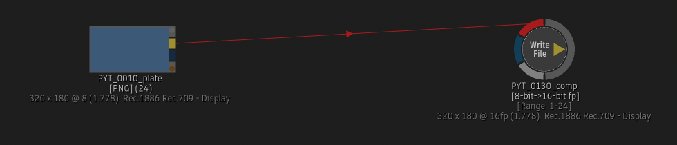
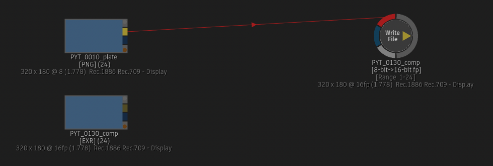
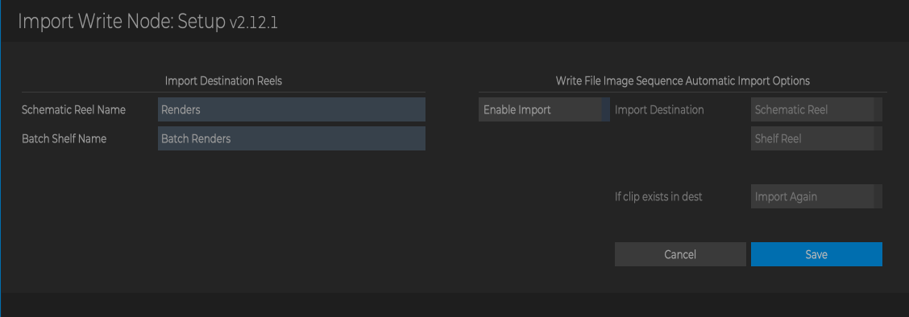
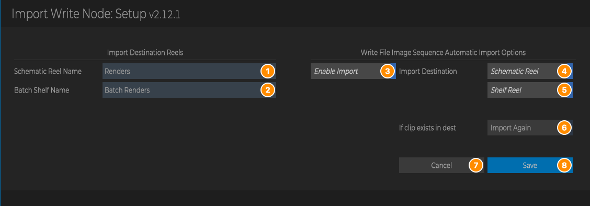

# Import Write Node

**Script Version:** 2.12.2  
**Flame Version:** 2025.1  
**Written by:** Michael Vaglienty  
**Creation Date:** 05.26.19  
**Update Date:** 11.03.26  

**Script Type:** Batch

## Description

Import open clip created by selected write node into batch schematic reel or shelf reel or auto-import write node image sequence when render is complete.

## URL

https://logik-portal.com/scripts/import_write_node

## Menus

- Flame Main Menu → Logik → Logik Portal Script Setup → Import Write Node Setup
- Right-click on a Write File node in Batch → Import... → Import Open Clip to Batch
- Right-click on a Write File node in Batch → Import... → Import Open Clip to Renders Reel

## Installation

Copy script folder into /opt/Autodesk/shared/python

---

# User Guide

<!-- user-guide: v2.12.2 11.03.26 -->

## Contents

- [Overview](#overview)
- [Requirements and Installation](#requirements-and-installation)
- [Where to Find It](#where-to-find-it)
- [The Setup Window](#the-setup-window)
- [How Importing Works](#how-importing-works)
- [Workflows](#workflows)
- [Messages and What to Do](#messages-and-what-to-do)
- [Tips, Troubleshooting and FAQ](#tips-troubleshooting-and-faq)

## Overview

Import Write Node brings what a Batch **Write File** node has rendered back into Batch, so you don't have to find it in the MediaHub.

It does this in two ways:

- **From the right-click menu.** Right-click a Write File node and import the **open clip** (`.clip` file) the node writes, either into a schematic reel (which also adds a clip node to the schematic) or into a Batch shelf reel. An open clip can hold every version the node has rendered, so you get one clip you can switch versions on.
- **Automatically after a render.** When **Enable Import** is on in Setup, the image sequence a Write File node has just rendered is imported into the schematic reel and/or the shelf reel as soon as the render finishes.

Example: batch group `PYT_0130_comp` has a Write File node `PYT_0130_comp` with **Create Open Clip** on. After rendering it, you right-click the node and choose **Import... → Import Open Clip to Batch**.

Before:

After: the open clip is now in the schematic reel **Renders** (created because it didn't exist yet), and a clip node for it has been added to the schematic, ready to view or compare against the plate.

The reel names and the automatic import are set in the Setup window:

## Requirements and Installation

- Flame 2025.1 or newer. The menus don't appear in older versions.
- Copy the whole `import_write_node` folder (with its `lib` and `assets` folders) into `/opt/Autodesk/shared/python`, so the script is at `/opt/Autodesk/shared/python/import_write_node/import_write_node.py`.
- In Flame, rescan Python hooks (or restart Flame) so the menus appear.
- If the script folder isn't named `import_write_node`, or Flame can't write to it, the script shows a message when you run it, and a Python error follows in the console because the script doesn't stop cleanly. The same check also runs after every Write File render in Batch, so a misnamed or read-only script folder shows the message plus a console error after each such render, even with **Enable Import** off. Check the folder name and its permissions.
- To use the right-click import, turn on **Create Open Clip** in the Write File node, so it writes a `.clip` file.

## Where to Find It

| Where | Right-click on | Menu | What it does |
| --- | --- | --- | --- |
| Flame Main Menu | | Logik → Logik Portal Script Setup → **Import Write Node Setup** | Opens the Setup window: reel names and the automatic import after render. |
| Batch | A Write File node | Import... → **Import Open Clip to Batch** | Imports the node's open clip into the schematic reel set in Setup and adds a clip node for it to the schematic. |
| Batch | A Write File node | Import... → **Import Open Clip to Renders Reel** | Imports the node's open clip into the Batch shelf reel set in Setup. |

Notes:

- The **Import...** menu appears when at least one of the selected nodes is a Write File node.
- Select **one** Write File node. Only the first selected node is imported; any other selected Write File nodes are skipped without a message. If the first selected node is not a Write File node (for example a Blur node selected together with a Write File node), the import is likely to fail with a Python error in the console.
- The automatic import has no menu. Once **Enable Import** is on in Setup, it runs by itself after Write File renders in Batch.

## The Setup Window

Open it from **Flame Main Menu → Logik → Logik Portal Script Setup → Import Write Node Setup**.

The parts on the right are greyed out until **Enable Import** is on. Here it is with Enable Import on:

| # | Part | What it does |
| --- | --- | --- |
| 1 | **Schematic Reel Name** | The schematic reel that clips are imported into, by **Import Open Clip to Batch** and by the automatic import. Default: `Renders`. The reel is created in the batch group if it doesn't exist. |
| 2 | **Batch Shelf Name** | The Batch shelf reel that clips are imported into, by **Import Open Clip to Renders Reel** and by the automatic import. Default: `Batch Renders` (the shelf reel new batch groups have). The reel is created if it doesn't exist. |
| 3 | **Enable Import** | Turns the automatic import after render on or off. Off by default. |
| 4 | **Schematic Reel** | When on, the automatic import puts the rendered image sequence into the schematic reel (1). On by default. |
| 5 | **Shelf Reel** | When on, the automatic import puts the rendered image sequence into the shelf reel (2). On by default. |
| 6 | **Import Again** | What the automatic import does when the reel already has a clip with the same name. Off: that reel is skipped, so each render is imported only once. On: the clip is imported again, giving a second copy. Off by default. |
| 7 | **Cancel** | Closes the window without saving. (Escape does the same.) |
| 8 | **Save** | Saves the settings and closes the window. (Return does the same.) |

### What is saved, and when

- Settings are saved only when you click **Save** (or press Return). **Cancel** and Escape keep the old settings.
- The settings are read again every time you use a menu or a render finishes, so a change takes effect straight away.
- The reel names aren't checked. Type them exactly as you want the reels to be named; a different spelling or case creates a new reel.
- The first time the script runs, it writes a settings file with the defaults above into its `config` folder.

## How Importing Works

### Finding the open clip

For the right-click import, the script works out where the Write File node's open clip is. It takes the node's **Media Path** and adds the node's **Create Open Clip** path pattern with these tokens filled in, then `.clip`:

| Token | Becomes | Example |
| --- | --- | --- |
| `<project>` | The Flame project name | `Big_Job` |
| `<project nickname>` | The Flame project nickname | `BJ` |
| `<batch name>` | The batch group name | `PYT_0010_comp` |
| `<batch iteration>` | The batch group's current iteration | `PYT_0010_comp_v003` |
| `<version name>` | Same as `<batch iteration>` | `PYT_0010_comp_v003` |
| `<name>` | The Write File node's name | `PYT_0010_comp` |
| `<shot name>` | The Write File node's shot name | `PYT_0010` |
| `<ext>` | Removed (becomes nothing) | |

For example, Media Path `/Volumes/projects/Big_Job/renders/` with the open clip pattern `<shot name>/<name>` gives `/Volumes/projects/Big_Job/renders/PYT_0010/PYT_0010_comp.clip`.

Notes:

- Any other token in the open clip pattern is left as it is, so the file isn't found and you get **Open clip not found**.
- The console shows the media path, the pattern and the path the script built (`Open clip translated path: ...`). Compare it with the real `.clip` file when an import fails.

### Import Open Clip to Batch

1. Finds the open clip as above. If the file doesn't exist, shows **Open clip not found** with the path, and stops.
2. Creates the schematic reel named in Setup if the batch group doesn't have it.
3. Imports the open clip into that reel and adds a clip node for it to the schematic.

Each run imports the clip again, so running it twice gives two clips in the reel and two clip nodes.

### Import Open Clip to Renders Reel

1. Finds the open clip as above. If the file doesn't exist, shows **Open clip not found** (without the path), and stops.
2. Creates the shelf reel named in Setup if the batch group doesn't have it.
3. Imports the open clip into that shelf reel. No node is added to the schematic.

Each run imports the clip again.

### Automatic import after render

Flame tells the script each time a Write File render in Batch finishes. Then:

- If **Enable Import** is off, nothing is imported. The console shows `Import write node not enabled. Nothing Imported.` after every such render.
- If it's on, the script takes the rendered image sequence (not the open clip) and:
  - with **Schematic Reel** on, imports it into the schematic reel (created if needed), which also adds a clip node to the schematic;
  - with **Shelf Reel** on, imports it into the shelf reel (created if needed).
- With **Import Again** off, a reel that already holds a clip with the same name as the render is skipped. With it on, the render is imported every time.

The import goes into the batch group that is open in Batch. The script doesn't check whether the render was stopped, so a render you abort may still be imported with the frames that were written.

## Workflows

### Import a render as an open clip

1. In the Write File node, turn on **Create Open Clip** and render.
2. Select only the Write File node, right-click it and choose **Import... → Import Open Clip to Batch**.
3. The clip appears in the **Renders** schematic reel (or the reel set in Setup) and as a new clip node in the schematic.

To put it in the Batch shelf instead, choose **Import... → Import Open Clip to Renders Reel**.

### Import every render automatically

1. Open **Flame Main Menu → Logik → Logik Portal Script Setup → Import Write Node Setup**.
2. Turn on **Enable Import**.
3. Choose where renders go: **Schematic Reel**, **Shelf Reel**, or both.
4. Leave **Import Again** off to import each render only once, or turn it on to import it every time.
5. Click **Save**.
6. Render Write File nodes as usual. Each finished render is imported.

### Use your own reel names

1. Open Setup.
2. Type the names in **Schematic Reel Name** and **Batch Shelf Name**, for example `Comps` and `Renders`.
3. Click **Save**. The next import creates the reels if the batch group doesn't have them.

## Messages and What to Do

### Pop-up messages

| Message | When | What to do |
| --- | --- | --- |
| `Open clip not found` `Write node export path:` `<path>` | **Import Open Clip to Batch**, when there is no `.clip` file at the path the script built. | Check that the node was rendered with **Create Open Clip** on, and that its open clip pattern only uses the tokens listed in [Finding the open clip](#finding-the-open-clip). |
| `Open clip not found` | **Import Open Clip to Renders Reel**, for the same reason. This one doesn't show the path. | As above. The path is shown in the console (`Open clip translated path: ...`). |
| `Script install path is incorrect:` `<script folder path>` `The name of the script folder should match the name of the main script file.` `Script install path should be:` `<correct path>` | Any menu, Setup, or after a Write File render in Batch, when the script folder isn't named `import_write_node`. A Python error follows in the console. | Rename the folder to `import_write_node` (or move it to the path shown) and rescan Python hooks. |
| `Script folder is not writable.` `Please check permissions and try again.` | Any menu, Setup, or after a Write File render in Batch, when Flame can't write to the script folder. A Python error follows in the console. | Fix the script folder's permissions. |

### Console messages

| Message | Meaning |
| --- | --- |
| `Open clip imported.` | Printed after either right-click import. It is also printed when the open clip wasn't found, so check for the pop-up message and the reel. |
| `Imported write node image sequence.` | The automatic import ran after a render. |
| `Import write node not enabled. Nothing Imported.` | A Write File render finished while **Enable Import** is off. Shown in red, but nothing is wrong; turn on Enable Import in Setup if you want renders imported. |
| `Open clip path not found.` | No node was passed to the import. |
| `Translating write node path...` followed by `media path:`, `pattern:` and `Open clip translated path:` | The values used to find the open clip. |

## Tips, Troubleshooting and FAQ

**I get "Open clip not found" but the node was rendered.**
Look at `Open clip translated path:` in the console and compare it with the real `.clip` file. The usual causes are a token the script doesn't fill in (see [Finding the open clip](#finding-the-open-clip)) or **Create Open Clip** being off.

**I selected several Write File nodes but only one was imported.**
Only the first selected node is imported. Run the menu once per node.

**The menu shows but the import fails with an error in the console.**
The first selected node is probably not a Write File node. Select only the Write File node and try again.

**Every render prints "Import write node not enabled" in red.**
That's the automatic import telling you it's off. It's harmless.

**The same render is in the reel twice.**
The right-click imports always import again. For the automatic import, turn **Import Again** off.

**Where is the shelf reel?**
In the batch group's **Batch Shelf** (in the Media Panel, under the batch group: **Batch Shelf → Batch Renders**), not with the schematic reels.

## Updates

### v2.12.2 [11.03.26]
- Fixed open clips not being found when the Write File node's Create Open Clip name uses `<batch iteration>` or `<version name>`. The batch iteration name was used with quote marks around it.
 

### v2.12.1 [10.13.26]
- Updated to PyFlameLib v5.5.3 - Fixes screenGeometry error with Flame 2027.2.
- Changed license from GPL-3.0 to MIT. See LICENSE file for details.
 

### v2.12.0 [03.30.26]
- Updated to PyFlameLib v5.3.0.
 

### v2.11.0 [07.10.25]
- Updated to PyFlameLib v5.0.0.
 

### v2.10.0 [04.10.25]
- Updated to PyFlameLib v4.3.0.
 

### v2.9.0 [12.31.24]
- Updated to PyFlameLib v4.0.0.
- Updated SCRIPT_PATH to use absolute path. Allows script to be installed in different locations.
- Script now only works with Flame 2023.2+.
 

### v2.8.0 [09.02.24]
- Updated to PyFlameLib v3.0.0.
 

### v2.7.0 [01.15.24]
- Updates to PySide.
- Updated to PyFlameLib v2.0.0.
- Updated script versioning to semantic versioning.
 

### v2.6 [03.02.23]
- Updated config file loading/saving.
- Updated menus for Flame 2023.2+
- Added check to make sure script is installed in the correct location.
 

### v2.5 [11.10.22]
- Fixed bug loading open clip when (ext) token is used in the Create Open Clip path.
 

### v2.4 [05.30.22]
- Messages print to Flame message window - Flame 2023.1 and later.
 

### v2.3 [04.13.22]
- Script renamed to: Import Write Node.
- Updated UI for Flame 2023.
- Moved UI widgets to external file.
 

### v2.1 [09.24.21]
- Added token translation for project nickname.
 

### v2.0 [05.25.21]
- Updated to be compatible with Flame 2022/Python 3.7.
 

### v1.5 [09.19.20]
- Pops up message box when open clip doesn't exist.
 

### v1.4 [07.01.20]
- Open clips can be imported to Batch Renders shelf reel - Batch group must have shelf reel called Batch Renders.
- Added token for version name.
 

### v1.3 [11.01.19]
- Right-click menu now appears under Import...
 

### v1.1 [09.29.19]
- Code cleanup.
