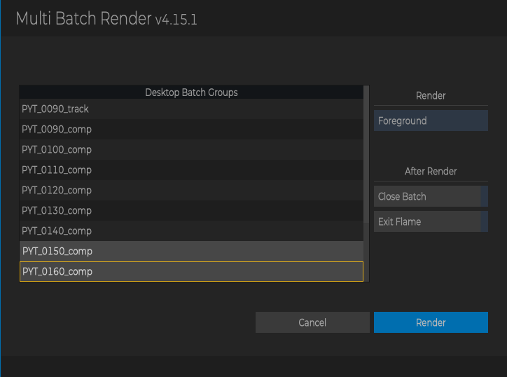
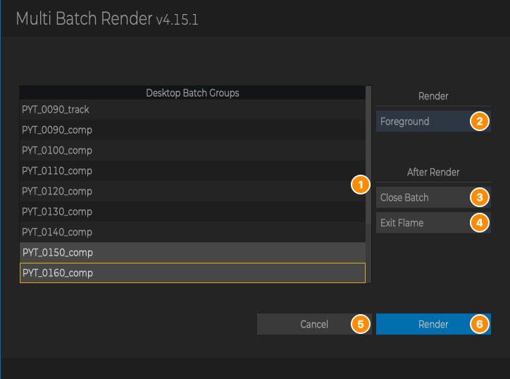

# Multi Batch Render

**Script Version:** 4.15.2  
**Flame Version:** 2025.2  
**Written by:** Michael Vaglienty  
**Creation Date:** 12.12.18  
**Update Date:** 11.03.26  

**Script Type:** Batch / Media Panel Desktop

## Description

Batch render multiple batch groups

## URL

https://logik-portal.com/scripts/multi_batch_render

## Menus

- Right-click in Batch → Multi-Batch Render
- Right-click selected batch groups on the Desktop in the Media Panel → Render Selected Batch Groups

## Installation

Copy script folder into /opt/Autodesk/shared/python

---

# User Guide

<!-- user-guide: v4.15.2 11.03.26 -->

## Contents

- [Overview](#overview)
- [Requirements and Installation](#requirements-and-installation)
- [Where to Find It](#where-to-find-it)
- [The Multi Batch Render Window](#the-multi-batch-render-window)
- [The Progress Window](#the-progress-window)
- [How Rendering Works](#how-rendering-works)
- [Workflows](#workflows)
- [Messages and What to Do](#messages-and-what-to-do)
- [Tips, Troubleshooting and FAQ](#tips-troubleshooting-and-faq)

## Overview

Multi Batch Render renders several batch groups on the Desktop one after another, so you don't have to open each batch group and press Render yourself.

For example, select `PYT_0150_comp` and `PYT_0160_comp` in the window and click **Render**. Multi Batch Render renders `PYT_0150_comp`, then `PYT_0160_comp`, and shows a progress window while it works. At the end the progress window says the renders are complete, or lists the batch groups that couldn't be rendered.

You can render in the foreground, or send the renders to the Background Reactor. You can also have Flame close the other batch groups while rendering, or exit Flame when everything is done (useful for overnight renders).

## Requirements and Installation

- Flame 2025.1 or newer. The menus don't appear in older versions.
- Copy the whole `multi_batch_render` folder (with its `lib` and `assets` folders) into `/opt/Autodesk/shared/python`, so the script is at `/opt/Autodesk/shared/python/multi_batch_render/multi_batch_render.py`.
- In Flame, rescan Python hooks (or restart Flame) so the menus appear.
- If the script folder isn't named `multi_batch_render`, or Flame can't write to it, the script shows a message when you run it and stops. A Python error then follows in the console; you can ignore it. Check the folder name and its permissions.
- Each batch group you want to render needs at least one **Render** or **Write File** node. Batch groups without one are skipped.
- To use **BG Reactor**, Flame's Background Reactor must be set up and running on your system.

## Where to Find It

| Where | Right-click on | Menu | What it does |
| --- | --- | --- | --- |
| Batch | Anywhere in the Batch schematic | **Multi-Batch Render** | Opens the Multi Batch Render window, where you choose which Desktop batch groups to render and how. |
| Media Panel | One or more batch groups on the Desktop | **Render Selected Batch Groups** | Starts rendering the selected batch groups straight away, with no window. |

Notes:

- Both items are near the top of the right-click menu (among the custom script items), with a separator line below them.
- **Render Selected Batch Groups** only appears when the selection includes a batch group that is on the Desktop. It doesn't appear for batch groups filed in a library or library folder.
- **Render Selected Batch Groups** has no window. It uses the **Render** and **Close Batch** settings last saved in the Multi Batch Render window (Foreground and Close Batch off until you change them). **Exit Flame** is never used by this menu.

## The Multi Batch Render Window

Open it from **Batch → right-click → Multi-Batch Render**.

| # | Part | What it does |
| --- | --- | --- |
| 1 | **Desktop Batch Groups** | Lists every batch group on the current Desktop. The batch group open in Batch is selected when the window opens. Select the batch groups to render: Cmd/Ctrl-click to add or remove one, Shift-click to select a range. |
| 2 | **Render** menu | **Foreground** renders each batch group in Flame, one after another, and you wait for them to finish. **BG Reactor** sends each batch group to the Background Reactor instead, so you can keep working while they render. |
| 3 | **Close Batch** | When on, all the other Desktop batch groups are closed before each batch group is rendered (see [How Rendering Works](#how-rendering-works)). |
| 4 | **Exit Flame** | When on, Flame exits when all the renders are done. You are asked to confirm when you click **Render**. |
| 5 | **Cancel** | Closes the window without rendering. (Escape does the same.) |
| 6 | **Render** | Renders the selected batch groups. (Return does the same.) The window closes and the progress window opens. |

The **Render** menu has two choices:

### What is saved, and when

- **Render** (Foreground / BG Reactor) and **Close Batch** are saved when you click **Render**. They are used the next time you open the window, and by the Media Panel **Render Selected Batch Groups** menu.
- **Cancel** doesn't save anything.
- **Exit Flame** is never saved. It is always off when the window opens.
- The settings are stored in the `config` folder inside the `multi_batch_render` script folder, so everyone using the same installed copy of the script shares them.

## The Progress Window

The progress window opens as soon as rendering starts. It shows how far it has got as `Rendering Batch: [<batch group number> of <total>] (<percent>%)`, for example `Rendering Batch: [2 of 2] (100.0%)` at the end (with BG Reactor the text starts `Submitting Batch Render to Background Reactor`), a progress bar, and the name of each batch group as it starts.

When everything is done:

- **Foreground:** the title changes to **Rendering Complete** and the text ends with `Rendering Complete`.
- **BG Reactor:** the title changes to **Submitting Renders Complete**. The renders themselves carry on in the Background Reactor.
- If one or more batch groups couldn't be rendered, the title changes to **Render Failed**, the line under the title turns yellow, and the text ends with `These batch groups failed to render:` followed by their names.
- If a batch group couldn't be sent to the Background Reactor, the title changes to **Render Failed**, the line turns red, and the text is replaced with `Failed to submit batch render to Background Reactor. Try rendering in Foreground.`

Click **Done** to close it.

## How Rendering Works

For each selected batch group, in turn, Multi Batch Render:

1. Opens the batch group and shows it in Batch. Batch is left on the batch group rendered last.
2. If **Close Batch** is on, closes every other batch group on the Desktop. (The tooltip says "after each render", but the closing happens before each render. The batch group rendered last stays open.)
3. Checks that the batch group has at least one Render or Write File node. If it has none, it is skipped and added to the failed list.
4. Replaces every Render and Write File node with a copy of itself and deletes the original. This works around a Flame problem where Render nodes sometimes stop rendering. The copy keeps the node's position, connections and Smart Replace setting. Only the batch group being rendered is changed. If it can't be shown in Batch, its nodes aren't replaced (a warning is printed) and it is rendered as it is.
5. Renders the batch group (Foreground), or sends it to the Background Reactor and waits one second before the next one, so no submission is missed.

Then the progress window shows the result.

### When a render fails or is stopped

- **Foreground:** clicking on the screen while a batch group is rendering stops the render. If a render is stopped, or fails for any other reason (for example a missing output folder), Multi Batch Render stops: the batch groups after it are **not** rendered, and the failed list is not shown. The progress window line turns red, the text ends with `Render aborted.` and **Done** is enabled. The console shows `<batch group>: Render failed - 
` and then `Render aborted.`
- **BG Reactor:** if a batch group can't be sent to the Background Reactor, the others are still sent, and the progress window shows the Background Reactor error at the end.
- A batch group with no Render or Write File node doesn't stop the others. It is listed as failed at the end.

### Exit Flame

With **Exit Flame** on, Flame exits when all the batch groups are done. Flame doesn't exit if a Foreground render was stopped or failed. The button's tooltip says "Save workspace and exit Flame", but the script doesn't save anything itself before it asks Flame to exit.

### Render Selected Batch Groups (Media Panel)

This menu renders the selected Desktop batch groups in their Desktop order, with the saved Render and Close Batch settings, and shows the same progress window. Other items in the selection (and batch groups not on the Desktop) are ignored.

The renders finish normally, and the progress window shows the result. Click **Done** to close it. This menu never exits Flame.

## Workflows

### Render a few batch groups now

1. In Batch, right-click and choose **Multi-Batch Render**.
2. Select the batch groups to render in **Desktop Batch Groups**.
3. Leave **Render** on **Foreground**.
4. Click **Render** and wait for the progress window to say **Rendering Complete**.
5. Click **Done**.

### Render overnight and exit Flame

1. Save your work first. The script doesn't save the workspace before exiting.
2. In Batch, right-click and choose **Multi-Batch Render**.
3. Select the batch groups, and turn on **Exit Flame**.
4. Click **Render** and confirm the `Exit Flame when render is complete?` message.

### Send renders to the Background Reactor

1. In Batch, right-click and choose **Multi-Batch Render**.
2. Select the batch groups and set **Render** to **BG Reactor**.
3. Click **Render**. When the progress window says **Submitting Renders Complete**, the renders are running in the Background Reactor and you can carry on working.

### Render from the Media Panel

1. Select the batch groups on the Desktop in the Media Panel.
2. Right-click and choose **Render Selected Batch Groups**.
3. Rendering starts at once, with the settings last saved in the Multi Batch Render window. To change them, open the window from Batch, change them and render once (or render from the window instead).

## Messages and What to Do

### Pop-up messages

| Message | When | What to do |
| --- | --- | --- |
| `Exit Flame when render is complete?` | **Render** in the window with **Exit Flame** on. | Confirm to render and exit Flame at the end, or cancel to go back to the window (nothing is rendered or saved). |
| `Script install path is incorrect:` `<script folder>` `The name of the script folder should match the name of the main script file.` `Script install path should be:` `<correct path>` | Any menu, when the script folder has been renamed. A Python error follows in the console. | Rename the folder to `multi_batch_render` and rescan Python hooks. |
| `Script folder is not writable.` `Please check permissions and try again.` | Any menu, when Flame can't write to the script folder. A Python error follows in the console. | Fix the folder's permissions. |

### Messages in the progress window

| Message | Meaning |
| --- | --- |
| `These batch groups failed to render:` followed by names | These batch groups had no Render or Write File node. The names are written one after another with no space between them. |
| `Render aborted.` | A Foreground render was stopped or failed. The batch groups after it were not rendered. |
| `Failed to submit batch render to Background Reactor. Try rendering in Foreground.` | At least one batch group couldn't be sent to the Background Reactor. Check that it is running, or render in Foreground. |

### Console messages

These appear in the console (the shell Flame was started from), not in a pop-up:

| Message | Meaning |
| --- | --- |
| `'<batch group>' has no render or write nodes. Skipping.` | The batch group has no Render or Write File node. It is skipped and listed as failed. |
| `<batch group>: Could not switch Batch to this batch group - 
` | Flame wouldn't show that batch group in Batch. It is still rendered. |
| `<batch group>: Not shown in Batch, Render/Write nodes not replaced.` | Its Render and Write File nodes were left as they were, and it is rendered as it is. |
| `<batch group>: Render failed - 
` | A Foreground render was stopped or failed. The remaining batch groups are not rendered. |
| `<batch group>: Submitted to Background Reactor` | The batch group was sent to the Background Reactor. |
| `Rendering Complete` / `Submitting Renders Complete` | All the selected batch groups are done. |
| `Render aborted.` | A Foreground render was stopped or failed. The batch groups after it were not rendered. |
| `Exiting Flame` | Exit Flame was on; Flame is exiting. |
| `Cancelled.` | The window was closed with Cancel or Escape. |

## Tips, Troubleshooting and FAQ

**Some batch groups weren't rendered and nothing was listed as failed.**
A Foreground render was stopped (for example by clicking on the screen) or failed, and Multi Batch Render stopped there. Check the console for `Render failed`, fix the problem and render the remaining batch groups again.

**A batch group is listed as failed, but it rendered fine before.**
It probably has no Render or Write File node. Check the console for `has no render or write nodes`, and add one.

**I selected batch groups in a library, and Render Selected Batch Groups isn't in the menu.**
The menu only works on batch groups on the Desktop. Move them to the Desktop first.

**I clicked Render with nothing selected.**
Select at least one batch group before you click **Render**. With nothing selected nothing is rendered, and if **Exit Flame** is on, Flame still exits (known bug, found by reading the code; not tested).

**Why do my Render and Write File nodes look new after rendering?**
Multi Batch Render replaces them with copies before rendering (see [How Rendering Works](#how-rendering-works)). Settings, position, connections and Smart Replace are kept, but they are new nodes. Only the batch groups that were rendered are changed.

**Two batch groups have the same name. Which one is selected when the window opens?**
The last one with that name in the list.

**Does Exit Flame save my work?**
The script doesn't save anything itself before asking Flame to exit. Save your project before starting an overnight render.

## Updates

### v4.15.2 [11.03.26]
- Fixed Render/Write nodes being replaced in the batch group shown in Batch instead of the one being rendered. Each batch group is now shown in Batch before its nodes are replaced and it is rendered.
- Fixed an error at the end of Render Selected Batch Groups (Media Panel).
 

### v4.15.1 [10.13.26]
- Updated to PyFlameLib v5.5.3 - Fixes screenGeometry error with Flame 2027.2.
- Changed license from GPL-3.0 to MIT. See LICENSE file for details.
 

### v4.15.0 [07.22.26]
- Updated to PyFlameLib v5.5.0.
- Misc UI updates.
 

### v4.14.0 [05.12.26]
- Clicking on the screen will now abort the batch render.
- Updated to PyFlameLib v5.3.1.
 

### v4.13.0 [07.10.25]
- Updated to PyFlameLib v5.0.0.
- Added Background Reactor render option.
- Escape key closes window.
 

### v4.12.0 [03.11.25]
- Updated to PyFlameLib v4.3.0.
 

### v4.11.0 [12.27.24]
- Updated to PyFlameLib v4.0.0.
- Script now only works with Flame 2023.2+.
- Updated SCRIPT_PATH to use absolute path. Allows script to be installed in different locations.
 

### v4.10.0 [08.04.24]
- Updated to PyFlameLib v3.0.0.
 

### v4.9.0 [01.21.24]
- Updates to UI/PySide.
 

### v4.8.0 [07.08.23]
- Updated to PyFlameLib v2.0.0.
 

### v4.7.1 [06.26.23]
- Updated script versioning to semantic versioning.
- Render button is now blue.
- Pressing return in main window will now start render.
 

### v4.7 [05.23.23]
- Fixed bug with Smart Replace getting turned off when rendering.
 

### v4.6 [02.04.23]
- Updated config file loading/saving.
- Added check to make sure script is installed in the correct location.
 

### v4.5 [09.06.22]
- Updated menus for Flame 2023.2+:
    - Right-click in batch -> Multi-Batch Render
    - Right-click selected batch groups in desktop -> Render Selected Batch Groups
 

### v4.4 [05.27.22]
- Messages print to Flame message window - Flame 2023.1+.
- Fixed Exit Flame button.
- Added confirmation dialog for Exit Flame button.
 

### v4.3 [03.14.22]
- Moved UI widgets to external file - Added new render progress window.
 

### v4.2 [02.25.22]
- Updated UI for Flame 2023.
- Updated config to XML.
- Burn button removed - no ability to test.
 

### v4.1 [05.19.21]
- Updated to be compatible with Flame 2022/Python 3.7.
 

### v3.5 [11.29.20]
- More UI enhancements / Fixed Font for Linux.
- Misc bug fixes.
- Batch groups that fail to render won't stop script. Failed batch group renders listed when all renders are complete.
 

### v3.2 [08.10.20]
- Updated UI.
 

### v3.1 [07.26.20]
- Save/Exit button added to main render window. This will save the project and exit Flame when the render is done.
- Fixed errors when attempting to render from desktop with multiple batch groups with same name.
 

### v3.0 [07.09.20]
- Fixed errors when attempting to render batch groups with no Render or Write nodes. These batch groups will now be skipped.
- Code cleanup.
 

### v2.91 [05.18.20]
- Render menu no longer incorrectly appears when selecting a batchgroup in a Library or Folder.
 

### v2.9 [02.23.20]
- Render window now centers in linux.
- Script auto replaces all render and write nodes. Works as a fix for when render/write nodes stop working in batch.
- Added menu to render current batch to batch menu. Render... -> Render Current - Use when getting errors with existing render and write nodes.
 

### v2.8 [02.09.20]
- Window can now be resized.
- Fixed bug with Close Batch After Rendering checkbox - showed as checked even after being unchecked.
- Burn button updated when checked or unchecked in setup.
 

### v2.7 [11.06.19]
- Menu now appears as Render... when right-clicking on batch groups and in the batch window.
- Removed menu that showed up in media panel when right clicking on items that could not be rendered.
 

### v2.6 [10.13.19]
- Add option in main setup that will close batch groups when renders are done.
- Removed menu that showed up when clicking on items in media panel that could not be rendered.
