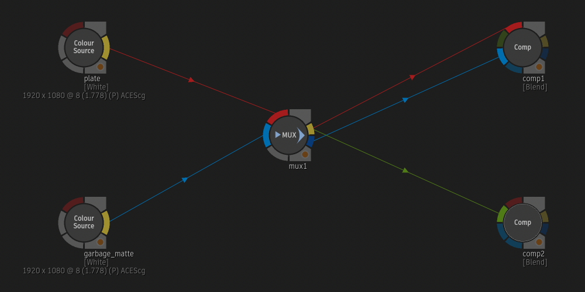
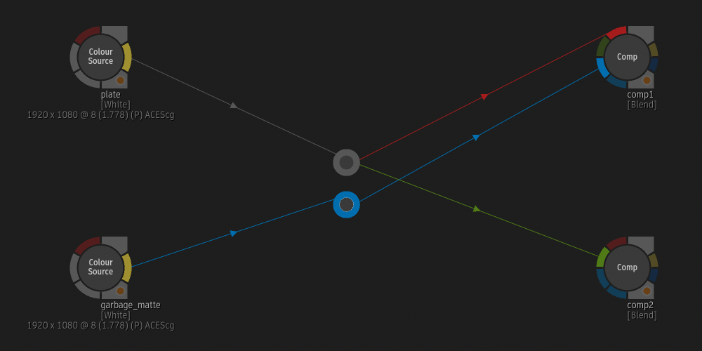
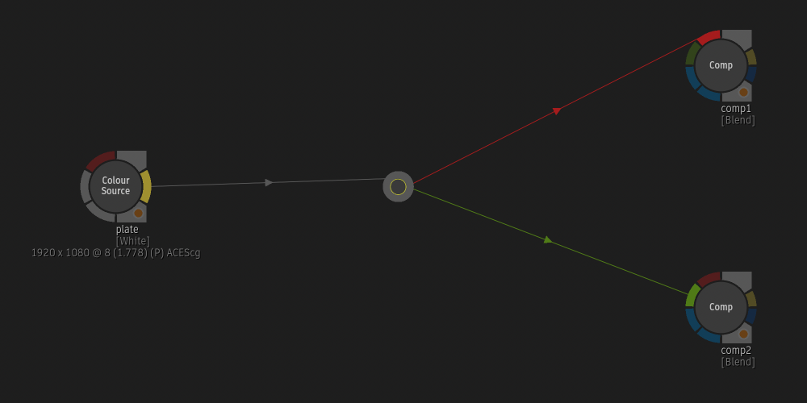
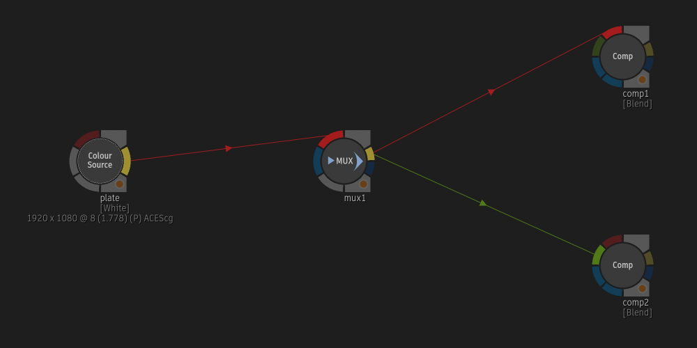

# Muxed Elbows

**Script Version:** 1.0.0  
**Flame Version:** 2027.2  
**Written by:** Michael Vaglienty  
**Creation Date:** 11.11.26  
**Update Date:** 11.11.26  

**Script Type:** Batch

## Description

Convert Mux nodes to Elbow nodes, or Elbow nodes to Mux nodes, keeping all connections.  
Each connected Mux input becomes its own Elbow. Each Elbow becomes a Mux connected through its Front input and Result output.  
Elbows can also become Mux nodes frozen at the current frame, named after that frame.  
Mux and Elbow nodes with no connections are skipped. If a node can't be converted, it's put back the way it was.

## URL

https://logik-portal.com/scripts/muxed_elbows

## Menus

- Right-click selected Mux nodes in Batch → MUX -> Elbow
- Right-click selected Elbow nodes in Batch → Elbow -> MUX
- Right-click selected Elbow nodes in Batch → Elbow -> Frozen MUX

## Installation

Copy script folder into /opt/Autodesk/shared/python

---

# User Guide

<!-- user-guide: v1.0.0 11.11.26 -->

## Contents

- [Overview](#overview)
- [Requirements and Installation](#requirements-and-installation)
- [Where to Find It](#where-to-find-it)
- [How It Works](#how-it-works)
- [Workflows](#workflows)
- [Tips, Troubleshooting and FAQ](#tips-troubleshooting-and-faq)

## Overview

Muxed Elbows swaps Mux nodes for Elbow nodes, and Elbow nodes for Mux nodes, without losing any connections. Use it to tidy a schematic: an Elbow is a small dot that only routes a link, while a Mux carries settings and a matte.

Example: a `plate` and a `garbage_matte` both go into `mux1`, and `mux1` feeds two Comp nodes:

Select `mux1`, right-click it and choose **MUX -> Elbow**. The Mux is replaced by two Elbows: one carries the plate (the Mux's front input) to both Comp nodes, and one carries the garbage matte (the Mux's matte input) to `comp1`'s matte input:

Going the other way, an Elbow between `plate` and two Comp nodes:

**Elbow -> MUX** replaces it with a Mux in the same place, wired through its front input:

**Elbow -> Frozen MUX** does the same, but the new Mux holds the frame Batch is on and is named after it, for example `freeze_frame_1012`.

The script has no windows. It runs straight away when you choose a menu item.

## Requirements and Installation

- Flame 2027.2 or newer. The menus don't appear in older versions.
- Copy the whole `muxed_elbows` folder (with its `lib` and `assets` folders) into `/opt/Autodesk/shared/python`, so the script is at `/opt/Autodesk/shared/python/muxed_elbows/muxed_elbows.py`.
- In Flame, rescan Python hooks (or restart Flame) so the menus appear.

## Where to Find It

| Where | Right-click on | Menu | What it does |
| --- | --- | --- | --- |
| Batch | One or more selected Mux nodes | **MUX -> Elbow** | Replaces each Mux with Elbow nodes. |
| Batch | One or more selected Elbow nodes | **Elbow -> MUX** | Replaces each Elbow with a Mux node. |
| Batch | One or more selected Elbow nodes | **Elbow -> Frozen MUX** | Replaces each Elbow with a Mux node frozen at the current frame. |

Notes:

- **MUX -> Elbow** only appears when every selected node is a Mux.
- **Elbow -> MUX** and **Elbow -> Frozen MUX** only appear when every selected node is an Elbow.
- If the selection mixes Mux and Elbow nodes, or has any other kind of node in it, neither menu appears. Select only one kind.

## How It Works

### MUX -> Elbow

For each selected Mux:

1. One Elbow is made for **each Mux input that has a connection**. A Mux with only its front input connected gives one Elbow. A Mux with its front and matte inputs connected gives two.
2. Each Elbow's input is connected to the same node and the same output that fed that Mux input.
3. The Mux's outputs are passed on:
   - Everything that was connected to the Mux's **Result** output is connected to the Elbow made for the Mux's **selected** front input.
   - Everything that was connected to the Mux's **OutMatte** output is connected to the Elbow made for the matching matte input.
   - An output can feed many nodes. Every one of those links is carried over.
4. The Elbows are placed where the Mux was, stacked one under the other.
5. The Mux is deleted.

**Muxes with extra inputs:** if inputs were added in the Mux's input switcher (front/matte pairs 0, 1, 2, ...), every connected input still gets its own Elbow. Only the Elbows for the input that was selected in the switcher take over the Mux's outputs. The others keep just their incoming link.

**Selected input not connected:** if the Mux's output is connected but the selected input isn't, an extra Elbow is made for that output, with nothing going into it. The links leaving the Mux aren't lost.

**Settings:** a Mux's settings (timing offset, range, input selection and so on) are not kept. An Elbow has no settings.

New Elbows get Flame's default names (`elbow1`, `elbow2`, ...).

### Elbow -> MUX

For each selected Elbow:

1. A new Mux is made with default settings, in the Elbow's place.
2. The node feeding the Elbow is connected to the Mux's front input (**Input_0**), from the same output.
3. Every node the Elbow fed is connected to the Mux's **Result** output, on the same input it used before.
4. Nothing is connected to the Mux's matte input or OutMatte output.
5. The Elbow is deleted.

New Muxes get Flame's default names (`mux1`, `mux2`, ...).

### Elbow -> Frozen MUX

The same as **Elbow -> MUX**, plus:

1. The new Mux is frozen at the frame Batch is on when you choose the menu item:

| MUX setting | Set to |
| --- | --- |
| Range | On |
| Range start | The current frame |
| Range end | The current frame |
| Before range | Repeat First |
| After range | Repeat Last |

2. It's named `freeze_frame_` plus the frame number, for example `freeze_frame_1012`. If that name is already taken, a number is added: `freeze_frame_1012_1`, `freeze_frame_1012_2`, and so on.

These are the same freeze settings the Add Mux script uses for **Add Freeze Frame MUX**.

### Nodes with no connections

A Mux or Elbow with nothing connected to it is left alone and listed in a message at the end.

### If something goes wrong

If a node can't be converted, the script puts it back the way it was: the new nodes made for it are removed and all its links are reconnected. The rest of the selection is still converted. One message at the end lists every node that failed.

## Workflows

### Replace Mux nodes with Elbows

1. Select the Mux nodes in Batch.
2. Right-click one of them and choose **MUX -> Elbow**.
3. Check the Elbows, especially for Muxes that had extra inputs in their input switcher.

### Replace Elbows with Mux nodes

1. Select the Elbow nodes in Batch.
2. Right-click one of them and choose **Elbow -> MUX**.
3. Set up each new Mux (range, timing and so on) as needed. They start with default settings.

### Hold one frame through an Elbow

1. In Batch, go to the frame you want to hold.
2. Select the Elbow nodes, right-click one of them and choose **Elbow -> Frozen MUX**.
3. Every node after the new `freeze_frame_<frame>` Mux now sees that one frame.

## Tips, Troubleshooting and FAQ

**I don't see the menu.**  
Check that you're on Flame 2027.2 or newer, that the `muxed_elbows` folder is in `/opt/Autodesk/shared/python`, and rescan Python hooks. Then check the selection: only Mux nodes for **MUX -> Elbow**, only Elbow nodes for **Elbow -> MUX** and **Elbow -> Frozen MUX**.

**One Mux turned into several Elbows.**  
That's by design: each connected Mux input gets its own Elbow, because an Elbow can only carry one link in.

**I converted Elbows back into Muxes and they sit on top of each other.**  
Each new Mux is placed exactly where its Elbow was. Elbows made from one Mux are stacked close together, so the Muxes made from them overlap. Move them apart in the schematic.

**My Mux settings are gone after converting to Elbows and back.**  
Elbows have no settings, so a Mux's settings can't survive the round trip. The new Mux starts with default settings.

**Can I convert Mux and Elbow nodes in one go?**  
No. Run **MUX -> Elbow** on the Muxes and **Elbow -> MUX** on the Elbows separately.

**Which frame does Elbow -> Frozen MUX use?**  
The frame Batch is on when you choose the menu item. To freeze at another frame later, change the Mux's range by hand (or use the Add Mux script's **Freeze Selected MUX**).

## Updates

### v1.0.0 [11.11.26]
- Initial release.
