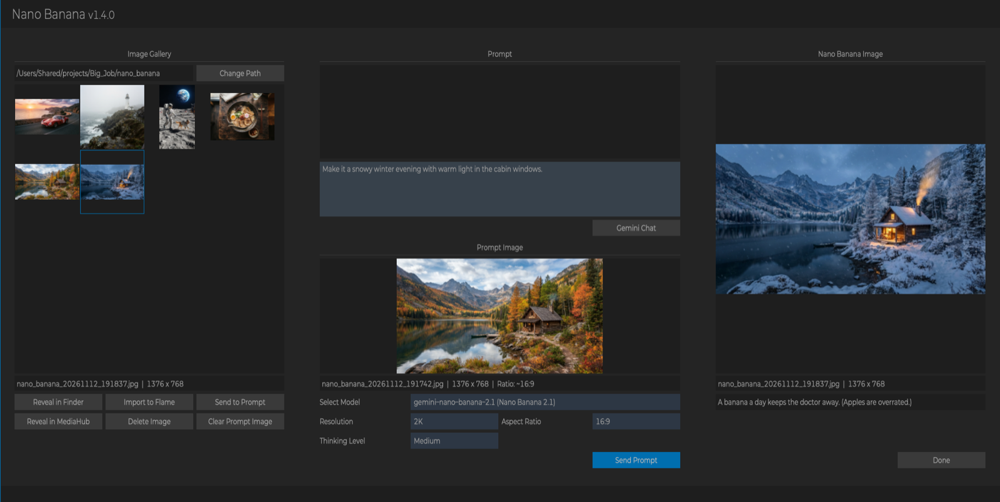
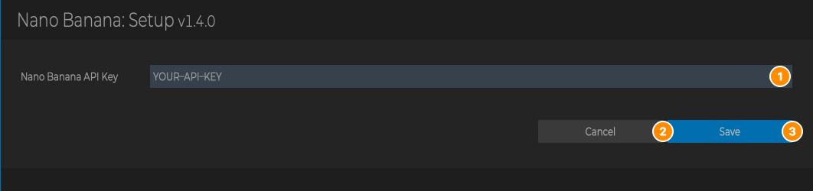
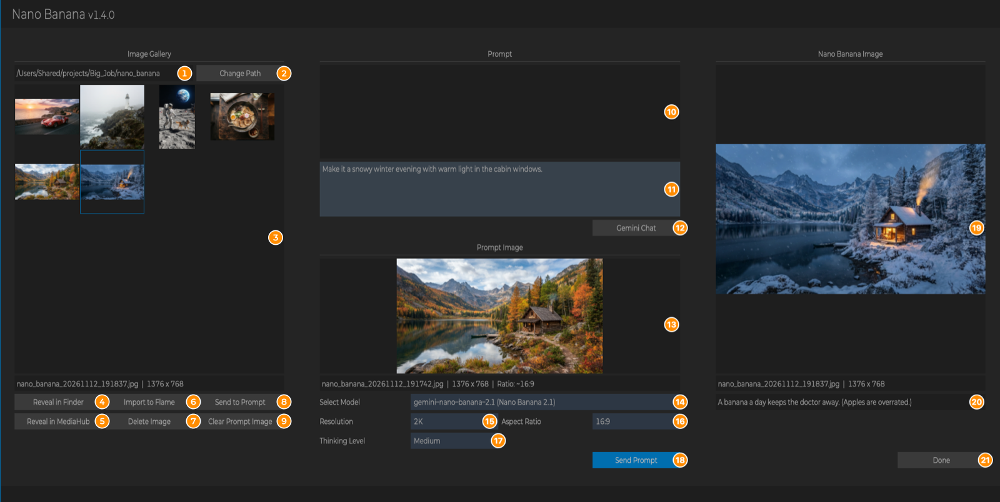
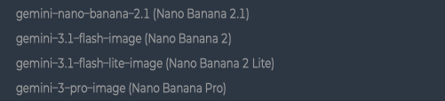
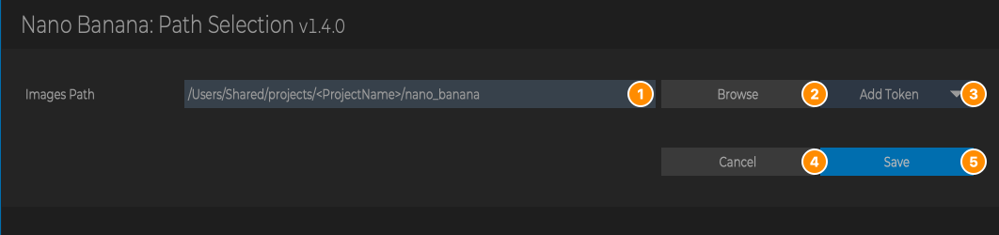
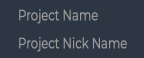

# Nano Banana

**Script Version:** 1.4.0  
**Flame Version:** 2025.2  
**Written by:** Michael Vaglienty  
**Creation Date:** 03.13.26  
**Update Date:** 11.12.26  

**Script Type:** Media Panel

## Description

Generate images using Nano Banana models.<br><br>
A valid Google/Gemini API key is required to use this script.<br><br>
Currently supported models:

- **Gemini Nano Banana 2.1 (Nano Banana 2.1)** - Default model
    - High-efficiency model with improved visual quality, text rendering and multi-turn consistency.
    - Supports 1K, 2K, and 4K resolutions.
    - Supports aspect ratios 1:1, 21:9, 16:9, 4:3, 3:2, 9:16, 3:4, 2:3, 5:4, 4:5.
    - Supports aspect ratios 1:4, 4:1, 1:8, 8:1.
    - Thinking levels: Minimal, Medium, High. Default: Medium.
- **Gemini 3.1 Flash Image (Nano Banana 2)**
    - Previous high-efficiency model. Still supported, Google recommends Nano Banana 2.1 for new work.
    - Supports 1K, 2K, 4K, and 512 (512px) resolutions.
    - Supports aspect ratios 1:1, 21:9, 16:9, 4:3, 3:2, 9:16, 3:4, 2:3, 5:4, 4:5.
    - Supports aspect ratios 1:4, 4:1, 1:8, 8:1.
    - Thinking levels: Minimal, High. Default: Minimal.
- **Gemini 3.1 Flash Lite Image (Nano Banana 2 Lite)**
    - Fastest and lowest cost model. Best for quick iteration.
    - Only supports 1K resolution.
    - Supports aspect ratios 1:1, 21:9, 16:9, 4:3, 3:2, 9:16, 3:4, 2:3, 5:4, 4:5.
    - Thinking levels: Minimal, High. Default: Minimal.
- **Gemini 3 Pro Image (Nano Banana Pro)**
    - Highest quality model. Best for complex prompts and rendering text in images.
    - Supports 1K, 2K, and 4K resolutions.
    - Supports aspect ratios 1:1, 21:9, 16:9, 4:3, 3:2, 9:16, 3:4, 2:3, 5:4, 4:5.
    - Thinking is always on and the level can't be set.

**Gemini Chat:**<br><br>
Send a message to chat with Gemini 3.8 Flash about creating an image. Great for improving prompts or describing images.
Enter a message in the prompt field and click the Gemini Chat button. The response will be displayed in the prompt
text window. Copy and paste any response into the prompt text field and use the Send Prompt button to send the prompt
to Nano Banana.<br><br>
**Images:**<br><br>
Returned images are saved as PNG or JPEG. Any other type Google returns (such as WebP, which Flame
can't read) is converted to PNG. The image gallery only shows PNG and JPEG files.<br><br>
**WARNING**<br>
Using this script will incur charges to your Nano Banana/Gemini account.
Please review your usage limits and pricing plan before proceeding.
Your API key will be stored unencrypted in the config file so be aware of who has access to it.<br><br>
Images are stored in `<script_path>/images/`. A tokenized path can be set with the Change Path
button in the main window to store images in a different location.
The folder images are saved to is shown at the top of the Image Gallery, next to the Change Path button.

## URL

https://logik-portal.com/scripts/nano_banana

## Menus

- Flame Main Menu → Logik → Logik Portal Script Setup → Nano Banana Setup
- Right-click in Media Panel → Nano Banana → Nano Banana (no prompt image)
- Right-click a clip or sequence in Media Panel → Nano Banana → Nano Banana (first frame becomes the prompt image)

## Installation

Copy script into /opt/Autodesk/shared/python/nano_banana

---

# User Guide

<!-- user-guide: v1.4.0 11.12.26 -->

## Contents

- [Overview](#overview)
- [Requirements and Installation](#requirements-and-installation)
- [Where to Find It](#where-to-find-it)
- [The Setup Window](#the-setup-window)
- [The Nano Banana Window](#the-nano-banana-window)
- [Models and Image Settings](#models-and-image-settings)
- [The Path Selection Window](#the-path-selection-window)
- [Path Tokens](#path-tokens)
- [How Prompting Works](#how-prompting-works)
- [Workflows](#workflows)
- [Tips, Troubleshooting and FAQ](#tips-troubleshooting-and-faq)

## Overview

Nano Banana lets you make and edit images with Google's Nano Banana (Gemini image) models without leaving Flame.

You type a prompt, optionally give it a **prompt image** to work from, and send it to Google. The image that comes back is saved to your images folder, shown in the window, and becomes the new prompt image, so you can keep refining it one prompt at a time. When you like a result, **Import to Flame** brings it into the Media Panel.

For example: right-click the clip `PYT_0010_plate` in the Media Panel and choose **Nano Banana → Nano Banana**. The first frame of the clip is exported as `PYT_0010_plate.png` and loaded as the prompt image. Type:

```
Replace the sky with a warm sunset and add a low sun behind the hills.
```

and click **Send Prompt**. A new image such as `nano_banana_20261103_101512.jpg` is saved to the images folder, shown on the right, and added to the Image Gallery. Send another prompt to change it again, or click **Import to Flame** to put it in a **Nano Banana** library.

**Gemini Chat** in the same window lets you talk to Gemini about the prompt instead, for example to improve a prompt or describe the prompt image, without making an image.



**Every image and chat request is charged to the Google account of your API key.** Check your usage limits and pricing with Google before you start.

## Requirements and Installation

- Flame 2025.2 or newer. The menus don't appear in older versions.
- A Google Gemini API key. It's checked with Google every time the script starts.
- An internet connection. The script checks it (by contacting `google.com`) every time the Nano Banana window or the Setup window opens.
- Copy the whole `nano_banana` folder (with its `lib` and `assets` folders) into `/opt/Autodesk/shared/python`, so the script is at `/opt/Autodesk/shared/python/nano_banana/nano_banana.py`.
- In Flame, rescan Python hooks (or restart Flame) so the menus appear.
- If the script folder isn't named `nano_banana`, or Flame can't write to it, the script stops and shows a message when you open the Nano Banana window. Check the folder name and its permissions.
- Flame needs permission to write to the images folder (by default the `images` folder inside the script folder).
- Nothing extra needs to be installed. The script uses the security certificates that come with Flame's Python and the system's own, so requests also work in Flame 2027.2.
- On Linux, **Reveal in Finder** opens the folder in the system's file manager.
- Your API key is stored **unencrypted** in `config/config.json` inside the script folder. Anyone who can read that folder can read the key.

## Where to Find It

| Where | Right-click on | Menu | What it does |
| --- | --- | --- | --- |
| Flame Main Menu | | Logik → Logik Portal Script Setup → **Nano Banana Setup** | Opens the Setup window for your API key. |
| Media Panel | A clip or sequence | Nano Banana → **Nano Banana** | Exports the first frame of the clip, then opens the Nano Banana window with that frame as the prompt image. |
| Media Panel | Anything else, or empty space | Nano Banana → **Nano Banana** | Opens the Nano Banana window with no prompt image. |

Notes:

- The **Nano Banana** menu is always in the Media Panel right-click menu, whatever is selected.
- Only the **first** selected item counts. If it's a clip or sequence, only that one is exported. If it's something else (a folder, a library, a batch group), the window opens with no prompt image.
- Before the window opens, the script checks the internet connection and your API key. If either check fails, you get a message and the window doesn't open.

## The Setup Window

Open it from **Flame Main Menu → Logik → Logik Portal Script Setup → Nano Banana Setup**.

If the script has no settings file yet, a message first warns you that using the script costs money on your Google account. This only happens if Setup is opened before the Nano Banana window has ever run: the Nano Banana window creates the settings file the first time it opens, so after that the warning doesn't show. The window itself only opens if the internet check passes.



| # | Part | What it does |
| --- | --- | --- |
| 1 | **Nano Banana API Key** | Your Google Gemini API key. Paste it in. The key is shown as plain text. |
| 2 | **Cancel** | Closes the window without saving. (Escape does the same.) |
| 3 | **Save** | Checks the key with Google, saves it, and closes the window. (Return does the same.) |

The images folder isn't set here. Use **Change Path** in the Nano Banana window (see [The Path Selection Window](#the-path-selection-window)).

### What is saved, and when

- **Save** checks that the key field is filled in, then checks the key with Google. Only a key Google accepts is saved. If the check fails, nothing is saved and the window stays open.
- If a Nano Banana window is open when you click Save, it switches to the new key straight away.
- After saving, a `Settings saved.` message is shown.
- **Cancel** saves nothing.
- The key is stored in the `config` folder inside the script folder, so everyone using the same installed copy of the script shares the same key.

## The Nano Banana Window

Open it from the Media Panel: right-click → **Nano Banana → Nano Banana**. The window has three columns: the image gallery on the left, the prompt in the middle, and the last result (or the gallery image you clicked) on the right.



| # | Part | What it does |
| --- | --- | --- |
| 1 | Images folder | Read-only. The folder the gallery shows and new images are saved to, with tokens filled in. |
| 2 | **Change Path** | Opens the [Path Selection window](#the-path-selection-window) to use a different images folder. |
| 3 | **Image Gallery** | Thumbnails of every PNG and JPEG file in the images folder, sorted by name. Click one (or use the arrow keys) to select it and show it in **Nano Banana Image** (19). The bar under the gallery shows the selected file's name and size in pixels. Other file types in the folder (EXR, TIFF, WebP...) aren't shown. |
| 4 | **Reveal in Finder** | Opens the images folder in Finder (on Linux, in the file manager). Creates the folder first if it doesn't exist yet. |
| 5 | **Reveal in MediaHub** | Switches Flame to the MediaHub tab and shows the images folder there. Creates the folder first if it doesn't exist yet. |
| 6 | **Import to Flame** | Imports the image shown in **Nano Banana Image** (19) into a library called **Nano Banana** in the current workspace. The library is created if it doesn't exist and is opened. Does nothing if no image is shown. |
| 7 | **Delete Image** | Deletes the selected gallery image **from disk**, after asking you to confirm. Can't be undone. Does nothing if no gallery image is selected. |
| 8 | **Send to Prompt** | Makes the selected gallery image the **Prompt Image** (13). |
| 9 | **Clear Prompt Image** | Removes the prompt image, so the next prompt is sent as text only. The file isn't deleted. |
| 10 | Prompt history | Read-only. Every prompt you sent in this window (on the right) and every Gemini Chat reply (on the left, starting with `Gemini:`). You can select and copy text from it. It's cleared when the window closes. |
| 11 | Prompt field | Type your prompt or chat message here. **Return** (or keypad Enter) sends it with **Send Prompt**; **Shift+Return** adds a new line. Cleared after a successful request. |
| 12 | **Gemini Chat** | Sends the prompt field text (and the prompt image, if there is one) to Gemini Chat. The reply appears in the prompt history (10). No image is made. |
| 13 | **Prompt Image** | The image sent with the prompt. Filled with the exported first frame when you start from a clip, with each new result, or with **Send to Prompt**. The bar under it shows the file name, size and aspect ratio, for example `plate.png  \|  1920 x 1080  \|  Ratio: 16:9`. A `~` in front (`Ratio: ~16:9`) means the image is close to that ratio, not exactly it. A size that isn't close to any aspect ratio the models support is shown as a decimal, for example `2.00:1`. |
| 14 | **Select Model** | The Nano Banana model used by Send Prompt. See [Models and Image Settings](#models-and-image-settings). |
| 15 | **Resolution** | Size of the image to make (`1K`, `2K`, `4K`, and `512` for Nano Banana 2). The choices depend on the model. |
| 16 | **Aspect Ratio** | Shape of the image to make, for example `16:9`. The choices depend on the model. |
| 17 | **Thinking Level** | How much the model "thinks" before making the image. The choices depend on the model. For Nano Banana Pro it shows **Always On** and can't be changed. |
| 18 | **Send Prompt** | Sends the prompt (and the prompt image, if there is one) to the selected model to make an image. |
| 19 | **Nano Banana Image** | The last image returned, or the gallery image you last clicked. The bar under it shows the file name and size. This is the image **Import to Flame** imports. |
| 20 | Status line | Read-only. Shows a random banana message when the window opens, then what's happening: `Sending prompt... Please wait...`, any text the model returned with the image, or why a request failed. |
| 21 | **Done** | Saves the model, resolution, aspect ratio and thinking level, and closes the window. |

### What is saved, and when

- **Done** saves the four menus (model, resolution, aspect ratio, thinking level). Next time the window opens with the same choices.
- **Escape** closes the window **without** saving the menus.
- Images are saved to disk as soon as they come back, whether you click Done or not.
- The prompt history and the prompt field are **not** saved. They are gone when the window closes. Copy anything you want to keep first.
- Send Prompt and Gemini Chat are greyed out while a request is running, and Return does nothing, so you can't send (and pay for) the same request twice by clicking again. Flame waits until the request ends; large images can take half a minute or more.

## Models and Image Settings



| Model (menu entry) | Resolutions | Aspect ratios | Thinking Level (default) |
| --- | --- | --- | --- |
| `gemini-nano-banana-2.1 (Nano Banana 2.1)` (default) | 1K, 2K, 4K | 1:1, 21:9, 16:9, 4:3, 3:2, 9:16, 3:4, 2:3, 5:4, 4:5, 1:4, 4:1, 1:8, 8:1 | Minimal, Medium, High (Medium) |
| `gemini-3.1-flash-image (Nano Banana 2)` | 1K, 2K, 4K, 512 | 1:1, 21:9, 16:9, 4:3, 3:2, 9:16, 3:4, 2:3, 5:4, 4:5, 1:4, 4:1, 1:8, 8:1 | Minimal, High (Minimal) |
| `gemini-3.1-flash-lite-image (Nano Banana 2 Lite)` | 1K | 1:1, 21:9, 16:9, 4:3, 3:2, 9:16, 3:4, 2:3, 5:4, 4:5 | Minimal, High (Minimal) |
| `gemini-3-pro-image (Nano Banana Pro)` | 1K, 2K, 4K | 1:1, 21:9, 16:9, 4:3, 3:2, 9:16, 3:4, 2:3, 5:4, 4:5 | Always On (can't be set) |

- **Choosing a different model resets** Resolution and Aspect Ratio to that model's first choices (`1K` and `1:1`) and Thinking Level to the model's default. Choosing the model that's already selected changes nothing.
- When the window opens, your saved choices are used. A saved value the model doesn't offer is replaced by the model's first choice (or default thinking level).
- If the saved model is one Google has retired (from an older version of the script), Nano Banana 2.1 is used instead.
- **Gemini Chat** always uses Gemini 3.8 Flash. The model menus have no effect on it.

## The Path Selection Window

Click **Change Path** (2) in the Nano Banana window to choose a different images folder. The default is the `images` folder inside the script folder.



| # | Part | What it does |
| --- | --- | --- |
| 1 | **Images Path** | The images folder, as saved (tokens are shown as tokens). Type a new path or change this one. |
| 2 | **Browse** | Opens Flame's file browser to pick a folder. The chosen folder **replaces** everything in Images Path. The Nano Banana window is hidden while the browser is open. |
| 3 | **Add Token** | Menu of [path tokens](#path-tokens). Choosing one inserts it at the text cursor. |
| 4 | **Cancel** | Closes the window and keeps the old path. (Escape does the same.) |
| 5 | **Save** | Saves the new path and switches the Nano Banana window to it. (Return does the same.) |

The Add Token menu:



### What is saved, and when

- **Save** stores the path straight away, exactly as typed, tokens included. It's used every time the window opens from now on, not just this time.
- The images folder field (1) and the gallery switch to the new folder at once.
- If Images Path is empty, Save closes the window and keeps the old path.
- If the path can't be saved, an error is shown and the old path is kept.
- Clicking **Change Path** again while the window is open brings it to the front instead of opening a second one.
- The path is stored in the `config` folder inside the script folder, so everyone using the same installed copy of the script shares the same images path.

## Path Tokens

Tokens let one images path give each Flame project its own folder. They are filled in when the Nano Banana window opens (or when a new path is saved). Type them exactly as shown (they are case-sensitive), or insert them with **Add Token**.

Examples below use project `Big_Job` with project nickname `bj`, and the path `/Volumes/projects/<ProjectName>/nano_banana`, which becomes `/Volumes/projects/Big_Job/nano_banana`.

| Add Token menu | Token | Becomes | Example |
| --- | --- | --- | --- |
| Project Name | `<ProjectName>` | Name of the current Flame project. | `Big_Job` |
| Project Nick Name | `<ProjectNickName>` | Nickname of the current Flame project (set in Flame's project settings). | `bj` |

Without tokens, every project uses the same folder.

## How Prompting Works

### Starting from a clip

When you start from a clip or sequence:

1. The images folder is created if it doesn't exist.
2. The first frame is exported as an 8-bit PNG named after the clip, for example `PYT_0010_plate.png`. An earlier export of the same clip is **replaced**.
3. The window opens with that frame as the prompt image. It also appears in the gallery.

If the export fails, an error is shown and the window opens with no prompt image.

### Send Prompt

1. The prompt field must not be empty.
2. If there is a prompt image, its file must still exist. If it was moved or deleted outside the script, an error names the file, the prompt image is cleared and nothing is sent.
3. The prompt text, the prompt image (if any) and the Resolution, Aspect Ratio and Thinking Level are sent to the selected model. Nano Banana Pro gets no thinking level.
4. A request bigger than Google's 20 MB limit isn't sent; you get an error with the prompt image's size. The prompt image grows by about a third when it's packed into the request, so a prompt image over about 15 MB is too big.
5. When the image comes back, it is saved to the images folder as `nano_banana_<date>_<time>`, for example `nano_banana_20261103_101512.jpg`. JPEG results are saved as `.jpg`, PNG results as `.png`, and any other type (such as WebP, which Flame can't read) is converted to `.png`. If a file with that name exists, `_1`, `_2`... is added, so nothing is ever overwritten.
6. The new image is shown in **Nano Banana Image**, added to the gallery, and becomes the new **Prompt Image**. Your prompt moves to the prompt history and the prompt field is cleared.
7. If the model sent text with the image, it's shown in the status line (otherwise `Image generated successfully.`).

If no image comes back (for example the prompt was blocked), you get an error with Google's reason and any text the model returned. Nothing is saved.

Because each result becomes the next prompt image, every new prompt edits the last result. Click **Clear Prompt Image** to start the next image from text only, or **Send to Prompt** to go back to an earlier image from the gallery.

### Gemini Chat

1. The prompt field must not be empty.
2. The text (and the prompt image, if any) is sent to Gemini 3.8 Flash, with an instruction to stay on the subject of image prompts.
3. Your message and the reply (starting with `Gemini:`) are added to the prompt history. The prompt field is cleared and the status line says `Message received.`

The reply isn't sent to Nano Banana. To use it as a prompt, copy it from the prompt history, paste it into the prompt field and click **Send Prompt**. Return in the prompt field always sends with **Send Prompt**, never Gemini Chat; click **Gemini Chat** to chat.

## Workflows

### First-time setup

1. Get a Gemini API key from Google and check the pricing for image generation.
2. Open **Flame Main Menu → Logik → Logik Portal Script Setup → Nano Banana Setup**. If a cost warning appears (only when Setup is opened before the Nano Banana window has ever run), read it and close it.
3. Paste your key into **Nano Banana API Key**.
4. Click **Save**. If Google accepts the key, you get `Settings saved.`
5. To save images somewhere other than the script's `images` folder, open the Nano Banana window, click **Change Path** and set your own folder, for example `/Volumes/projects/<ProjectName>/nano_banana` (use **Browse** first, then **Add Token**, because Browse replaces the whole path).

### Change a shot's plate

1. In the Media Panel, right-click the plate clip → **Nano Banana → Nano Banana**.
2. Check the first frame shows as the **Prompt Image**.
3. Choose the model, resolution, aspect ratio and thinking level. Match the aspect ratio to the plate (for example `16:9`) if you want to use the result over it.
4. Type what to change in the prompt field and press **Return** (or click **Send Prompt**).
5. Wait for the result. Send further prompts to adjust it; each one works on the last result.
6. When you're happy, click **Import to Flame**. The image appears in the **Nano Banana** library.
7. Click **Done** to keep your menu choices for next time.

### Make an image from text only

1. Right-click empty space in the Media Panel → **Nano Banana → Nano Banana** (or click **Clear Prompt Image** in an open window).
2. Type the prompt and click **Send Prompt**.
3. To start again from text only after a result, click **Clear Prompt Image** before the next prompt.

### Improve a prompt with Gemini Chat

1. Type a rough idea in the prompt field, for example `Give me a detailed prompt for a dusk sky over these hills.`
2. Click **Gemini Chat**. The reply appears in the prompt history.
3. Select the part you want in the history, copy it, paste it into the prompt field and click **Send Prompt**.

With a prompt image loaded, you can also ask Gemini Chat to describe the image.

### Go back to an earlier result

1. Click the image in the gallery. It shows in **Nano Banana Image**.
2. Click **Send to Prompt** to make it the prompt image, then send a new prompt. Or click **Import to Flame** to import it.

### Keep each project's images separate

1. Click **Change Path**.
2. Enter a path with a token, for example `/Volumes/projects/<ProjectName>/nano_banana`, and click **Save**.
3. Each Flame project now saves into its own folder. The folder in use is shown at the top of the gallery.

## Tips, Troubleshooting and FAQ

**How much does it cost?**
Every **Send Prompt** and every **Gemini Chat** is a paid request on the Google account of your API key. Nano Banana 2 Lite is the lowest cost model. Check Google's pricing and your usage limits in your Google account.

**Where are my images?**
In the folder shown at the top of the gallery (1). Click **Reveal in Finder** or **Reveal in MediaHub** to open it.

**I clicked Send Prompt twice. Did I pay twice?**
No. The buttons are greyed out while a request runs, and clicks made while Flame was waiting are dropped.

**Flame seems frozen after Send Prompt.**
Flame waits for Google's answer. A 4K image can take 30 seconds or more. Requests give up after 3 minutes (1 minute for Gemini Chat).

**My next prompt changed the last result instead of starting fresh.**
Each result becomes the prompt image. Click **Clear Prompt Image** before sending to start from text only.

**Return added a new line instead of sending.**
Shift was held. Return on its own sends with **Send Prompt**. Return does nothing when the focus is outside the prompt field (for example on the gallery).

**I pressed Return to send a chat message and it made an image.**
Return always sends with **Send Prompt**. Click **Gemini Chat** to chat.

**Some files in my images folder don't show in the gallery.**
The gallery only shows PNG and JPEG files (`.png`, `.jpg`, `.jpeg`), so Import to Flame only gets files Flame can read.

**Running the script on the same clip again replaced my exported frame.**
Yes: the exported frame is always named after the clip (`<clip name>.png`) and replaced each time. Rename the file if you want to keep an older one. Results from Nano Banana are never overwritten.

**My menu choices weren't kept.**
Model, resolution, aspect ratio and thinking level are only saved when you click **Done**. Closing with Escape doesn't save them.

**The Thinking Level menu is greyed out and says Always On.**
Nano Banana Pro always thinks and the level can't be set. Choose another model to set it.

**My prompt history is gone.**
The history only lasts while the window is open. Copy anything you want to keep before closing.

**I get "Invalid API key" but the key is right.**
Copy the key again from Google, paste it into Setup (with no spaces before or after it) and click Save.

## Updates

### v1.4.0 [11.12.26]
- The images folder and the Change Path button are now at the top of the Image Gallery.
- The images path is no longer in the Setup window. Set it with the Change Path button in the main window.
- The path selection window (Change Path) now stays on top of the main window.
- API key error messages from the Setup window's Save now open on top of the Setup window.
- The prompt image info now also shows the image's aspect ratio (Ratio: 16:9). A ~ means it's close to that ratio, not exact.

### v1.3.0 [11.01.26]
- Updated to PyFlameLib v5.5.3 - Fixes screenGeometry error with Flame 2027.2.
- Changed license from GPL-3.0 to MIT. See LICENSE file for details.
- Working path is now shown under the image gallery.
- Added a Change Path button to change the working folder from the main UI.
- Fixed: in Flame 2027.2 every request failed with "No internet connection" because Flame's Python couldn't find its SSL certificates. Requests now also use the certificates that come with Flame's Python (certifi) and the system's own certificate bundle, so nothing needs to be installed.
- Fixed: Send Prompt and Gemini Chat caused an error when the prompt image file was moved or deleted outside the script. The error names the file, the prompt image is cleared and nothing is sent.
- Added the 512 (512px) resolution for Nano Banana 2.
- Added Gemini Nano Banana 2.1 (Nano Banana 2.1) and made it the default model.
- Added Thinking Level menu.
- Updated Gemini Chat to use Gemini 3.8 Flash. Gemini 3.7 Flash is deprecated and Google auto-routes it to 3.8 (no shutdown date).
- Fixed: the image gallery listed file types the prompt image can't show (exr, dpx, tif...), and clicking one raised an error. The gallery now shows only PNG and JPEG files, so Import to Flame only gets files Flame can read.
- Fixed: the prompt image was sent with the wrong type for non-PNG files. The type now matches the file (PNG or JPEG).
- Fixed: Send Prompt and Gemini Chat stayed enabled during a request, so a double click could send a second paid request. Both are disabled (and Return does nothing) until the request ends.
- Fixed: saved resolution and aspect ratio were lost when the window opened (4K/4:3 came back as 1K/1:1). Changing the model now resets them to that model's first options.
- Fixed: clicking Done saved the resolved images path over the tokenized one, so every project saved into the first project's folder.
- Fixed: Send Prompt API errors now show Google's error message.
- Requests over Google's 20 MB request size limit are no longer sent. An error shows the prompt image size.
- Fixed: running the script again on the same clip opened a file exists dialog and the window didn't open. The exported frame is now overwritten.
- Export errors are now shown in a message window.
- Fixed: exporting failed when the images folder didn't exist yet. The folder is now created.
- Fixed: every selected clip was exported. Only the first selected clip or sequence is exported now.
- Fixed: an empty Gemini Chat reply was added to the history instead of showing an error.
- Fixed: "Image generated successfully." was shown when no image came back. The reason is now shown (blocked prompt, safety finish reason, returned text).
- Fixed: "Please wait..." stayed in the status line after an empty prompt or a failed request.
- Fixed: an empty or invalid API response raised an error instead of showing a message.
- Fixed: Delete Image raised an error when the selected file was already removed.
- Fixed: Reveal in Finder/MediaHub failed when the images folder didn't exist yet. The folder is now created.
- Fixed: Return pressed in the image gallery sent a prompt. Return/Enter in the prompt text field now sends the prompt, Shift+Return adds a new line, and Return elsewhere no longer sends.
<br>

### v1.2.0 [08.18.26]
- Updated to use Google's current Nano Banana models.
    - Added: Gemini 3.1 Flash Lite Image (Nano Banana 2 Lite).
    - Updated: gemini-3.1-flash-image-preview to gemini-3.1-flash-image (Nano Banana 2).
    - Updated: gemini-3-pro-image-preview to gemini-3-pro-image (Nano Banana Pro).
    - Removed: Gemini 2.5 Flash Image (Nano Banana). Google lists its shutdown as 03.15.27.
- Updated Gemini Chat to use Gemini 3.7 Flash. Google limits access to Gemini 2.5 Flash to earlier users (no shutdown date announced).
- Nano Banana 2 is now the default model. Models saved in the config by older versions of the script are replaced with the default model on startup.
- Fixed: aspect ratios 1:4, 4:1, 1:8, and 8:1 were listed for Nano Banana Pro, which does not support them.
<br>

### v1.1.2 [03.25.26]
- Fixed: model resolution menu not updating when a different model is selected.
<br>

### v1.1.1 [03.24.26]
- Fixed: export preset path. This was causing the script not to work when running the script with an image selected.
<br>

### v1.1.0 [03.23.26]
- Added Gemini Chat button to send a message to chat with Gemini about creating an image.
- Updated model menus to clarify model names.
<br>

### v1.0.1 [03.20.26]
- Updated script to work with Flame 2025.2.
<br>

### v1.0.0 [03.13.26]
- Initial release.
